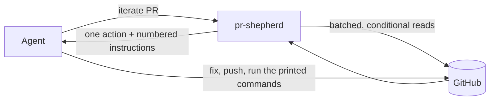

# pr-shepherd

Drive a pull request to merge-ready with a coding agent. Shepherd fetches the PR's state from GitHub and tells the agent the one next step. It works with Claude Code, Codex, Grok, and any stdio MCP client.

**[jongleberry.com/pr-shepherd](https://jongleberry.com/pr-shepherd/)** covers the why and the design principles.

## Why

An agent finishing a PR should think about code. Without Shepherd it fans out across `gh`, the GitHub MCP server, and GraphQL to rebuild PR state. Then it guesses what to do next. It misses outdated or edited comments, misreads cancelled CI, and blocks on `gh run watch`.



## Outcomes

| Outcome                                                                 | How                                                                              | Evidence                                    |
| ----------------------------------------------------------------------- | -------------------------------------------------------------------------------- | ------------------------------------------- |
| [Context and correctness](#context-and-correctness)                     | One call returns every review item, CI failure, and merge requirement            | [Handled edge cases](docs/handled-cases.md) |
| [Fewer tokens, lower cost](#fewer-tokens-and-lower-cost)                | Batched reads, filtering, seen markers, lean output                              | [Token bench](evals/tokens/README.md)       |
| [Clearer agent direction](#clearer-agent-direction)                     | One deterministic action per tick with exact commands                            | [Behavior evals](evals/README.md)           |
| [Lower GitHub API quota use](#lower-github-api-quota-use)               | One batched query per tick, fingerprint skips, conditional REST reads            | [GitHub API](docs/github-api.md)            |
| [Safe by construction](#safe-by-construction)                           | Read-only git, no merge unless asked, finite escalations, untrusted review input | [Escalations](docs/escalations.md)          |
| [Works across agents and stacks](#works-across-agents-and-environments) | MCP, CLI, plugin skills, cloud REST transport, native stacked PRs                | [MCP](docs/mcp.md), [cloud](docs/cloud.md)  |

### Context and correctness

One `iterate` call returns everything the agent needs about the PR:

- review threads with replies, PR comments, and review summaries;
- each CI failure with its failed step and a log excerpt;
- mergeability and the actual merge requirements;
- first-look, outdated, and edited items, and stack topology.

The agent reasons less and misses less. [docs/handled-cases.md](docs/handled-cases.md) catalogs the GitHub edge cases this covers. Two examples:

- On a stack layer, the latest run of a required check can be cancelled while an older run passed. GitHub still blocks the merge ([#567](https://github.com/jonathanong/pr-shepherd/pull/567), [gh-stack#466](https://github.com/github/gh-stack/issues/466)).
- A comment can be resolved or edited after the agent first read it.

### Fewer tokens and lower cost

Batching, noise filtering, fingerprint skips, seen markers, and lean output cut tokens and agent turns. Estimated cost per session from the [token bench](evals/tokens/README.md) ([report](evals/tokens/REPORT.md)):

| Session   | Cost vs. `gh` | Cost vs. GitHub MCP |
| --------- | ------------: | ------------------: |
| Single PR |      **−42%** |            **−77%** |
| PR stack  |      **−45%** |            **−63%** |

These are offline estimates at 3.5 characters per token over recorded sessions, not measured billing. Two cases do not save money:

- A single fresh read-and-reply tick is roughly even with `gh`.
- Confirming an already-merged PR costs about 15% more.

### Clearer agent direction

Each tick returns exactly one action: `WAIT`, `READY`, `MARK_READY`, `FIX_CODE`, `MERGE`, `CANCEL`, or `ESCALATE`. Numbered `## Instructions` and exact commands come with it, so the agent does not invent policy. In the [behavior evals](evals/README.md), Sonnet 5.5 at low effort scored a mean Δ (with − without plugin) of **+0.09** across 23 cases, and **+0.13** on the 14 non-stack cases. The largest gain is **+1.00**: without the plugin, the agent blocked on `gh run watch` in every run. The skill fired in 64 of 66 runs where it should have. Cases 29–46 have not run live yet. See [docs/actions.md](docs/actions.md) for the output contract.

### Lower GitHub API quota use

GitHub meters two tiers ([details](docs/github-api.md#github-metering)):

- Primary hourly budgets: GraphQL points and REST `core` requests.
- Secondary limits: per-minute points, where each GraphQL query or REST `GET` costs 1 and each mutation costs 5, plus concurrency and content-creation limits.

Waiting is where most quota goes, and where Shepherd saves the most. By default `gh pr checks --watch` refreshes every 10 seconds, at 1 GraphQL point per refresh. That is about 360 points an hour for each watched PR, so a few agents waiting on CI can drain the shared 5,000-point hourly budget. Shepherd polls every 60 seconds by default:

- Each tick is one batched GraphQL query (1 point). When nothing changed, the fingerprint skip returns the stored report from that same query.
- While CI runs, that is about 60 points an hour per PR, against about 360 for `gh pr checks --watch`.
- When no check is running, conditional REST change detectors run first. A `304` consumes no primary quota. An hour of unchanged idle waiting costs about 4 GraphQL points instead of 60 ([graphql-usage.md](docs/graphql-usage.md)).

Fewer requests help on both tiers. The GitHub MCP server issues one or more REST requests per tool call, so unbatched calls drain `core` and the per-minute pool faster.

Per session, assumed and deterministic, from the [token bench](evals/tokens/README.md):

| Session   | GraphQL points: Shepherd / `gh` / MCP | REST core: Shepherd / `gh` / MCP |
| --------- | ------------------------------------: | -------------------------------: |
| Single PR |                      30.8 / 36.5 / 12 |                   4.8 / 9 / 78.3 |
| PR stack  |                          11 / 27 / 12 |                       2 / 6 / 74 |

- On the default GraphQL transport, Shepherd spends fewer GraphQL points than `gh`. It makes fewer REST requests than `gh` and far fewer than MCP.
- On a single PR, MCP spends fewer GraphQL points but about 16× the REST requests.
- The REST transport used in cloud sessions spends no GraphQL points. It does spend more `core` requests than `gh` or MCP (175 single PR, 432 stack).

See [docs/graphql-usage.md](docs/graphql-usage.md) and [docs/rest-usage.md](docs/rest-usage.md).

### Safe by construction

- The CLI runs read-only git only. It emits patches and commit commands for the agent to run ([AGENTS.md](AGENTS.md#git-operations)).
- Shepherd never merges by itself. With `--merge`, it emits a merge or queue command for the agent to run. The command is head-pinned for a single PR and guarded by READY receipts for a stack.
- Human handoff is a [finite escalation list](docs/escalations.md).
- Review titles, comments, and CI logs are treated as untrusted data.
- A denied reply or resolve is a one-look skip, not a retry loop.

### Works across agents and environments

- The plugin ships [skills](docs/skills.md) for Claude Code, Codex, and Grok.
- Cursor and other stdio clients use the [MCP server](docs/mcp.md).
- Shell and CI use the [CLI](docs/cli-usage.md).
- In Claude Code cloud sessions, Shepherd switches to the [REST transport](docs/rest.md) and [event mode](docs/cloud.md).
- `--stack` shepherds every layer of a native GitHub stacked PR.

## Use cases

- **Autonomous agents.** An agent opens a PR and drives it to merge-ready, or merged when you allow it. Nobody has to watch CI and reviews.
- **Exhaustive AI code review.** Some PRs get many bot reviews (CodeRabbit, Codex, Copilot, and others). Shepherd shows every thread and comment once and tracks first-look, edited, and outdated items. It batches the replies, resolves, and minimizes.

## How to use

1. **Install the MCP server and the CLI.** See [Install](#install) below.
2. **Write your policy into a skill or agent instruction.** Examples: "skip non-blocking review comments", "reply instead of fixing nits", "never merge". Shepherd reports state and the next action. Your instructions decide how the agent treats each comment. The shipped `pr-shepherd` skill is a thin dispatcher you can wrap ([docs/skills.md](docs/skills.md)).
3. **Configure Shepherd.** In `.pr-shepherdrc.yml`, turn on the bundled classification rules. They drop known bot noise before it reaches the agent, which saves more tokens and tool calls. See [docs/configuration.md](docs/configuration.md#classifystandard--default-).

   ```yaml
   classify:
     standard:
       all: true
   ```

## Install

The plugin starts the version-matched `pr-shepherd-mcp` server automatically.

```bash
# Claude Code
claude /plugin marketplace add jonathanong/pr-shepherd
claude /plugin install pr-shepherd

# Codex (then enable the pr-shepherd plugin)
codex plugin marketplace add jonathanong/pr-shepherd

# Grok
grok plugin marketplace add jonathanong/pr-shepherd
grok plugin install pr-shepherd --trust

# CLI, for shells and CI
npm install -g pr-shepherd
```

For the MCP server without the plugin, or a local checkout, see [docs/mcp.md](docs/mcp.md).

Requirements:

- Node.js >= 22.19.0, Bun, or Deno
- `git`
- A GitHub token or an authenticated `gh` CLI with [the required access](docs/authentication.md)

## Quick start

```text
/goal /pr-shepherd:pr-shepherd 42    # Claude Code
/goal $pr-shepherd 42                # Codex
/pr-shepherd 42                      # Grok
```

```sh
pr-shepherd 42                       # shell: poll until there is work or a terminal state
```

Leave out the PR number to use the current branch. Example `FIX_CODE` output:

```text
# PR #123 [FIX_CODE]

**status** `UNRESOLVED_COMMENTS` · **repo** `owner/repo`
**summary** 3 passing

## Review threads

### `threadId=PRRT_kwDOSGizTs58XB1L` — `src/commands/iterate/index.mts:42` (@alice · MEMBER)

> The variable name is misleading.

## Failing checks

- `24697658766` — `CI › lint / typecheck / test (22.x)` [conclusion: FAILURE]
  > oxfmt

## Instructions

1. Fix each warranted item.
2. Triage `## Failing checks`. Playbook: "CI failure triage".
3. Commit and push any changes.
4. Journal key decisions or rejections with URLs or IDs: `pr-shepherd apply journal 123 '- <decision>'`
5. `$DISMISS_MESSAGE`: one sentence on what changed. Run even if no code changed: `pr-shepherd apply review 123 --reply-thread-ids PRRT_kwDOSGizTs58XB1L --message "$DISMISS_MESSAGE" --require-sha HEAD`
6. Rerun Shepherd now.
```

## Documentation

| Topic                                        | Doc                                                                                                  |
| -------------------------------------------- | ---------------------------------------------------------------------------------------------------- |
| Index of every doc                           | [docs/README.md](docs/README.md)                                                                     |
| Features, workflow assumptions, limits       | [docs/features.md](docs/features.md)                                                                 |
| Commands, flags, stacks, polling             | [docs/cli-usage.md](docs/cli-usage.md)                                                               |
| Actions and exit codes                       | [docs/actions.md](docs/actions.md), [docs/exit-codes.md](docs/exit-codes.md)                         |
| Configuration and classification rules       | [docs/configuration.md](docs/configuration.md), [examples/classification/](examples/classification/) |
| Journal, library API                         | [docs/api.md](docs/api.md)                                                                           |
| Compared with Cursor, Copilot, CodeRabbit, … | [docs/comparison.md](docs/comparison.md)                                                             |

## Harness ecosystem

- [auto-harness](https://github.com/jonathanong/auto-harness): non-interactive agent CLI orchestration across sandboxes
- [agent-blackboard](https://github.com/jonathanong/agent-blackboard): session-scoped telemetry for autonomous agents
- [pr-shepherd](https://github.com/jonathanong/pr-shepherd): autonomous pull request shepherd
- [no-mistakes](https://github.com/jonathanong/no-mistakes): deterministic AST-based codebase intelligence, test selection, and linting for agents
