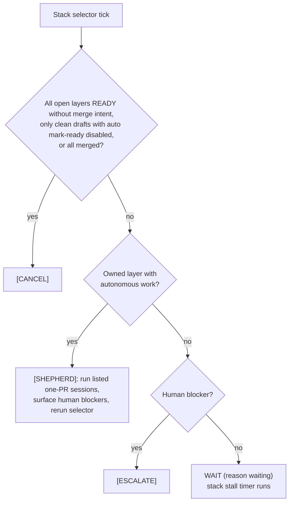

# shepherd actions

[← README](../README.md)

The canonical spec for `pr-shepherd iterate` output: the actions, their triggers and exit codes, the section structure, and the `## Instructions` variants. It is written for skill authors and agent or script consumers; the shipped skill reads this structure directly. See [iterate-flow.md](iterate-flow.md) for the decision order and [context.md](context.md) for what the header and body gather.

## Summary

Each `pr-shepherd iterate` tick returns exactly one action.

| Action                        | Trigger (short)                                                                                     | Exit                                                                           | Terminal?                                  | Key sections                                                                                                                          |
| ----------------------------- | --------------------------------------------------------------------------------------------------- | ------------------------------------------------------------------------------ | ------------------------------------------ | ------------------------------------------------------------------------------------------------------------------------------------- |
| [`ready`](#ready)             | Clean PR, ready-delay still counting                                                                | 10                                                                             | No — rerun when `remainingSeconds` elapses | `## Instructions`                                                                                                                     |
| [`wait`](#wait)               | Fallthrough: nothing actionable yet                                                                 | 10                                                                             | No                                         | `## Instructions`                                                                                                                     |
| [`mark_ready`](#mark_ready)   | Clean draft, auto mark-ready enabled                                                                | 11                                                                             | No                                         | `## Instructions`                                                                                                                     |
| [`fix_code`](#fix_code)       | Review, comment, CI, conflict, or annotation work                                                   | 12                                                                             | No — always                                | `## Review threads`, `## Failing checks`, … `## Instructions`                                                                         |
| [`escalate`](#escalate)       | A [finite trigger](escalations.md) needs a human                                                    | 13                                                                             | Yes — the only human hand-off              | `## Items needing attention`, `## Pending review commands`, `## Instructions`                                                         |
| [`merge`](#merge)             | `--merge` and ready-delay elapsed                                                                   | 15                                                                             | No                                         | `## Instructions` (the merge command)                                                                                                 |
| [`cancel`](#cancel)           | Merged, closed, ready-delay elapsed without `--merge`, or clean draft with auto mark-ready disabled | 0 (`merged`, `ready-delay-elapsed`, `auto-mark-ready-disabled`), 14 (`closed`) | Yes — the ordinary stop                    | `merged`/`closed`: heading only. `ready-delay-elapsed`/`auto-mark-ready-disabled`: full header and body line. Never `## Instructions` |
| `SHEPHERD` (stack-level only) | An aggregate selector has owned layers that need one-PR sessions                                    | 16                                                                             | No                                         | One-PR Shepherd commands in `## Instructions`                                                                                         |

Process failures use sysexits.h codes (`75` rate limit, `77` permission or session refusal, …); see [exit-codes.md](exit-codes.md).

## Invocation

CLI `PR` accepts a positive number, `owner/repo#N`, or a GitHub pull-request URL. A qualified reference selects its repository for GitHub I/O; the current working directory remains the local git, configuration, classification-rule, and debug-log context. Multiple PR arguments select an exact same-repository set; `--stack PR` selects its complete native GitHub stack. Direct MCP calls still require qualified references, but they can name any accessible repository.

| Entry point                          | Behavior                                                                             |
| ------------------------------------ | ------------------------------------------------------------------------------------ |
| `pr-shepherd iterate`, MCP `iterate` | One tick. The caller schedules the next one. MCP has no debounce.                    |
| `pr-shepherd <PR>`                   | Bounded poll dispatcher; prints the final iterate action.                            |
| `pr-shepherd [PR] --until-terminal`  | What the shipped skill runs. Keeps ordinary `WAIT` and `MARK_READY` inside the poll. |

The default output is Markdown — what the skill and direct CLI users see. `--format=json` emits the same action data as one JSON object. Every example below shows the default (lean) format. MCP `iterate`'s `structuredContent` uses the same lean JSON shape (see [mcp.md](mcp.md)); MCP has no verbose equivalent.

Command examples show the default `pr-shepherd` launcher. Every emitted follow-up command starts with the configured [`cliCommand`](configuration.md#clicommand--default-pr-shepherd) argv instead, such as `pnpm exec pr-shepherd`.

### Bounded poll

The bare command accepts `--interval`/`--timeout`/`--debounce`/`--quiet-status`/`--no-quiet-status` (e.g. `pr-shepherd <PR> --interval 60s --timeout 4.5m --quiet-status`). Polling defaults come from the `poll` configuration group; explicit flags override them.

- It waits while the PR remains in `[WAIT]` and returns on an agent-facing action.
- It does not sleep through a ready-delay countdown: a clean PR returns `READY` (exit 10) with `remainingSeconds` on the first such tick, even with time left before `--timeout`, so the caller can schedule the rerun and continue other owned work.
- With `--merge`, it also continues through `MARK_READY`; the rerun after the ready-delay completes returns `MERGE`.
- Each ordinary `WAIT` tick writes a stderr line naming what it is waiting on (the `WAIT` log's check counts and reason) unless quiet status is enabled; the final action remains the only stdout result.
- If `--timeout` expires during WAIT polling, it returns that final `WAIT` result.

### `--until-terminal`

- Ordinary `WAIT` and `MARK_READY` stay inside the poll.
- It returns `READY` while a clean ready-delay is counting.
- It returns `FIX_CODE` or stack-level `SHEPHERD` after `--debounce` (`poll.debounceSeconds`, default 1m, `0` disables), plus `MERGE`, a non-terminal quota warning, or terminal `CANCEL` / `ESCALATE`.
- A quota warning returns immediately. Follow its cadence and rerun without `--timeout`.
- After every other non-terminal result (including `[READY]` and a quota-warning `WAIT` or `MARK_READY`), follow `## Instructions` and run the same canonical command again.
- `[READY]` is non-terminal. Rerun when `remainingSeconds` elapses. Do not invent unrelated work. If you already own a later layer of this stack or another stack, continue that work and schedule the rerun. A parent of more than one stack delegates that wait to the worker that owns the stack.
- Debounce ticks set `persistSeen: false`. Seen markers and first-look suppression wait for the post-window tick.
- `--quiet-status` keeps unchanged WAIT ticks out of agent context.

### `--verbose`

- **JSON:** starts from the full `IterateResult` shape (all fields, including `baseBranch`, `checks`, `shouldCancel`, `mergeStatus: "CLEAN"`, and command-scoped `apiUsage`), then applies the same instruction projection as lean JSON: actions other than `fix_code` and `cancel` get a top-level `instructions` array (`cancel` has none), and `fix.instructions` may be rewritten.
- **Markdown:** restores the full header summary line (all six counts, `remainingSeconds`, `blockingBotReviewInProgress`, `isDraft`, and `shouldCancel`) and adds `## GitHub API usage`: credential source labels, request counts, the latest authoritative quota state by resource, exact measured GraphQL query cost, and, when nonzero, the count of REST responses without rate-limit headers (`apiUsage.unmeteredRestRequestCount`, such as the Claude Code proxy's `ccr/review_threads` read). GraphQL mutations remain counted as unmeasured because GitHub exposes `rateLimit` only on the query root. Verbose mode also adds base `checks` on every action, rendered under `## Checks`, and lists every name on the `**ignored**`, `**superseded**`, and `**activity** active:` lines instead of capping them at five.

Markdown and JSON use different representations but surface equivalent action information; MCP structured and Markdown content use the same projection options. Lean mode is the default because most fields are `false`/`0`/`[]` on a typical healthy tick.

`apiUsage` keeps raw telemetry for every pool used during the command, including GraphQL attempts before an automatic switch to REST. Warning selection and poll cadence use the active pool: REST mode uses REST core only; GraphQL mode considers both GraphQL and REST core budgets. Pending REST core warnings stay active through the poll loop; GraphQL warnings are discarded after a switch to REST.

## Output shape

Every one-PR action, default lean format:

```
# PR #<N> [ACTION]

**status** `<…>`[ · **merge** `<…>`][ · **reviewDecision** `<…>`][ · **state** `<…>`][ · **repo** `<…>`]
[**summary** <N> passing[, <N> skipped][, <N> filtered][, <N> inProgress][, <N> queued][, <N> superseded]][· **remainingSeconds** <N>][· **blockingBotReviewInProgress**][· **isDraft**][· **branch** behind PR base `<base>` | · **branch** conflicts with PR base `<base>` | · **branch** conflicts with stack trunk `<trunk>`]
[Approvals: <None|N[/M]> [Required|Not Required]]
[Conversations Resolved: <Yes|No> [Required|Not Required]]
[Merge queue: <No|position N STATE> [Required|Not Required]]
[Stack: <n> (layer <pos>/<size>, base <ref>)]
[other required-only merge-rule lines]
[**ignored** `<check-name>`, …[, +<N> more]]
[**superseded** `<check-name>`, …[, +<N> more]]
[**activity** <N> commits · <N> review rounds[ · <N> review items since latest commit][ · active: `<check>`, …[, +<N> more]]]
[**merge queue** enabled `<bool>` · inQueue `<bool>`[ · state `<state>` · position `<N>`][ · checkCommit `<oid>`][ · head updated after removal][ · removals on this head `<N>`][ · removal acknowledged]]
[**auto-merge** method `<method>` · enabledAtUnix `<unix>`[ · by `@<login>`]]
[**queue removal** reason `<reason>` · createdAtUnix `<unix>`[ · actor `@<login>`][ · commit `<oid>`][ · parents `<oid,...>`]]

<action-specific body>

[## GitHub API quota warning

- Resource: `<resource>`
- Remaining: <remaining>/<limit> [· used <used>]
- Crossed threshold: <percent>% remaining
- Reset: <time>
- Recommended poll interval: <minutes> minutes
- Recommended bounded CLI timeout: <minutes> minutes
- Recommendation: keep polling pr-shepherd at the cadence above; for incidental PR reads use explicit REST endpoints such as `gh api repos/OWNER/REPO/pulls/PR`; do not substitute `gh pr checks`/`gh pr watch`]

[## Classification auto-resolve

<one-line summary>[ (rule: <reason>)]
[- <url or `id`>]
[- <id>: <error> [(rule: <reason>)] ]]

[## Instructions

1. <numbered steps telling the agent exactly what to do>]
```

`## Instructions` is present for every action except `cancel`.

### Lean header rules

| Field                                    | Shown when                                                                                                                                                                                                                                   |
| ---------------------------------------- | -------------------------------------------------------------------------------------------------------------------------------------------------------------------------------------------------------------------------------------------- |
| `**merge**` / JSON `mergeStateStatus`    | Not `CLEAN`. An absent field means `CLEAN`.                                                                                                                                                                                                  |
| `**state**` / JSON `state`               | Not `OPEN`.                                                                                                                                                                                                                                  |
| `**repo**`                               | `## Instructions` does not already print this PR's URL or a `--repo <owner/repo>` command. JSON always keeps `repo`; `--verbose` always prints it.                                                                                           |
| `**reviewDecision**`                     | The derived merge status is `BLOCKED`.                                                                                                                                                                                                       |
| `**summary**` counts                     | Nonzero (`passing` included). When every count is zero, the label and lean JSON `summary` are omitted. `inProgress` counts `IN_PROGRESS` checks; `queued` counts `QUEUED`, `WAITING`, `PENDING`, and `REQUESTED` checks (raw GitHub status). |
| `remainingSeconds`                       | The ready-delay timer is counting (`status === "READY"` and `remainingSeconds > 0`).                                                                                                                                                         |
| `blockingBotReviewInProgress`, `isDraft` | `true`.                                                                                                                                                                                                                                      |
| `shouldCancel`                           | Never in lean output (implied by `action === "cancel"`).                                                                                                                                                                                     |
| `**branch**`                             | `mergeStatus` is `BEHIND` or `CONFLICTS`, so the agent can decide on a rebase without another fetch.                                                                                                                                         |
| `Approvals:`                             | Approvals exist or are required. Lean JSON `mergeRequirements` drops the same entries.                                                                                                                                                       |
| `Conversations Resolved:`                | Resolution is required or not known to be unrequired.                                                                                                                                                                                        |
| Extra merge-rule lines                   | They apply: code-owner review, last-push approval, signed commits, linear history, branch up to date, required status checks, deployments, workflows, code scanning, merge queue, GitHub stacks.                                             |
| `**merge queue**` / JSON `mergeQueue`    | It adds something to the `Merge queue: … [Required]` rule line (it is omitted when the queue is required and enabled, membership matches, and no entry, removal, or acknowledgment field is present).                                        |
| Author type in labels                    | Not `User` (for example `@bot[bot] · Bot`); JSON keeps `authorType`.                                                                                                                                                                         |

- After a sweep, iterate prints `Approvals:` and `Conversations Resolved:` (current vs required) unless the rule is trivial, as the table above describes. Read those instead of inferring a required review from `reviewDecision`: `REVIEW_REQUIRED` with no `Approvals:` line (none required) means GitHub is not waiting on an approval.
- A test result with no `mergeRequirements` still gets a fallback `**required**` line from `requiredStatusCheckContexts`. Live iterate uses `mergeRequirements` and omits that line.
- Lean mode prints passing checks only as the `**summary**` count. Failing detail is `## Failing checks` on `[FIX_CODE]`, or the escalation's items when follow-up is unavailable; lean JSON uses `fix.checks[]` or `escalate.checks[]` and has no top-level `checks` array (`--verbose` JSON keeps it).
- Lean output caps the `**ignored**`, `**superseded**`, and `**activity** active:` lists at five names and appends `+<N> more`. Lean JSON caps `ignoredNames`, `supersededNames`, and `inProgressChecks` the same way and carries the hidden count as `ignoredNamesMore`, `supersededNamesMore`, and `inProgressChecksMore`, each only when nonzero. The `WAIT:` log's `active checks:` list uses the same cap and suffix in both formats.

### Note on mergeStatus in JSON lean mode

Lean JSON emits raw `mergeStateStatus` when it is not `CLEAN`, plus derived `mergeStatus` when that is not `CLEAN`; an absent field means `CLEAN`. `mergeStateStatus` alone cannot rebuild `mergeStatus` (a conflicting `mergeable` value can be `CONFLICTS` while `mergeStateStatus` says something else). `--verbose` JSON returns the full `IterateResult`, including `mergeStatus: "CLEAN"`.

### `ignored` and `superseded` lines

**`ignored`** (Markdown and JSON `ignoredNames`) appears only when a check matched `ignoreChecks`. It lists the suppressed check names. Those checks do not affect the CI verdict, the `inProgress` or `queued` counts, or stall detection; an ignored check's pending or failing state does not drive stall-timeout escalation. If `mergeStateStatus` is `UNSTABLE` and every non-ignored check passed, the PR is `READY`, same as `BLOCKED` with passing CI.

**`superseded`** (Markdown and JSON `supersededNames`) appears only when a `CANCELLED` check has newer-run evidence in the same loaded commit context — concurrency-group eviction from a new push or a second trigger of the same push.

- Evidence is either a strictly greater run ID from the same workflow, event, scope, and commit, or an exact-name `SUCCESS` check with a distinct lower numeric run ID and the same workflow ID, event, scope, and commit whose valid positive start and completion timestamps are both strictly later (the successful check must complete at or after start; a cancelled wrapper can report completion before start, but both observed boundaries must still be strictly older). The timestamp form establishes observed ordering only; it does not prove that both triggers used an identical PR base.
- These checks do not affect `anyFailing` or `allPassed` and never appear under `## Failing checks`. No action is needed for the local Shepherd verdict. GitHub's status rollup remains unchanged; its branch protection evaluates the checks it received.
- The timestamp form never applies to a required status context (the stack trunk's contexts for a native-stack layer). GitHub's required gate reads the latest, highest-ID run, so that cancellation still fails it ([github/gh-stack#466](https://github.com/github/gh-stack/issues/466)). The max-run-ID form covers a required context only when the newer run contains that same context.
- A `CANCELLED` check without either form of newer-run evidence is not superseded. It stays under `## Failing checks` with `[conclusion: CANCELLED]`.

## Load-bearing conventions

The iterate skill depends on these.

- **Headings:** one PR `# PR #<N> [<ACTION>]`; explicit multi-PR summary `# Poll summary [<REASON>]`; stack overview `# <repo> stack #<number> — <reason>`, with `nextAction`.
- **Terminality:** `[READY]`, `[FIX_CODE]`, and stack-level `[SHEPHERD]` are non-terminal; run another iteration. `[ESCALATE]` is the only human hand-off. `[CANCEL]` is the ordinary stop.
- **Header lines** 3–4 carry status, merge, state, repo, and summary. Lean mode omits trivial defaults.
- **`## Instructions` is the entry point.** The skill has no dispatch table of its own.
- **Stack overview:** shepherd, mark ready, and push only rows marked `owned`.
- **Playbooks:** some steps say `Playbook: "<name>".` instead of inlining an invariant procedure, for example `Playbook: "CI failure triage".` The name matches a file in `plugins/pr-shepherd/skills/pr-shepherd/references/`, linked from the skill. Read that file once, then apply it. **Untrusted review input** stays in `SKILL.md`; it always applies to surfaced review and CI text, and instructions never point at it.
- **Review commands:** under `[FIX_CODE]`, the instruction steps print the `apply review` command inline when the viewer can run at least one review mutation, and a separate resolve-only `Run:` step when that split applies. Strip the backticks and run the command.

## Quota warning

When a configured threshold is crossed on a non-terminal result:

- Lean Markdown and JSON include `GitHub API quota warning` / `quotaWarning`. Markdown includes `Recommended poll interval`, `Recommended bounded CLI timeout`, and `Recommendation`.
- The last instruction replaces the ordinary immediate continuation: keep polling at that cadence. Do not substitute `gh pr checks` or `gh pr watch`; those waiters hide review comments until CI finishes.
- For incidental PR reads that do not need a full snapshot, use explicit REST endpoints such as `gh api repos/OWNER/REPO/pulls/PR` only while REST core is above its band. GraphQL and REST are separate pools. REST core uses the same bands and the same once-per-window claim. When both budgets are low, one combined block uses the later reset and does not recommend switching pools.
- A `--until-terminal` retry names the exhausted resource: `GitHub GraphQL`, `GitHub REST core`, or `GitHub secondary`, plus the reset time.
- Resume full cadence at the block's `Reset` time. Before that, a bounded poll raises shorter `--interval` and `--timeout` flags and keeps a longer cadence. The shipped skill keeps `--until-terminal`, omits `--timeout`, and applies the cadence before it reruns. A single-tick CLI, API, or MCP caller waits before the next tick.
- The warning fires once per worktree (or process, when there is no worktree), credential, and quota window. Within a window the block reports the lowest `remaining` and the highest `used` seen, even when they come from different responses. An older sample saved later in that window does not warn again. A different credential fingerprint re-arms it.
- Every `WAIT` / `MARK_READY` sleep uses `max(effective interval, resolved band interval)` from the latest GraphQL remaining percent, including after the one-shot warning. An unbounded `--until-terminal` poll still returns the first warning so the skill can slow down and rerun with `--interval`. Single-tick `iterate` / MCP do not sleep.
- Terminal `cancel` and `escalate` do not warn. `[FIX_CODE]` and stack-level `[SHEPHERD]` still can, because they are non-terminal.
- Usage, cost, and fingerprint skip: [github-api.md](github-api.md) and [graphql.md](graphql.md).

### `--until-terminal` rate-limit retry

| Situation                                | Behavior                                                                                                                                                                                                                                         |
| ---------------------------------------- | ------------------------------------------------------------------------------------------------------------------------------------------------------------------------------------------------------------------------------------------------ |
| Exhausted primary limit                  | Sleep until `resetAt`, plus 5 seconds, plus `resetAt % 5` seconds. A later `resetAt` starts that wait over.                                                                                                                                      |
| First retry landing on the reset instant | Does not exit 75.                                                                                                                                                                                                                                |
| Unchanged or missing `resetAt`           | Back off 15s, then 30s, then 60s.                                                                                                                                                                                                                |
| Fifth no-progress attempt                | Write one stderr line naming the resource and reset time, then exit 75.                                                                                                                                                                          |
| Sleep longer than `--interval`           | Split into interval chunks. Between chunks, when the exhausted resource is not REST core, one REST `GET /repos/{owner}/{repo}/pulls/{n}` checks for a merge or close; a REST core limit on that check skips further probes until the sleep ends. |
| PR merged or closed during the sleep     | Return the same `CANCEL` as a merged or closed iterate tick. `--stack` and multi-PR polls return all-terminal `CANCEL` only when every tracked layer is merged or closed; a partial merge keeps sleeping.                                        |
| Bounded poll (no `--until-terminal`)     | Fail with 75 on the first rate-limit error.                                                                                                                                                                                                      |

## Aggregate selectors (multi-PR and `--stack`)

Explicit multi-PR and `--stack` selectors use a separate compact, read-only summary path. A CLI aggregate returns when work is needed, every selected PR is complete (including when every row is `CANCEL`), or its bounded timeout expires; `--until-terminal` also returns a crossed quota warning with the same cadence instructions as singular polling. Aggregate API and MCP calls return one summary tick without recurrence.

The summary path never mutates GitHub, writes seen markers, maintains ready-delay state, or emits rebase/push commands; one-PR sessions remain authoritative for those mutations and full review context. Its only local state is a `--stack` selection's [stall timer](escalations.md#stall-timeout).

### Rows

| Row field            | Multi-PR row                                                                                                                                                                                                                                                     | `--stack` row                                                                                                                                                                                                                                                 |
| -------------------- | ---------------------------------------------------------------------------------------------------------------------------------------------------------------------------------------------------------------------------------------------------------------- | ------------------------------------------------------------------------------------------------------------------------------------------------------------------------------------------------------------------------------------------------------------- |
| Shape                | Rich: repository, title/URL, raw PR/merge/review/head/base/stack state, bounded check and review counts (including ignored and superseded checks and active merge-queue commit checks), incomplete flags, and `pollCommand` when the row needs a one-PR session. | Overview, ordered bottom-to-top; entries fetched completely.                                                                                                                                                                                                  |
| `shepherded`         | —                                                                                                                                                                                                                                                                | Only when true (a current one-PR READY receipt). A missing receipt omits it; it is not a mergeability blocker.                                                                                                                                                |
| Mergeability         | —                                                                                                                                                                                                                                                                | Mergeable, or one blocker on an open layer. Failing, in-progress, or actionable counts appear only for the blocker they explain. A merged or closed layer carries only its state.                                                                             |
| `owned`              | —                                                                                                                                                                                                                                                                | When the author matches the authenticated viewer (REST reads the authenticated `/user` login without inferring capabilities).                                                                                                                                 |
| `requiresMergeQueue` | —                                                                                                                                                                                                                                                                | REST rows only, when branch policy proves a queue is required (`true`) or not (`false`); an unavailable or incomplete negative policy remains omitted. Markdown: `merge queue required` / `merge queue not required`.                                         |
| Position, base       | —                                                                                                                                                                                                                                                                | `position` and the layer's own base branch. Markdown omits `position n/m` when list order already shows it and links the row only when its URL differs from the one the header repository and PR number imply; JSON keeps `position`, `stackSize`, and `url`. |
| Omitted              | —                                                                                                                                                                                                                                                                | One-PR action tags, head SHAs, repeated stack coordinates, check and review histograms, and `pollCommand`.                                                                                                                                                    |

The stack header is ``anchor PR #<N> · <K> layers · mode `summary` ``; Markdown and JSON for a stack are the same overview (`mode` stays `"summary"`). `stackMergeable` appears only when true. Aggregate JSON/MCP carries the raw ancestry rows, `stackMergeable`, `nextAction`, and the same numbered instructions that Markdown renders.

### Stack routing

`stackMergeable` is true only when every open layer is shepherded and mergeable and every adjacent open boundary is linear.



- The skill runs one-PR sessions only for rows marked `owned`. Review and CI sessions for every owned layer that still has work are listed on the same tick, with exact one-PR Shepherd commands, and the caller reruns the same selector after them.
- If every remaining session belongs to someone else, the overview is the result: `ESCALATE` with no rerun, quota-cadence, or wake-up step; the caller does not shepherd those layers.
- `ESCALATE` is reserved for a human decision, such as a closed-unmerged or otherwise unverified dependency, once no autonomous one-PR session remains. Only `owned` layers count as shepherdable: when every remaining autonomous layer belongs to another author, a human blocker returns `ESCALATE` immediately. If human blockers coexist with shepherdable layers, `SHEPHERD` comes first — its instructions surface those blockers, route the autonomous layers, and require another reconciliation — and `ESCALATE` follows only after the shepherdable layers are handled.
- A closed dependency and a stale-but-otherwise-ready child are first reprojected to effective `ESCALATE` and `FIX_CODE` at the row level, so an all-`CANCEL` stack truly has no remaining layer work. An all-terminal stack with a closed layer is an `ESCALATE`, not a successful completion.
- `CANCEL` is terminal when every open layer is READY without merge intent, when only clean drafts remain under disabled auto mark-ready, or when every layer is merged. The stack heading then includes `[CANCEL]`; clean drafts held by disabled auto mark-ready count as terminal here. A human hand-off heading includes `[ESCALATE]`. Those tokens are what the skill stops on.
- A layer whose only failing checks are deferred on an open external pull request or issue is `WAIT` (a probed row). The selector does not return `SHEPHERD` for that layer alone, so `--until-terminal` keeps polling. A merged or closed blocker still sends the layer to its one-PR session, which says to update the branch rather than rerun the job.
- A draft is marked ready by its own session as soon as that layer is clean when auto mark-ready is enabled; it does not wait for a lower layer's receipt.
- An explicit PR set that contains a native-stack member still routes that row to an authoritative one-PR poll and includes its `pollCommand`.

### Draft probes (auto mark-ready disabled)

When `--no-auto-mark-ready` or `actions.autoMarkReady: false` applies, a draft layer with work gets a bounded `pollCommand` probe (`--timeout 1s --debounce 0s --no-auto-mark-ready`, flagged `pollProbe: true`) to surface and route review and CI work without promoting the draft. A clean disabled draft with complete summary evidence is terminal in the summary: its row has `action: "cancel"`, reason `draft-auto-mark-ready-disabled`, and no `pollCommand` or `pollProbe`. If the compact check or review sample is incomplete, the row instead has `action: "fix_code"`, reason `draft-readiness-verification-required`, and a bounded one-PR probe. When these are the only remaining sessions, the stack or explicit selector stops after every probe returns `CANCEL` with reason `auto-mark-ready-disabled`. A probe's `ESCALATE` is reported as a handoff and also stops the selector after the other probes run. Otherwise the caller follows probe instructions and reruns the selector after that work completes. This verifies omitted pages once without repeatedly probing an unchanged clean draft. The selector continues independent work on other layers and can emit a merge for an eligible ready prefix. It never instructs the agent to run `gh pr ready` or re-enable automatic mark-ready.

The one-PR probe likewise processes pending CI, bot reviews, and other review work before it can finish. Once the draft is otherwise clean and automatic mark-ready is disabled, it returns `CANCEL` with reason `auto-mark-ready-disabled` and exit 0. It leaves the draft unchanged and skips both the ready-delay countdown and stall guard. A configured blocking review or pending CI remains active work and is handled through the ordinary wait or fix paths.

### Stack ancestry

For a native stack, aggregate compares each open child's raw `baseRefOid` with the immediately lower stack entry's `headRefOid` when both entries are open. GitHub can report both rows `CLEAN` and `MERGEABLE` while those OIDs differ: the child was based on an earlier parent head and cannot carry the parent's later work. The summary emits each mismatch in `stackAncestry` (JSON) / `## Stack ancestry` (Markdown), including both PR numbers, ref names, and OIDs. The mismatch makes `stackMergeable` false and routes the child through its one-PR Shepherd session; aggregate does not prescribe the git repair.

### READY receipts

READY-receipt certification uses the compact review sample independently of the full one-PR review check.

- When the base branch requires conversation resolution and GitHub reports `CLEAN`, a truncated sample does not prevent certification: GitHub confirms conversations no longer block merging. The raw `review.incomplete` flag remains visible.
- Sampled actionable feedback, incomplete CI, and blocked or unknown merge states still prevent certification. Without required conversation resolution, truncation alone is not a blocker; that optional-resolution exception requires a complete branch-rule page. Queue membership alone does not waive completeness when conversation resolution is required.
- A truncated review sample binds the receipt to the PR's `updatedAt`, so a later PR update invalidates it and routes the layer back through its full one-PR poll before stack merging.
- Close/reopen and draft/ready transitions invalidate older receipts even when the PR returns to the same commit.
- A changed base branch name invalidates the receipt. Outside the queue, a changed base commit (`baseRefOid`) also invalidates it. While a PR stays queued, an earlier queue entry advancing its target branch does not invalidate the receipt by itself; Shepherd still requires the same source head and review evidence, and checks the current merge-group state.
- A hard `CONFLICTING` or `DIRTY` state invalidates readiness even in the queue.
- Compact check annotation counts are part of the receipt. A late annotation on a completed check sends the layer back through its one-PR session.
- An ejection stays actionable until a current one-PR READY receipt acknowledges that exact removal. Local timestamps are not proof.

Receipt creation is described under [`cancel`](#cancel).

### Stack merge (`--stack --merge`)

The selector finds the highest open layer such that:

- That layer and every open layer below it have a current READY receipt.
- The bottom open layer targets the stack base.
- The prefix has no stale ancestry, queued layer, escalation, or closed-unmerged layer.

The lowest open layer is selected by native-stack order, even when GitHub still records its merged parent's branch as its base, only after every preceding layer is verified `MERGED`. A closed or unverified predecessor keeps the lookup fail-closed and cannot become a trunk rebase target merely because the next layer is open. With a merged prefix, the retained base does not prevent one-PR review or loading the stack trunk's required checks. Once the open layers are ready, `--stack --merge` waits for GitHub to retarget the lowest open layer onto the trunk before emitting a merge command; it does not instruct the caller to edit a native-stack PR's base with `gh pr edit`.

| Transport | Command                                                                                                                                                                                                                                                                                                                                                                                                                      |
| --------- | ---------------------------------------------------------------------------------------------------------------------------------------------------------------------------------------------------------------------------------------------------------------------------------------------------------------------------------------------------------------------------------------------------------------------------- |
| GraphQL   | Repository-qualified `gh stack merge` naming the ready prefix. The flag is `--squash` unless `merge.method` or the repository settings select another.                                                                                                                                                                                                                                                                       |
| REST      | SHA-pinned `pr-shepherd apply merge` naming the ready prefix, using the stack trunk's parsed branch policy (including when the highest ready layer targets its parent): `--merge-action merge_queue` for a known required queue, `direct_merge` with `--method` for known no-queue policy, or `default` without a method for unknown policy. Queue requests omit the direct merge method because GitHub's queue controls it. |

- A known queue rule remains authoritative when other policy is unavailable; a configured direct method with unknown queue policy escalates.
- When the command needs a direct merge method and no allowed method remains, the result is `ESCALATE` / `merge-method-unavailable` with no merge command. A REST queue request still proceeds when a configured direct method is disabled.
- REST stack commands include `--expected-stack '<JSON>'`, binding the stack number, trunk, and ordered lower prefix through the named PR. Each prefix entry binds its PR number, head branch and SHA, and target branch. Applying that command rejects missing membership or a changed stack, trunk, prefix, or parent boundary before submission, then rechecks current READY receipts and topology. Rerun the aggregate selector to obtain a fresh command after a stack change; do not remove its guard.
- `gh stack merge <PR>` lands that pull request and every unmerged pull request below it ([GitHub's stacked PR merge](https://github.github.com/gh-stack/introduction/overview/)). It reads a bare number as a stack number before a PR number. Native stack numbers come from the repository issue and pull request sequence (observed; GitHub does not document it), so a PR number never names a stack.
- If `gh stack` is an unknown command, the instructions install `github/gh-stack` and then rerun the merge command. The same step says not to rebase, push, or run `gh stack push`.
- A direct merge is atomic. On a merge queue, the prefix is queued together and each layer is evaluated from the bottom. A failure ejects that layer and the layers above it. Layers that already merged stay merged.
- Layers above the prefix keep their one-PR sessions in the same instructions.
- After each merge, GitHub retargets the next layer. Rerun `--stack --merge` until every layer is merged and the result is `CANCEL`.
- If GitHub queues a layer, the summary stays `WAIT` for those queued layers. Recheck at the polling cadence. Do not rewrite a queued layer. That wait does not block a layer that is not queued. The stack is not finished until every layer merges.
- An ejected layer leaves the merge prefix until a receipt acknowledges that removal. The instruction names the reason and actor and says to run that layer's one-PR session, which fixes failing queue CI, records a validated acknowledgment for a transient or grouped-entry failure that does not reproduce after updating from the latest base, with no remaining blocker, or escalates when no autonomous path remains.

## Event mode

With `--poll-mode event` (or `poll.mode: event`, or `auto` under `CLAUDE_CODE_REMOTE=true`) Shepherd runs one tick and never sleeps. The action, exit code, and every section below are unchanged. Two additions apply; see [cloud.md](cloud.md) for the full contract.

- **`pollMode`** is `"event"`. The text header repeats it as ``**pollMode** `event` ``. It is omitted in poll mode.
- **`nextCheck`** is `{ at, inSeconds, reason }`, printed as a `**nextCheck**` header line after `**activity**`. It is omitted for `cancel`, `escalate`, a `merge` whose command is not a REST merge, `mark_ready`, and an aggregate that is all terminal, has only `cancel`/`escalate` rows, or has only final draft-verification probes alongside terminal rows.

| `nextCheck.reason` | Meaning                                                                                                                     |
| ------------------ | --------------------------------------------------------------------------------------------------------------------------- |
| `ready-delay`      | The ready-delay deadline.                                                                                                   |
| `stall-timeout`    | The unchanged-state stall timer, or on `wait` the time the oldest unstarted check's age reaches the CI-start stall timeout. |
| `merge-queue`      | A queued PR recheck.                                                                                                        |
| `merge-pending`    | A printed REST or stack merge that can stay `pending`; about five minutes.                                                  |
| `safety-net`       | A backstop for a missed PR event.                                                                                           |

Instruction changes when `nextCheck` is present:

| Action               | Change                                                                                                                                                                                                                                                                                                                                                                                                                                                                     |
| -------------------- | -------------------------------------------------------------------------------------------------------------------------------------------------------------------------------------------------------------------------------------------------------------------------------------------------------------------------------------------------------------------------------------------------------------------------------------------------------------------------- |
| `ready`, `wait`      | "Iterate immediately" or "rerun when the timer elapses" becomes two steps: end the turn without sleeping (`Playbook: "Cloud event loop".`), then keep exactly one wake-up at `nextCheck.at` and rerun the same command on a PR event or that wake-up, acting only on Shepherd's output. A safety-net wake-up is named `safety-net wake-up`. The quota-aware polling-cadence sentence is not printed, since Shepherd is not polling; the quota warning itself still prints. |
| REST `merge`         | The merge command step without the polling-cadence sentence, then the same two event steps with a `merge-pending` wake-up; the rerun reprints the command, which resumes a pending request.                                                                                                                                                                                                                                                                                |
| `mark_ready`         | No `nextCheck`; always the plain instruction to iterate immediately, without the quota-aware cadence sentence: the tick saw a draft, so only the next tick can start the ready-delay timer and schedule its deadline.                                                                                                                                                                                                                                                      |
| `fix_code`           | The last step (`FIX_CODE_CONTINUATION`, or its quota-aware variant) becomes: rerun once after the fixes, then end the turn, keeping one wake-up at `nextCheck.at`.                                                                                                                                                                                                                                                                                                         |
| Aggregate            | One appended numbered step with the same rule and one `nextCheck` for the selection, including the stack stall deadline (`stall-timeout`) and, when a stack merge is printed, a `merge-pending` recheck. Stack steps drop "Recheck at the configured polling cadence", and a pending REST stack merge reruns after the wake-up instead of at the polling cadence. Every row `pollCommand` carries `--poll-mode event`.                                                     |
| Clean disabled draft | Returns `CANCEL` with no `nextCheck`; the aggregate selector handles other layers and ends when only these terminal drafts remain.                                                                                                                                                                                                                                                                                                                                         |

In durable-state sessions (event mode or `CLAUDE_CODE_REMOTE=true`), a generated `apply review` command that replies carries `--adopt-existing-replies`, so rerunning it after a lost state directory adopts a reply GitHub already shows instead of posting it twice. A direct `apply review` without the flag forwards every supplied ID.

```markdown
**nextCheck** `2024-05-15T19:57:00Z` · in 3020s · reason `safety-net`

## Instructions

1. Non-terminal — no action needed this tick.
2. Event mode: end this turn now without sleeping or polling. Playbook: "Cloud event loop".
3. Keep exactly one safety-net wake-up at `2024-05-15T19:57:00Z` (`safety-net`). When a PR event or that wake-up arrives, rerun this command with the same options and act only on Shepherd's output, never on the event payload.
```

---

## `ready`

The PR is clean and its ready-delay is still counting.

|                      |                                                                                                                                                                                         |
| -------------------- | --------------------------------------------------------------------------------------------------------------------------------------------------------------------------------------- |
| **Trigger**          | `status === "READY"`, no readiness work, the ready-delay marker is counting (`readyState.isReady && !readyState.shouldCancel && remainingSeconds > 0`). The stall guard does not apply. |
| **CLI side-effects** | Clears stall state. Does not write the READY receipt; that happens when the delay elapses.                                                                                              |
| **Exit code**        | 10, the same code as `wait`.                                                                                                                                                            |

```markdown
# PR #42 [READY]

**status** `READY` · **repo** `owner/repo`
**summary** 1 passing · **remainingSeconds** 127

READY: PR #42 is ready — 127s of ready-delay remaining — 1 passing

## Instructions

1. PR #42 is ready. Ready-delay has 127s left. Rerun this command when the timer elapses. Do not invent unrelated work.
```

The bounded poll and `--until-terminal` both return this action instead of sleeping through the countdown. When the delay elapses, the next tick is `cancel` / `ready-delay-elapsed` or `merge`, and that completion writes the READY receipt a later stack read calls shepherded.

## `wait`

Nothing actionable to do: CI is passing or in progress, or the PR is not yet in the clean ready countdown.

|                      |                                                                                                                                                      |
| -------------------- | ---------------------------------------------------------------------------------------------------------------------------------------------------- |
| **Trigger**          | Fallthrough — no actionable work, no terminal state, not ready to mark, and not a clean ready-delay countdown.                                       |
| **CLI side-effects** | None.                                                                                                                                                |
| **Exit code**        | 10. Not an error and not terminal — see [exit-codes.md](exit-codes.md) for why `wait` is nonzero, including when `poll --timeout` gives up mid-wait. |

```markdown
# PR #42 [WAIT]

**status** `IN_PROGRESS` · **repo** `owner/repo`
**summary** 1 inProgress
**activity** 0 commits · 0 review rounds · active: `CI / build`

WAIT: 1 in-progress — active checks: CI / build

## Instructions

1. Non-terminal — no action needed this tick. Iterate immediately with the same options to continue.
```

- The bare CLI command owns its bounded `--interval`/`--timeout` waits. A final `WAIT` returned at timeout is still non-terminal, so a direct caller decides when to start another bounded poll. `--until-terminal` continues ordinary `WAIT` internally; a quota warning can return `WAIT` so the skill can apply its cadence. MCP `iterate` and `pr-shepherd iterate` return one tick and their caller schedules the next one.
- A `--ready-delay 15m` override remains a summary field rather than part of a rerun command; JSON carries the same value as `readyDelayOverride`.
- When a failing check is deferred on an open external pull request or issue, the body line names that blocker as `owner/name#N` (`blocked by acme/widgets#9`). Text and JSON both carry that log. `--until-terminal` keeps polling at its normal cadence instead of returning `FIX_CODE` for that check alone.
- The body line (`WAIT: …`) varies with the merge state — `branch is behind base`, unmet merge requirements (approvals, conversations, merge queue, …), `PR is a draft`, or `some checks are unstable`. The merge-rule lines show _why_ GitHub is not mergeable (for example `Approvals: None [Required]`, `Merge queue: position 2 QUEUED [Required]`, `Stack: 7 (layer 2/3, base main)`); queue and stack lines are omitted when the PR is not in a queue or stack and merge queue is not required.

**Deferred work while queued** (`--merge` and `mergeQueue.inQueue`):

- Review threads, PR comments, `CHANGES_REQUESTED` reviews, and review summaries do not trigger `fix_code`. A push now would eject the PR.
- The tick is `WAIT`. Raw counts are `deferredWork` in JSON and `**deferred (in merge queue)**` in Markdown, omitted when nothing is deferred.
- Failing checks, including `merge_group` failures on the queue commit, unseen check annotations, and merge conflicts are never deferred. They still go to `fix_code`.
- [`actions.workWhileQueued: true`](configuration.md#actionsworkwhilequeued--default-false) acts on that work immediately.
- After the PR leaves the queue, the next tick picks the work up. Held items are not marked seen, so nothing is dropped. See the comment visibility invariant in [`AGENTS.md`](../AGENTS.md).

**What the skill does:** Ordinary `WAIT` actions remain inside its `--until-terminal` poll. If a quota-warning `WAIT` is returned, follow `## Instructions`, adjust cadence, and re-invoke the canonical command. Direct MCP/`iterate` callers must reschedule themselves.

---

## `mark_ready`

Converts a draft PR to ready for review.

|                      |                                                                                                                                                                                                                                                                                                                                                                                                                                                                                                                                                              |
| -------------------- | ------------------------------------------------------------------------------------------------------------------------------------------------------------------------------------------------------------------------------------------------------------------------------------------------------------------------------------------------------------------------------------------------------------------------------------------------------------------------------------------------------------------------------------------------------------ |
| **Trigger**          | All of: `status === "READY"`, `isDraft === true`, `!blockingBotReviewInProgress`, `config.actions.autoMarkReady` is enabled (disable with `--no-auto-mark-ready`), and ready-delay not elapsed (`readyState.shouldCancel === false`). When automatic mark-ready is disabled, a clean draft instead returns `CANCEL` with reason `auto-mark-ready-disabled`, without starting the ready-delay or stall guard. Once the delay elapses, the action flips to `merge` with `--merge`, otherwise `cancel`. There is no extra `mergeStateStatus === "CLEAN"` check. |
| **CLI side-effects** | Calls the selected transport's mark-ready operation when it is otherwise eligible. GraphQL remains fail-closed unless `viewerCanUpdate: true`; a false or unavailable GraphQL capability does not attempt the mutation. REST omits viewer capabilities, so on the supported cloud CCR route Shepherd attempts mark-ready and lets GitHub's response decide. An actual denial returns `authorization-required` with action `mark-ready`; an unavailable route returns `transport-unsupported`.                                                                |
| **Exit code**        | 11                                                                                                                                                                                                                                                                                                                                                                                                                                                                                                                                                           |

**Draft state:** when GitHub confirms the conversion (`markedReady: true`), the result reports `isDraft: false`, so JSON omits `isDraft` and the summary line drops `**isDraft**` (`--verbose` prints `**isDraft** false`). A `mergeStatus` of `DRAFT` is re-derived from the raw `mergeStateStatus` as for a non-draft PR (`CLEAN` stays `CLEAN` and is omitted). A raw `mergeStateStatus` of `DRAFT` has not been recomputed yet, so both fields report `UNKNOWN`. The other fields still show the snapshot read before the conversion. When a reused snapshot skips the conversion (`markedReady: false`), the PR is still a draft and `isDraft` stays `true`.

```markdown
# PR #42 [MARK_READY]

**status** `READY` · **repo** `owner/repo`
**summary** 1 passing · **remainingSeconds** 300

MARKED READY: PR #42 converted from draft to ready for review

## Instructions

1. The CLI marked the PR ready for review. Iterate immediately with the same options to continue.
```

**What the skill does:** Ordinary `MARK_READY` actions remain inside its `--until-terminal` poll. If a quota-warning `MARK_READY` is returned, follow `## Instructions`, adjust cadence, and re-invoke the canonical command. Direct MCP/`iterate` callers must reschedule themselves.

---

## `merge`

Emits an exact merge command; Shepherd does not execute or wrap the merge operation.

|               |                                                                                                                                   |
| ------------- | --------------------------------------------------------------------------------------------------------------------------------- |
| **Trigger**   | `--merge` is enabled and the clean READY state has lasted for the configured ready-delay. `--ready-delay 0` emits it immediately. |
| **Exit code** | 15                                                                                                                                |

**Command modes.** Explicit merge intent is not gated by `viewerCanEnableAutoMerge`. Every emitted command pins the expected PR head.

| Mode                                                                                             | Command                                                                                                                                                                                                                                                                                                                                           |
| ------------------------------------------------------------------------------------------------ | ------------------------------------------------------------------------------------------------------------------------------------------------------------------------------------------------------------------------------------------------------------------------------------------------------------------------------------------------- |
| GraphQL, ordinary branch                                                                         | `gh pr merge <PR> --repo <owner/repo> --match-head-commit <head> --auto ...commandArgs` plus a plain-merge fallback command.                                                                                                                                                                                                                      |
| GraphQL, queue-required or queue-enabled (`mergeRequirements.mergeQueue.required` or `.enabled`) | A head-pinned queue command (`mode: "queue"`) plus a `queueApiFallbackCommand` for the known gh CLI queue limitation.                                                                                                                                                                                                                             |
| REST                                                                                             | One `pr-shepherd apply merge <PR URL> --require-sha <head> --merge-action <action> --transport rest`. `<action>` is `merge_queue` when queue use is known, `direct_merge` when direct merge is known, or `default` when REST cannot determine queue policy. `--method` is included only for a known direct merge and a repository-allowed method. |

**Merge method.** `merge.commandArgs` applies only to GraphQL-mode ordinary commands. `merge.method` applies to GraphQL direct commands and REST `direct_merge` requests. The method is one of `merge`, `squash`, or `rebase`, and the repository must allow it. When none is configured, Shepherd selects an allowed method in the order merge, squash, rebase. A direct request with a configured method the repository disables, or every method disabled, returns `ESCALATE` with trigger `merge-method-unavailable`. REST `merge_queue` requests do not validate or send that unused method. When REST cannot read the queue policy, it uses `default` without a method unless a configured method would make that request unsafe; then it escalates until policy is known.

**REST queue policy evidence.** Complete ruleset evidence plus an explicit classic-protection `Branch not protected` response proves the absence of a queue rule. Generic protection 403/404 responses leave that policy unknown; a successful classic-protection read also cannot exclude a classic queue because REST omits that setting. A positive ruleset queue requirement remains authoritative in all these cases.

**Native stacks.** When GitHub's batch query reports the PR is part of a native stack, Shepherd builds neither ordinary command mode above, for any stack position including position 1: `--auto` is rejected server-side on stacked PRs, and the plain-merge fallback would land a mid-stack PR into its still-unmerged parent branch instead of the stack's trunk ref. After persisting its fresh READY receipt, the one-PR poll returns non-terminal `FIX_CODE` with `pr-shepherd --stack <PR URL> --until-terminal --merge`. That selector reconciles each layer's READY receipt and linear ancestry and returns `MERGE` for the highest open layer whose open lower layers are all ready ([Stack merge](#stack-merge---stack---merge)); it then rechecks until every layer merges and returns `CANCEL`. If the fresh snapshot or receipt cannot be persisted, or GitHub reports the layer `BLOCKED`, the one-PR poll returns `WAIT` and does not claim the stack is ready.

```markdown
# PR #42 [MERGE]

**status** `READY`
**summary** 1 passing

## Instructions

1. Run the auto-merge command exactly as printed: `gh pr merge 42 --repo owner/repo --match-head-commit abc123 --auto --merge`.
2. Only if GitHub reports that auto-merge is unavailable, run the plain merge fallback: `gh pr merge 42 --repo owner/repo --match-head-commit abc123 --merge`.
3. Then iterate immediately with the same options until the PR merges or needs work.
```

Each command is printed once, inline in its instruction step; there is no separate `## Merge command` section. The header omits `**repo**` because the printed command already names the repository. A queue-required or queue-enabled branch instead emits the selected transport's queue command and any transport-specific fallback supported by the current interface. Queue enqueue is not assumed to be GraphQL-only; the instruction carries the applicable command and operation details.

```markdown
1. Run the merge queue command exactly as printed: `gh pr merge 42 --repo owner/repo --match-head-commit abc123`.
2. If gh says auto-merge is disabled instead of adding the PR to the queue, run the queue API fallback: `<head-pinned enqueue operation>`.
3. Then iterate immediately with the same options until the PR merges or needs work.
```

REST output uses a single command:

```markdown
1. Run the REST merge command exactly as printed: `pr-shepherd apply merge https://github.com/owner/repo/pull/42 --require-sha 0123456789abcdef0123456789abcdef01234567 --merge-action direct_merge --method squash --transport rest`. If its status is `pending`, rerun that same command at the configured polling cadence to resume the recorded request; `enqueued` is not merged.
2. Then iterate with the same options until GitHub confirms the PR merged or needs work.
```

**REST merge requests.** REST merge is asynchronous: `pending` and `enqueued` are not merged states. The command prints a result with `status` set to `pending`, `enqueued`, `merged`, or `failed`, and may include `details.uuid`, `details.expected_head_sha`, `details.merge_action`, `details.merge_method`, `details.bypass_rules`, or the merged `details.sha`. GitHub remains authoritative for permission, branch-policy, and execution results.

- A pending UUID and request options are persisted locally. Rerun the same printed command to resume its persisted UUID; it checks the existing request rather than submitting a duplicate. If the request outcome is uncertain or the UUID expires, Shepherd does not submit a duplicate; reconcile the PR state before starting another request.
- A definite failed request can be replaced when the requested options change. A recorded `enqueued` request can also be replaced after a fix or rebase changes the head, provided a fresh PR read matches the new `--require-sha`; its old SHA guard cannot merge the new head. Pending or uncertain requests, and enqueued requests with the same head, remain protected from replacement.
- An interrupted local replacement can resume its persisted intent before submission; once submission may have started, retries never send a duplicate.
- Native-stack replacements still require fresh READY receipts for the complete open prefix. The expected-stack guard is persisted with request options; dropping or changing it cannot resume a pending or uncertain request as a standalone merge.

**After the merge command.** Iteration continues after the caller runs an emitted auto-merge or queue command (or its fallback).

- An active auto-merge request or queue entry emits `WAIT` without ready-delay cancellation or generic stall escalation. REST retains an available `auto_merge` request as `mergeQueue.autoMergeRequest`, including `mergeMethod` and `enabledBy` when known; its unavailable `enabledAtUnix` timestamp is omitted in JSON and Markdown. The aggregate merge-enabled route also waits with reason `already-auto-merging`.
- Synthetic queue-commit `merge_group` failures emit `FIX_CODE` with their run/log context. Queue check contexts are fully paginated. Recovery commands (`requeue`, native-stack removal acknowledgment) are described under [Merge-queue ejection](#merge-queue-ejection).
- A queue removal without an actionable failure emits `ESCALATE` with GitHub's raw reason, actor, time, queue commit, and parent commit IDs. Squash and rebase queue commits have one parent and still count as the current removal until a later push of the head (the earliest pull_request check time on that commit, or the head's committer time when no check time is available); see [`merge-queue-removed`](escalations.md#merge-queue-removed).

---

## `cancel`

Stops polling this pull request — no further iterations for this PR are needed. Continue any remaining pull requests or issues from the original request.

|                    |                                                                                                                                                                                                                                                                                                                                                                                                                |
| ------------------ | -------------------------------------------------------------------------------------------------------------------------------------------------------------------------------------------------------------------------------------------------------------------------------------------------------------------------------------------------------------------------------------------------------------- |
| **Trigger**        | The PR is merged or closed (`state !== "OPEN"`), `--merge` is not enabled and the ready-delay timer elapsed after the current sweep still verifies the PR as READY, or the PR is clean and remains a draft because automatic mark-ready is disabled. Candidate READY reports get a fresh mergeability read before the timer can complete, so newly detected conflicts route to `fix_code` instead of `cancel`. |
| **Exit code**      | 0 for `reason: "merged"`, `"ready-delay-elapsed"`, or `"auto-mark-ready-disabled"`; 14 for `reason: "closed"` (closed without merging). See [exit-codes.md](exit-codes.md).                                                                                                                                                                                                                                    |
| **`reason` field** | `"merged"`, `"closed"`, `"ready-delay-elapsed"`, or `"auto-mark-ready-disabled"` — a first-class field in JSON and Markdown. JSON consumers should branch on `reason` rather than parsing `log`.                                                                                                                                                                                                               |

**CLI side-effects — ready-delay marker and READY receipt:**

- A clean draft canceled because auto mark-ready is disabled remains a draft; this outcome does not start or consume a ready-delay marker and does not use the stall guard.

- Deletes the `ready-since.txt` marker and READY receipt when the PR is merged/closed, and consumes the elapsed marker when ready-delay elapses.
- Before an open PR completes its ready-delay, a fresh compact summary must still confirm READY, non-draft status, a mergeable state, current head/base OIDs, and no actionable review or CI before Shepherd persists its READY receipt. The base OID on both sides is the base commit GitHub recorded for the PR, not the base branch's live tip.
- A later tick invalidates the receipt when that evidence changes. While it stays current, re-polling the PR — for example rerunning with `--merge` after a `ready-delay-elapsed` cancel — completes its ready-delay immediately instead of restarting it. A PR whose fresh summary is not yet mergeable (for example `BLOCKED` on a required review) gets no receipt, so a rerun waits the full delay again.
- Outside a native stack the receipt only lets a rerun skip the wait, so an unreadable snapshot or failed write still returns `CANCEL`. On a native-stack layer, an unreadable snapshot or failed receipt write remains `WAIT` with `remainingSeconds` 0 and keeps the elapsed marker, so the next tick retries the receipt instead of restarting the ready-delay; the marker is deleted once the receipt is written. A receipt that keeps failing reaches the [stall timeout](escalations.md#stall-timeout). When the fresh summary is ready except that GitHub reports `BLOCKED` (for example a layer above an unmerged parent, or a pending approval), the layer gets no receipt: without `--merge` its one-PR session returns `CANCEL` with `ready-delay-elapsed` like a single PR, and with `--merge` it returns `WAIT` naming the `BLOCKED` state. Aggregate `--stack` still holds that layer until a later one-PR session writes its receipt.
- Aggregate `--stack` uses these receipts but never creates them.
- The marker and receipt live in the shared state directory (only the debug log is per worktree), so sessions shepherding the same PR share one countdown: after one session consumes the elapsed marker, another finishes through the current receipt. A receipt whose fingerprint no longer matches, including one written by a Shepherd build whose fingerprint inputs differ, is cleared, and that session starts a fresh countdown.

```markdown
# PR #42 [CANCEL] — merged
```

- `cancel` has no `## Instructions` section and no JSON `instructions`: the `[CANCEL]` tag already means stop this PR's loop, and continuing the rest of the original request is the skill's invariant recurrence rule.
- Merged and closed PRs are terminal, so their default output is only the heading. The lean JSON matches: `{ "action": "cancel", "pr": 42, "reason": "merged" }` (plus `ruleAutoResolve` when that ran). `--verbose` keeps the full header, status lines, and `CANCEL: PR #42 is merged — stopping` / `CANCEL: PR #42 is closed — stopping` log line.
- On the REST transport a merged PR is answered from its first pull read, so a verbose merged cancel has no merge-requirement lines and no JSON `mergeRequirements`. `transportUnavailable` lists `branchProtection` and `mergeRequirements` as `not read for a merged pull request`. A closed, unmerged PR reads the full snapshot.
- A `ready-delay-elapsed` cancel (`# PR #42 [CANCEL] — ready-delay-elapsed`) keeps the full header, including the `**merge queue** …` line when `mergeQueue` is present, and its body line: `CANCEL: PR #42 has been ready for review — ready-delay elapsed, stopping`. When merge is still `BLOCKED` after the delay, the body uses a specific unmet-requirement note when one is known (`awaiting 1 approval`, `in merge queue position 2`, …) and otherwise `is awaiting human review or branch protection resolution` — it does not guess from `reviewDecision` alone.

**What the skill does:** stop polling this pull request and continue any remaining work from the original request.

---

## `fix_code`

Actionable work exists — whether it requires code edits or only resolution is up to the agent. `[FIX_CODE]` is always non-terminal: the agent completes the work and returns to `pr-shepherd [PR] --until-terminal`; only `[ESCALATE]` hands work to a human.

**Exit code:** 12

**Trigger.** Any of:

- Unresolved inline review threads, or resolution-only inline threads.
- Actionable PR-level comments.
- `CHANGES_REQUESTED` reviews.
- A failing CI check with autonomous follow-up.
- A later-attempt workflow failure while the branch is behind its PR base.
- Required status contexts with no check run and no status context, while no Actions workflow is running.
- Unseen check-run annotations on non-passing checks.
- Merge conflicts (`mergeStatus.status === "CONFLICTS"`).
- A verified stale native-stack boundary for this PR.
- Pending first-look review summary IDs to minimize.

Eligible **already-seen** `COMMENTED` review summaries (surfaced in a prior iteration, body unchanged, author matches `iterate.minimizeComments`, no unresolved child thread) do **not** trigger `fix_code` on their own — iterate minimizes them in-process before computing actionable work, since there is no new content to show. A first-look eligible summary still routes to `fix_code` for one tick so its body can be rendered (section 8 below). If GitHub does not confirm the in-process minimize (null response, GraphQL error, rate limit — reported without throwing), that ID falls back into `reviewSummaryIds`/`## Review IDs to minimize queue` so `fix_code` still triggers and the `apply review` command remains a working fallback.

**CLI side-effects.** Independently of the action returned, iterate issues an in-process `minimizeComment` mutation only for eligible already-seen review summaries whose raw `viewerCanMinimize` value is `true`. Iterate never cancels workflow runs or recommends cancellation, regardless of repository role, because GitHub exposes no exact viewer capability for it; `fix.inProgressRunIds`, `fix.protectedRuns`, and `cancelled` remain empty. Iterate never issues a rerun itself — it only recommends the `gh run rerun` command, matching the `commit-suggestion` pattern used for git mutations.

```markdown
# PR #42 [FIX_CODE]

**status** `UNRESOLVED_COMMENTS`

## Review threads

### [threadId=PRRT_kwDOSGizTs58XB1L](https://github.com/owner/repo/pull/42#discussion_r100) — `src/commands/iterate/index.mts:42` (@alice · MEMBER)

> The variable name is misleading.

## Instructions

1. Fix each warranted item.
2. Optional: If you reject a code review suggestion, journal why: `pr-shepherd apply journal https://github.com/owner/repo/pull/42 '- <reason>'`.
3. Commit and push any changes.
4. `$DISMISS_MESSAGE`: one sentence on what changed. Run even if no code changed: `pr-shepherd apply review https://github.com/owner/repo/pull/42 --reply-thread-ids PRRT_kwDOSGizTs58XB1L --message "$DISMISS_MESSAGE" --require-sha HEAD`
5. Rerun Shepherd now.
```

When review feedback is present, `FIX_CODE` prints one optional advisory: if the agent rejects a code review suggestion, consider journaling why. The advisory includes the concrete `apply journal` command. CI-only and minimized-comment acknowledgment ticks do not receive it. Journal entries remain the agent's choice and are never required before review mutations or the next iteration.

### Instruction steps

- Review mutation commands are printed inline in their steps rather than as `## Post-fix actions` bullets. `--require-sha HEAD` makes `apply review` read the checkout's HEAD itself (a read-only `git rev-parse HEAD`), so it needs no substitution; run the command after any push so it equals the remote PR head. Run from another checkout (a qualified PR reference), that HEAD is unrelated: `apply review` then times out and its error says to rerun with the PR head SHA you pushed, naming the current head.
- `$DISMISS_MESSAGE` substitution stays in the CLI output when `resolveCommand.requiresDismissMessage` is set; the printed command is invalid without it. It must be one specific sentence describing what changed — never generic text like "address review comments". When `resolveCommand.requiresHeadSha` is set, the command carries `--require-sha HEAD`.
- A caller who never loads the skill can still run the printed commands; placeholder steps are in the output. Dismiss-ID retention stays in its printed step. Omitting a `--dismiss-review-ids` value leaves `CHANGES_REQUESTED`.
- **`--instructions playbook`** (or `iterate.instructions: playbook`, or the MCP `instructions` input) folds the commit/push step into one step that carries only the trigger and a pointer to the "Fix-code loop" playbook (also readable with `pr-shepherd playbook "Fix-code loop"`). The fold applies only when the generic commit/push step is printed. When a conflict or queue-recovery push step replaces it, the playbook's push to the PR head branch would conflict with the specialized push. The review mutation step stays inline because its command needs `$DISMISS_MESSAGE` substitution, and the final `[FIX_CODE]` continuation stays inline. The default is `inline`: the bench measured the playbook default as a smaller saving than inline for the typical session.
- **Suggestions:** when one or more threads carry a `[suggestion]` marker, `## Instructions` adds one triage step naming the retrieve/apply command; the mechanics live in the skill's "Suggestion patches" playbook (see [Applying suggestion blocks](#applying-suggestion-blocks)). The step is absent when no thread has the marker.

```markdown
## Instructions

1. Fix each warranted item.
2. For every `[suggestion]` thread under `## Review threads`, run one `pr-shepherd build-suggestion-patches https://github.com/owner/repo/pull/42 --thread-id <id> --message "<one-sentence headline>" --format=json`, repeating `--thread-id` and `--message` in displayed order. Playbook: "Suggestion patches".
3. [remaining remediation, finalization, mutation, and recurrence steps]
```

### Branch state and conflicts

- The summary line shows raw `**branch**` state. The caller chooses rebase and commit mechanics. Conflict and code-change ticks say to commit, push, finish SHA-gated review mutations, and iterate.
- Push access to the PR head is a usage precondition. Do not start pr-shepherd when the caller cannot push. `viewerCanEditFiles` and `headRepositoryPermission` stay raw context; they do not gate `[FIX_CODE]`, hide review mutations, or create a hand-off.
- When `mergeStatus` is `BEHIND` or `CONFLICTS` and [`iterate.behindBaseHint`](configuration.md#iteratebehindbasehint--default-) is set, one instruction echoes it: ``The branch is behind PR base branch `<base>`. <hint> before pushing.`` or ``The branch conflicts with PR base branch `<base>`. <hint> before pushing.`` The CLI does not choose the git mechanics. The conflicts line directly follows the merge-conflicts step. A conflicting native stack layer omits it because the gh-stack route applies.
- A later workflow attempt that is still failing while the branch is `BEHIND` or `CONFLICTS` names the PR base branch and says to inspect it for an existing fix. The next step says to update from that base using repository conventions; conflict output includes resolving conflicts. A behind branch must be pushed before the next iteration.
- **Merged parent base:** for a non-stack conflict, Shepherd may show `## Merged PRs matching the current base` when a lookup of the 20 most recently updated merged PRs with the current base's branch name finds rows whose exact head OID and head repository match this PR's recorded base. JSON exposes the same raw rows as `mergedBasePullRequests` (number, URL, state, head branch and OID, base branch, merge time, and head repository). The first instruction asks the caller to verify whether this is the remaining layer intended for that merged parent's base. If so, change the PR base with `gh pr edit` (in REST mode, `gh api --method PATCH repos/<repo>/pulls/<pr> -f base=<verified-parent-base>`) and rerun Shepherd immediately, following the fresh result; otherwise follow the remaining conflict-resolution steps. A failed non-rate-limit lookup leaves the ordinary conflict route in place, while rate limits propagate for retry.
- A conflicting head with a complete empty check-suite page and no check runs says GitHub did not start `pull_request` workflows after Shepherd has seen that head for 2 minutes. Commit time is not used. An unreadable seen marker omits the note. Pushing that same head again does not start them.

**Native stacks:**

- A stale boundary returns the observed parent and child OIDs and a one-PR repair, then the ordinary `FIX_CODE` continuation. Aggregate `--stack` never does that repair.
- On a native stack layer, a branch update is the gh-stack rebase below, and the push is `gh stack push`. Updating one layer from its base strands the layers above it. `iterate.behindBaseHint` applies except on a conflicting native stack layer.
- In GraphQL mode, a native-stack conflict uses a gh-stack rebase from a clean checkout. It imports with `gh stack checkout <stack number>` when `gh stack` does not track the stack locally (use the stack number, not the PR number). REST-mode instructions use the repository's stack-update procedure rather than gh-stack API commands.
- The step points at the Branch update playbook for the head check and `gh stack rebase --continue` in GraphQL mode. The `gh stack merge` step prints its own missing-extension and no-push rules inline.
- In GraphQL mode, an upper layer behind its parent gets `gh stack rebase --upstack --no-trunk` from that parent, not from the stack trunk.
- A whole-stack rebase starts at the lowest open layer by stack order when the upper layer already contains its parent (summary: `conflicts with stack trunk`, JSON: `stackTrunkConflict`) or when this is the lowest open layer. The latter includes a higher-position layer whose lower layers are all verified `MERGED`, even if GitHub has not yet retargeted its recorded PR base onto the trunk. An unavailable bottom PR number is described as the stack's bottom open layer, without requiring its base branch to name the trunk. A known closed or unverified lower layer cannot supply that fallback.
- Publish the rewritten stack with the repository's stack-update procedure in REST mode and `gh stack push` in GraphQL mode, not a push of the PR head alone.

### Failing checks and reruns

Failing checks of every type enter check handling, using the included failed step, summary, and bounded log excerpt. Conclusion and rerun rules are the CI failure triage playbook, keyed on the `[conclusion: …]` tag and `rerun:` command already printed on each bullet.

**Rerun eligibility.** When no nonblank log excerpt is included, or the check is `CANCELLED` or `STARTUP_FAILURE`, Shepherd adds a `rerun:` command (printed once per run id) when all of the following hold:

| Condition                                             | Why                                                                                                                                                                                                                                                                                                                                                                                                        |
| ----------------------------------------------------- | ---------------------------------------------------------------------------------------------------------------------------------------------------------------------------------------------------------------------------------------------------------------------------------------------------------------------------------------------------------------------------------------------------------- |
| `repositoryPermission` is `WRITE`/`MAINTAIN`/`ADMIN`  | GitHub's Actions rerun API requires `actions: write`, which rides with `WRITE`+ access. This confirms the account's role, not the granular scope of whatever credential executes `gh`; an unauthorized rerun simply fails when run. REST reads omit `repositoryPermission`: in REST mode an unknown role does not deny the rerun and GitHub's response decides, while a reported role stays authoritative. |
| `run_attempt === 1`                                   | Later attempts have consumed Shepherd's single rerun allowance; unavailable attempt metadata is denied conservatively.                                                                                                                                                                                                                                                                                     |
| Scope is not `merge_group`                            | Rerunning queue CI cannot restore a removed queue entry and overwrites the failure evidence.                                                                                                                                                                                                                                                                                                               |
| `runId` is confirmed to identify a GitHub Actions run | Either fetched directly from the Actions REST API (a `STARTUP_FAILURE` check) or carrying a resolved `workflowName` (any other check), rather than a coincidental number parsed from another CI system's details URL.                                                                                                                                                                                      |
| Conclusion is not `ACTION_REQUIRED`                   | The run is paused pending manual workflow approval, which a rerun cannot grant.                                                                                                                                                                                                                                                                                                                            |
| The run is not still in progress                      | A sibling job from the same run in `report.checks.inProgress` means GitHub cannot rerun it yet.                                                                                                                                                                                                                                                                                                            |

**External checks and later attempts:**

- An external check has no run id, so it never gets a rerun. A non-empty `detailsUrl` is still an investigation path: the check stays `[FIX_CODE]` — inspect the provider or reproduce it locally, apply a warranted fix, and iterate.
- A later attempt (`runAttempt > 1`) stays `[FIX_CODE]` when the log excerpt is nonblank, or when the branch is behind or conflicting: inspect the PR base for an existing fix, update from that base, push, and iterate. It never gets another rerun.

**Manual-only checks.** Bare checks, external checks without a URL, `CANCELLED`, `STARTUP_FAILURE`, and `ACTION_REQUIRED` checks, and GitHub Actions failures without a nonblank log excerpt require manual follow-up when they have no authorized rerun. They stay in `[FIX_CODE]` while other autonomous work remains: finish that work and iterate; the manual-only blocker escalates on the next tick. When they are the only remaining blockers — no usable evidence, rerun, or branch refresh — the result is `[ESCALATE]` / `check-follow-up-unavailable`. They never make a `[FIX_CODE]` completion terminal.

**Blocked on an external PR or issue.** A failing check recorded as blocked on an open external pull request or issue does not by itself return `[FIX_CODE]`, does not carry a `rerun:` command, and does not count toward fix-attempt or fix-thrash. If it was the only `[FIX_CODE]` cause, Shepherd returns `[WAIT]` and the log names the blocker (`owner/name#N`). Other causes on the same tick still return `[FIX_CODE]`, with that check omitted from `## Failing checks` and from rerun commands. Once the blocker is merged or closed, the check stays actionable while the branch is `BEHIND`, conflicting, or `UNKNOWN`: `## Instructions` includes a numbered step to update this PR branch from its base, for example `gh pr update-branch <pr> --rebase`, and tells the agent not to rerun the job. When the branch is already current, Shepherd deletes that record so a later failure of the same check is an ordinary failure again. A released record whose check is no longer failing is ignored.

**Annotations.** Unseen annotations on skipped, ignored, or filtered CheckRuns route here for one tick unless the conclusion is `SUCCESS`; they do not keep `fix_code` alive after the seen marker is written. A successful parent CheckRun is authoritative: its annotations stay visible in `check` output and are marked seen without `FIX_CODE`.

### Merge-queue ejection

Merge-group failures retain their scope, queue commit, and available log evidence but never carry `rerunCommand` or `rerun:`. The CI failure triage playbook directs the caller to fix the PR head if the failure belongs to this PR.

**Triage step.** Whenever a failing merge-group check belongs to the current removal (the PR is not queued and its head has not changed since), one numbered step triages the ejection right after the `## Failing checks` triage step, with or without `--merge` and whatever the removal reason:

1. Update from the latest base first. When no queue command is printed, do so only if the raw `**queue removal**` reason shows GitHub removed the entry itself; a possible human dequeue skips the update unless a conflict step requires it. On a native stack it prints the `gh stack checkout`/`gh stack rebase` route (or points at the route already printed for a conflict).
2. The push step pushes (`gh stack push` on a stack) only when the base update or a fix changed the head.
3. A one-line guard. With a printed recovery command, the guard says to run `requeue:` or `acknowledge queue removal:` only if the failure does not reproduce on the updated head, neither the update nor a code change altered the head, and no other blocker remains, and names the `requeue API fallback:` trigger. Without one, it says not to enqueue.
4. The step ends with `Playbook: "Merge queue ejection"`, which holds the fixed procedure: fix and push a failure that belongs to this PR; push an updated head that no longer fails; for a failure that comes from the base itself, make no change so the unchanged failure escalates through the [`stall-timeout`](escalations.md#stall-timeout); and run the printed command only for a transient or grouped-entry failure shown by the logs or the check's details page.

The `merge queue` header shows `removals on this head` when GitHub removed the current head more than once (counted from the last 10 removals since the head reached the PR, dated the same way as removal currency).

**Recovery commands.** Offered only on a head's first removal and never while the branch has conflicts. Recovery plans require usable logs or an inspectable external-provider URL for every matching failed queue check, including ticks that also carry review work. Both commands require the observed head SHA; changed heads must iterate for a fresh plan. Active entries, updated heads, mismatched removal commits, and manual, missing, or unknown removal reasons get neither recovery plan.

| Session                                                                                                                    | Recovery                                                                                                                                                                                                                                                                                                                                                                                                                                                                                                                                                                                                                                                                                                                                                                   |
| -------------------------------------------------------------------------------------------------------------------------- | -------------------------------------------------------------------------------------------------------------------------------------------------------------------------------------------------------------------------------------------------------------------------------------------------------------------------------------------------------------------------------------------------------------------------------------------------------------------------------------------------------------------------------------------------------------------------------------------------------------------------------------------------------------------------------------------------------------------------------------------------------------------------- |
| Non-stack GraphQL `--merge`, current removal with raw reason `failed_checks` whose failed check matches the removal commit | `fix.requeue`: a SHA-matched `requeue` queue command and GraphQL fallback under `## Post-fix actions`. Use the GraphQL API fallback only if gh reports auto-merge is disabled instead of enqueueing.                                                                                                                                                                                                                                                                                                                                                                                                                                                                                                                                                                       |
| Native stack, GraphQL (including aggregate child sessions without `--merge`)                                               | `fix.queueRemovalAcknowledgment.argv`, printed as `acknowledge queue removal:`; the native stack retains its aggregate merge route. `apply queue-removal` validates the fresh head, queue commit, removal time, CI-driven reason, and native-stack metadata before storing a local acknowledgment. Later checks suppress only that exact removed queue commit while retaining its raw removal header and `mergeQueue.removalAcknowledged: true` (`removal acknowledged` in text); source CI, reviews, and READY delay remain required. A new head or removal does not match the acknowledgment. After fresh READY validation the existing receipt acknowledges the event ID, and the aggregate selector checks the complete lower prefix before emitting `gh stack merge`. |
| REST (either case)                                                                                                         | Neither command. The result keeps the failed-check work and the shared `fix.instructions` text/JSON/MCP projection explicitly reports `transport-unsupported`: REST cannot verify the current removal history. Rerunning a recorded same-head enqueue only resumes its old result and cannot recover a removal.                                                                                                                                                                                                                                                                                                                                                                                                                                                            |

Without `--merge`, report the failure without enqueueing; a stack acknowledgment only records local disposition and returns to the original aggregate selector options. A merge-group check without usable log evidence follows the `check-follow-up-unavailable` escalation when no other autonomous work remains.

### Required checks that never reported

- Missing required status contexts, with no check run and no status context, are their own `FIX_CODE` cause, even when other checks passed and `mergeStateStatus` is `BLOCKED`. On a native stack the required names come from the stack trunk (`stack.baseRefName`), not the layer's parent.
- The newest run of a name wins. A later success supersedes an older cancelled run.
- Shepherd stays on `WAIT` while a relevant check run is in progress, or a check suite with a `workflowRun` is not completed. A `QUEUED` suite with no workflow run does not count.
- The instruction says no CI is running and names the required checks that have not passed.
- When those contexts are missing (including when `mergeStateStatus` is `BLOCKED`), a non-stack PR loads `baseRef.compare(headRef).behindBy` against the head commit OID, and a native-stack layer loads the trunk compare against the bottom open layer's head. Neither compare runs while every required context has reported.
- If that compare, the trunk compare, or derived merge status is `BEHIND`, the instruction states the commit count and says to rebase and push — `gh stack rebase` then `gh stack push` on a native stack, otherwise rebase onto the PR base. That push is how the missing checks start. If it does not start them, investigate; do not close and reopen first. A branch that is still behind stays on `FIX_CODE` and does not write the retrigger marker.
- Once the branch is current, Shepherd instructs the caller to run `gh pr close <pr> -R <repo>` and `gh pr reopen <pr> -R <repo>` once for that head. The marker records that the instruction was returned; it does not verify the caller ran it. Internal poll debounce preview ticks do not consume this one reopen instruction. The next presented tick on that same head, still missing those contexts with nothing running, is `ESCALATE` / `required-checks-unreported`.
- Failing checks and merge conflicts keep their existing paths.
- Text prints `**unreported required**`, `**behind**` when the PR base compare is behind, and `**trunk behind**` when the trunk compare is behind. JSON uses `unreportedRequiredChecks`, `baseBehindBy`, and `trunkBehindBy`, omitted when empty.
- A `--stack` summary starts a one-PR session (`unreported-required-checks`) instead of idling in `pending-or-unknown`.

### Review routing

Shepherd recognizes its own reply only when the latest visible comment begins `<!-- pr-shepherd -->`; author equality is not enough, and the generated command never re-replies to a marked thread. For routing, only the original inline comment's `viewerDidAuthor` grants the viewer-owned human exception; it does not make an unmarked latest comment a Shepherd reply.

| Thread                                           | Generated mutation                                                                                                                                                                |
| ------------------------------------------------ | --------------------------------------------------------------------------------------------------------------------------------------------------------------------------------- |
| Unmarked bot/non-human, or viewer-authored human | Reply and resolve: the ID is in both `--reply-thread-ids` and `--resolve-thread-ids`. With GraphQL capabilities, only when both `viewerCanReply` and `viewerCanResolve` are true. |
| Marked, still being resolved                     | Resolve-only, so a previous reply can be retried without duplication. With GraphQL capabilities, needs `viewerCanResolve: true`.                                                  |
| Unmarked other-human                             | Reply-only unless [`iterate.resolveOtherHumanThreads`](configuration.md) is `outdated` or `always`.                                                                               |
| Marked other-human                               | Already acknowledged at the default `none`; no mutation.                                                                                                                          |

- Generated iterate commands and automatic side effects use capability data when the selected transport supplies it. GraphQL returns per-object fields (`viewerCanMinimize`, `viewerCanReply`, `viewerCanResolve`) and PR/repository fields (`viewerCanUpdate`, `viewerCanEnableAutoMerge`, `viewerCanAdminister`, `viewerPermission`). REST has no equivalent viewer-capability fields, so otherwise-eligible operations are attempted and GitHub's response is authoritative.
- A GitHub-denied generated review mutation is surfaced once, omitted from later generated commands until edited, and excluded from fix-thrash accounting. Unsupported REST minimization is surfaced as a one-look skip. Denied or unsupported cosmetic operations are marker-gated without an unsupported mutation command.
- Authorized reply/resolve mutations still emit by thread ID when GitHub clears the path or line; they do not count toward `fix-thrash`.
- Omission from a generated command means only that Shepherd did not select the ID for automation. A separate, user-directed `apply review` forwards its explicitly supplied IDs without iterate's author, capability, or current-state policy and surfaces GitHub's per-operation results. Explicit merge/enqueue requests likewise rely on GitHub's response.
- `--require-sha HEAD` is appended to the `apply review` command when it contains `--reply-thread-ids` following actionable thread fixes, when failing checks are being addressed, or whenever `--dismiss-review-ids` is present (dismissal is a post-push operation that must race-check against a moving HEAD). The resolve-only command (marker-ended retries still being resolved, plus minimize-only work) never carries `--require-sha` — run it independently of any SHA check.
- Journal entries are optional agent-authored notes; they are not a prerequisite for review mutations. Direct `apply journal` attempts the requested PR-body update and surfaces GitHub's result. `apply files` performs the requested file-view mutation where supported; REST reports it as unsupported.
- **Session refusal.** A cloud proxy session-access refusal is not a GitHub-denied review item. `apply review` stops the batch, preserves successful mutation IDs, and returns the proxy message in `sessionRefusal` with the remaining IDs in `unrepliedThreads`, `unresolvedThreads`, `unminimizedComments`, and `undismissedReviews` when nonempty. The CLI exits `77`; Markdown and MCP render the same successes, refusal, and pending IDs. The raw result's `instructions` array renders as numbered steps under `## Instructions`: repair session access and retry only those pending IDs. No denied marker is written. Automatic cleanup aborts the incomplete tick with exit `77`, and a session refusal during mark-ready escalates with `transport-unsupported` while quoting the proxy message.

### Section order

1. Heading + base fields (always present), then `**showing** <shown> of <total> review items` only when the [review output budget](#review-output-budget) held items back this tick.
2. `## Review threads` — active unresolved threads.
   - Other-human active threads are marker-gated unless `iterate.resolveOtherHumanThreads` is `always`: a previously seen thread whose transcript changed is rendered again with `[edited since first look]`, while unchanged seen other-human threads are suppressed until markers are cleared. GitHub-detected bots, logins in top-level `botUsernames`, and viewer-authored human threads are returned every tick until resolved, even when unchanged.
   - After evaluating each thread, the agent runs every generated review-mutation command even when no code change is warranted (routing per [Review routing](#review-routing)).
   - Heading: ``### `threadId=<id>` — <loc> (@author[ · <authorType>][ · <authorAssociation>][ · viewer-authored]) [reviewId=<id>]? [suggestion]?`` (or a linked `threadId` when a URL is available). `viewer-authored` is rendered only when `viewerDidAuthor: true`; `<loc>` is `` `path:line` `` for single-line threads or `` `path:startLine-endLine` `` for multi-line threads.
   - The full comment transcript follows, each comment/reply under ``#### `commentId=<id>` (@author[ · <authorType>][ · <authorAssociation>][ · viewer-authored])`` (or linked when a comment URL is available) with the full body as a `>` blockquote. Multi-paragraph bodies preserve empty lines as `>` lines.
   - Threads with a ` ```suggestion ` fence in the top comment carry a `[suggestion]` tag and a `Replaces lines …` block after the transcript.
3. `## Review threads to resolve` — unresolved outdated/minimized inline threads plus active marker-ended retry threads that are still being resolved. None require code edits unless the agent chooses to act on the body. Seen markers suppress repeated first-look/body display but do not remove these threads from this section or from generated mutation arguments while GitHub still reports `isResolved: false`. Routing per [Review routing](#review-routing).
4. `## Actionable comments` — same H3-plus-blockquote shape as threads minus the `<loc>`: ``### `commentId=<id>` `` or `### [commentId=<id>](<url>)`. New PR comments only; an edited PR comment goes to [`## Edited comments`](#edited-comments).
5. `## Failing checks` — one bullet per failing check:
   - ``- `<runId>` — `<workflowName> › <jobName>` `` for GitHub Actions checks (`workflowName ›` prefix omitted when unavailable; `jobName` falls back to the check name).
   - ``- external `<detailsUrl>` — `<name>` `` for external status checks (codecov, vercel, etc.) with null `runId` but a URL.
   - ``- (no runId) — `<name>` `` when both are null.

   Every bullet carries a `[conclusion: <CONCLUSION>]` tag (e.g. `[conclusion: FAILURE]`, `[conclusion: TIMED_OUT]`, `[conclusion: CANCELLED]`, `[conclusion: STARTUP_FAILURE]`); null conclusions produce no tag. Attempts after the original carry `[attempt: N]`. The first [rerun-eligible](#failing-checks-and-reruns) bullet for a `runId` carries a `rerun:` sub-line with `gh run rerun <runId> -R <owner/repo>`; later bullets sharing that `runId` (matrix jobs from one run) omit it, since one rerun covers all of them. There is no separate tag: the `rerun:` line is the authorization. Non-CANCELLED bullets may also carry a `> <failedStep>` blockquote (the first step that failed, GitHub Actions only), a `> <summary>` blockquote (one-line status text from the GitHub UI), and a bounded `> <logExcerpt>` blockquote from the matched failed job log. For aggregate jobs that print `Job results`, `logExcerpt` is condensed to non-success job results plus the exit-code/error line; otherwise it is the first failed step's visible output (run-command group and post-step cleanup omitted), suffix-truncated to 4000 characters. When the run has other failed jobs (`failure` or `timed_out`) that are not their own bullet, the first failing bullet for that run carries an `Other failed jobs in this run:` sub-list: one ``- `<job>` [conclusion: <CONCLUSION>]`` item per job (at most 5), each with an optional `> failed step: <step>` line and the same bounded `> <logExcerpt>` blockquote, so an aggregate gate job's failure can be triaged without running `gh run view`.

   The numbered instructions emit one triage pointer for every failing check: ``Triage `## Failing checks`. Playbook: "CI failure triage".`` Rerun-versus-fix rules, including bare checks with no run id, live in that playbook, which uses only evidence already in the output, never recommends cancellation without an exact capability, and recommends a rerun only when a `rerun:` command is printed.

6. `## Check annotations` — inline annotations on completed non-passing `CheckRun` checks (failing, skipped, ignored, or filtered), grouped by the same check locator. Each bullet includes the marker-gated annotation ID (`check_annotation_…`), optional blob link, file range, raw annotation level, optional title, bounded message blockquote, and optional bounded raw details blockquote. In-progress checks are not fetched. Each annotation is surfaced once per PR through the seen-marker store, adds no resolve/minimize mutation ID, and is omitted from later output. When this section is present without any failing conclusions, `## Failing checks` is omitted.
   - An annotation whose message is exactly `Process completed with exit code N.` with no raw details and no title is dropped entirely; a title alone keeps it.
   - A message or raw-details block byte-identical to text already in that check's log excerpt drops only the blockquote; the bullet (with its `path:line` anchor and blob link) still renders. A check whose annotations are all dropped is omitted; the section is omitted when every check's annotations are dropped.
7. `## Changes-requested reviews` — `CHANGES_REQUESTED` reviews, each with an H3 heading (``### `reviewId=<id>` (@<author>[ · <authorType>][ · <authorAssociation>])``) and the full body as a `>` blockquote (`(no review body)` when empty), except the terse `staleBotCr` reminder below.
   - **Human-authored CRs are marker-gated**: emitted once, then suppressed until the body changes; edited reviews are emitted again with `edited: true` in JSON. Human CRs are never auto-dismissed — the reviewer must re-review or dismiss.
   - Generated dismissal eligibility uses GitHub's `viewerCanAdminister` when the transport supplies it; REST capability is unknown, so an otherwise-eligible bot dismissal is attempted. A successful dismissal stays repeatable until the review leaves `CHANGES_REQUESTED`; a denied dismissal is surfaced once, omitted from later generated commands until edited, and does not trigger `authorization-required`. The first emission renders the full body; later authorized reminders render a terse one-line form carrying `staleBotCr: true`.
   - **Stale CR detection:** `staleReview: true` in JSON when its `commit.oid` differs from `headRefOid` AND every associated review thread (matched by `thread.reviewId === review.id`) is `isResolved || isOutdated`. Reviews with no associated threads are NOT marked stale. REST sets stale-review evidence only when the complete CCR thread snapshot proves every associated thread resolved or outdated; standard REST's unknown thread status never proves staleness.
   - **Stale bot CRs** follow the same routing with a `[stale — review is on an old commit, all threads resolved]` tag. **Stale human CRs** carry `[stale — review is on an old commit, all threads resolved; ask reviewer to re-review or dismiss]`, are never added to `--dismiss-review-ids`, and are not fresh feedback requiring code changes.
8. `## Review summaries (first look)` — `COMMENTED` review summaries **not yet seen**, H3 heading as in section 7 plus `>` blockquote body. Non-human IDs eligible under `iterate.minimizeComments` go into `--minimize-comment-ids` only when every known inline child thread from that review is resolved; human IDs are surfaced once, marked seen, and never minimized.
9. `## Review summaries (edited since first look — already minimized; do not re-minimize)` — `COMMENTED` summaries edited after Shepherd last surfaced them, rendered as in section 8. These IDs are **NOT** in `--minimize-comment-ids` (already minimized, or queued in a prior iteration). Read the updated body and pass these IDs to no mutation flag; recording an optional Shepherd Journal note is the agent's choice. The marker hash is updated after display.
10. `## Review IDs to minimize queue` — backticked review IDs (`PRR_…`) queued for `--minimize-comment-ids` that are not first-look bodies. Already-seen eligible summaries are minimized in-process and only land here when the transport does not support minimization or GitHub does not confirm the mutation. Also here: classification-rule `autoResolve` review-summary IDs not consumed by `actions.autoMinimizeSuppressed`, and — when `iterate.minimizeApprovals` is `true` — matching non-human `APPROVED` review IDs. REST cannot minimize comments; it surfaces the item as a one-look skip instead. A suppressed rule-matched summary that cannot be minimized returns to the normal first-look/edited gate. All IDs from sections 8 and 10 that pass the transport's operation support and policy are merged into `--minimize-comment-ids`.
11. `## Approvals (surfaced — not minimized)` — `APPROVED` reviews not routed to `--minimize-comment-ids` (the default `iterate.minimizeApprovals: false`, human approvals, non-human approvals excluded by `iterate.minimizeComments`, or items whose minimize is denied or unsupported). H3 heading uses `` `reviewId=<id>` ``; body is a `>` blockquote or `(no review body)`. A denied or unsupported item is surfaced once and marker-gated afterward. Surfaced approvals never go into `--minimize-comment-ids` and do not count as autonomous work that postpones a `check-follow-up-unavailable` escalation.
12. `## First-look items (N) — acknowledge status before acting` — threads and PR comments that are outdated, resolved, or minimized and not yet acknowledged. Emitted on first encounter only; a per-item seen-marker file (`src/state/seen-comments.mts`) suppresses them later. Displaying an item is its acknowledgement: Shepherd writes the marker with the displayed body's hash, so no separate acknowledge command exists. An item reappears only after its body changes again. Each bullet carries `[status: …]`: `outdated`, `resolved`, or `minimized`. A thread edited since first acknowledged adds an `, edited` suffix (e.g. `[status: resolved, edited]`); an edited PR comment never reappears here and goes to [`## Edited comments`](#edited-comments) instead. Thread bullets include the full transcript and links so a reply to a resolved thread gives enough context. If a first-look human thread also appears under `## Review threads to resolve`, its ID follows that section's routing; marker-ended other-human threads are already acknowledged and do not appear for mutation. Otherwise, do not pass first-look-only IDs to mutation flags. Active unresolved threads are marker-gated under `## Review threads`, not duplicated here.
13. `## In-progress runs` — reserved for compatibility and currently omitted (no exact viewer capability for workflow-run cancellation).
14. `## Protected runs` — reserved for compatibility and currently omitted because Shepherd does not cancel workflow runs.
15. `## Cancelled runs` — reserved for compatibility and currently omitted.
16. `## Post-fix actions`:
    - ``- base: `<branch>` `` — raw PR base branch context, under `--verbose` only.
    - ``- requeue: `<argv>` `` and ``- requeue API fallback: `<argv>` `` — [merge-queue recovery](#merge-queue-ejection).
    - ``- acknowledge queue removal: `<argv>` `` — the native-stack queue acknowledgment.
17. `## Edited comments (N) — informational; edits do not block readiness` — see [Edited comments](#edited-comments).
18. `## Instructions` — numbered list to execute in order, with review mutation commands inline:
    - ``Run: `<argv>` `` — the resolve-only command, present when authorized standalone resolve/minimize mutations are split from a message-bearing command, including authorized marker-ended viewer-authored retry resolves. It precedes the `apply review` step and needs no substitutions. Omitted when all mutations are combined into one command.
    - The `apply review` step — a fully quoted command containing IDs selected by iterate's capability and semantic routing.

Sections 3–17 are omitted when empty.

**Body truncation (Markdown only).** Thread, actionable-comment, changes-requested-review, and review-summary bodies (sections 2–4, 7, 8, 9, 11, and 12) are capped at 1,200 characters for a top-level body and 600 characters for a nested thread reply; a thread's first transcript entry always gets the top-level budget.

- The cap keeps a head and a tail so an opening question and a trailing summary both survive; a single line too long to fit either end falls back to a character-level slice instead of being dropped.
- An elided body carries `[…N chars elided — full text: <pointer>]` in place of the missing middle. `<pointer>` is a `gh api repos/<owner>/<repo>/pulls/comments/<id>` (inline review comment) or `gh api repos/<owner>/<repo>/issues/comments/<id>` (PR-level comment) command derived from the comment's URL; it falls back to the bare URL when the shape isn't recognized, and is omitted where no URL is available (e.g. review summaries).
- The cut point snaps to a line boundary outside any ` ``` ` or `~~~` fence; if no fence-safe cut exists, the body is left uncapped.
- `--verbose` renders bodies uncapped. **JSON is never capped:** `body` fields always carry the full text, so a capped Markdown body's pointer and the JSON `body` agree.

### Review output budget

`iterate.reviewOutputMaxChars` (default `50000`, `0` disables it) caps how many characters of review-item bodies one `fix_code` tick shows. Every item is still fetched; the budget only decides which are shown this tick. Review items are changes-requested reviews, active and resolution-only threads, actionable PR comments, first-look threads and comments, first-look and edited review summaries, and edited comments. A thread costs its full transcript; any other item costs its body. Approvals, already-seen summaries queued for minimization, and rule-suppressed items are not budgeted.

When every item fits, the output is unchanged. Otherwise Shepherd shows items in this priority order until the next item would exceed the budget, always showing at least one:

1. Changes-requested reviews.
2. Active and resolution-only threads, and actionable PR comments.
3. First-look threads and comments.
4. First-look and edited review summaries.
5. Edited comments.

Within a group, items go oldest first (unknown ages last). Selection stops at the first item that does not fit; it does not skip ahead to a smaller one.

A held item is absent from every section, from the generated `apply review` IDs, and from the JSON. Its seen marker is not written, so a later tick shows it. The tick prints `**showing** <shown> of <total> review items` below the base fields (JSON `fix.reviewItems: { shown, total }`) and adds this step before `Rerun Shepherd now.`:

```markdown
5. This is a subset: 40 of 115 review items are shown, and only their IDs are in the commands above. After handling these items, rerun Shepherd for the next batch; do not fetch the held items yourself.
6. Rerun Shepherd now.
```

While review items are held, the action stays `fix_code`; it is never `ready`, `mark_ready`, or `merge`. Edited comments are held only when other review items are held too, because edits never block readiness ([Edited comments](#edited-comments)). If every other item fits, all edited comments are shown, even past the budget, so a ready or terminal tick never leaves an edit unshown. While a held unresolved thread waits, its parent review summary is not minimized. If the tick escalates instead, the escalation shows the same subset and carries the rollup (`escalate.reviewItems`, the same `**showing**` line); the held items stay unmarked, so the next run shows them. A merge-queue deferral tick is never capped, because it shows no review items. Items that repeat every tick (bot threads and stale bot changes-requested reviews with authorized mutations) take budget on every tick until they are resolved or dismissed. The `check` command is never capped.

### `fix_code` JSON

The JSON payload exposes the same data under `fix.{threads, resolutionOnlyThreads, actionableComments, reviewSummaryIds, firstLookSummaries, editedSummaries, surfacedApprovals, checks, changesRequestedReviews, resolveCommand, resolveOnlyCommand, instructions, firstLookThreads, firstLookComments, inProgressRunIds, protectedRuns}` plus top-level `baseBranch`, `branchProtection` (on `IterateResultBase`, not under `fix`; omitted in lean JSON when `null`, always present in verbose JSON), and `cancelled`. In lean JSON, empty `fix.*` arrays, empty `cancelled`, absent `resolveOnlyCommand`, and unavailable optional fields are omitted; `--verbose` includes all fields.

| Field                                            | Contents                                                                                                                                                                                                                                                                                                                                                                                                                                                                                                                          |
| ------------------------------------------------ | --------------------------------------------------------------------------------------------------------------------------------------------------------------------------------------------------------------------------------------------------------------------------------------------------------------------------------------------------------------------------------------------------------------------------------------------------------------------------------------------------------------------------------- |
| Comment/review/thread objects                    | `authorType` (`User`, `Bot`, or `Unknown`) and raw `authorAssociation` when available — provenance, not a trust classification. Inline thread objects and transcript comments add `viewerDidAuthor: true` when GitHub identifies the viewer as author (GraphQL returns the flag; REST compares the author login with `/user`; a missing REST viewer identity omits it). Text labels append `viewer-authored`. Thread objects keep top-comment fields (`body`, `author`, `url`) and include `comments[]` with the full transcript. |
| `changesRequestedReviews[]`                      | `commitOid` (the commit the review was made against) when available; `staleReview: true` when stale.                                                                                                                                                                                                                                                                                                                                                                                                                              |
| `resolutionOnlyThreads`                          | Unresolved outdated/minimized threads plus active marker-ended retry threads still being resolved.                                                                                                                                                                                                                                                                                                                                                                                                                                |
| `reviewSummaryIds`                               | Policy-eligible non-human review IDs, only when the transport supports minimization.                                                                                                                                                                                                                                                                                                                                                                                                                                              |
| `firstLookSummaries`, `editedSummaries`          | Full `Review` objects for first-seen and edited summaries; edited IDs are **NOT** in `reviewSummaryIds`.                                                                                                                                                                                                                                                                                                                                                                                                                          |
| `changesRequestedReviews`, `surfacedApprovals`   | Marker-gated: unchanged bodies are suppressed, edited bodies re-surface.                                                                                                                                                                                                                                                                                                                                                                                                                                                          |
| `firstLookThreads`, `firstLookComments`          | Informational unless the same thread appears in `resolutionOnlyThreads`.                                                                                                                                                                                                                                                                                                                                                                                                                                                          |
| `reviewItems`                                    | `{ shown, total }`, only when the [review output budget](#review-output-budget) held review items back this tick.                                                                                                                                                                                                                                                                                                                                                                                                                 |
| `resolveCommand`                                 | `argv` starts with the configured [`cliCommand`](configuration.md#clicommand--default-pr-shepherd) argv (default `["pr-shepherd", …]`); carries `requiresDismissMessage` / `requiresHeadSha`.                                                                                                                                                                                                                                                                                                                                     |
| `resolveOnlyCommand`                             | Present when resolve-thread and minimize-comment mutations are split from the reply command (including a marked retry still being resolved); `requiresHeadSha: false`, no `$DISMISS_MESSAGE` placeholder.                                                                                                                                                                                                                                                                                                                         |
| `checks[]`                                       | Raw check fields; `logExcerpt` when Shepherd fetched a bounded excerpt; `runAttempt` when later than 1; `relatedJobs: [{ name, conclusion, failedStep?, logExcerpt? }]` (the sibling failed jobs, also on `escalate` checks); `rerunCommand` on every eligible check (not deduplicated, unlike Markdown's once-per-`runId` `rerun:` line).                                                                                                                                                                                        |
| `checks[]` with `annotationOnly: true`           | Skipped, ignored, or filtered CheckRuns that still have unseen annotations; omitted from `## Failing checks` and from failing-check rerun/`--require-sha` gating. Passing CheckRuns and their annotations stay in `check` output but are not projected into `FIX_CODE`.                                                                                                                                                                                                                                                           |
| `checks[].annotations[]`                         | Marker-gated `{ id, path, startLine, endLine, startColumn?, endColumn?, level, title?, message, rawDetails?, blobUrl? }`. `message` and `rawDetails` are capped independently before rendering or JSON projection. Seen annotations are not re-emitted.                                                                                                                                                                                                                                                                           |
| `inProgressRunIds`, `protectedRuns`, `cancelled` | Always empty (Shepherd does not cancel workflow runs).                                                                                                                                                                                                                                                                                                                                                                                                                                                                            |
| `branchProtection`                               | `null` when no branch protection rule applies or REST cannot provide the field; otherwise GitHub's raw rule values.                                                                                                                                                                                                                                                                                                                                                                                                               |

### Applying suggestion blocks

GitHub reviewers can leave ` ```suggestion ` fenced blocks in review thread bodies. The CLI parses these and adds to each thread:

- A `[suggestion]` marker on the heading.
- A `Replaces line(s) …` block immediately after the blockquoted body, showing the parsed replacement. An empty suggestion (deletion) uses the label `Replaces line(s) … with nothing:` followed by an empty fenced block. For a range (`path:startLine-endLine`, e.g. `src/foo.ts:40-42`), the `Replaces lines 40–42:` block is spliced in for that entire range: an empty block means "delete those lines"; a block containing a single blank line means "replace with one blank line".

The instruction step names `build-suggestion-patches` (the CLI substitutes the real PR URL; `<id>` and `<one-sentence headline>` are left for the agent). The procedure — structured path, manual fallback, refusal and drift handling — is the skill's [Suggestion patches playbook](../plugins/pr-shepherd/skills/pr-shepherd/references/suggestion-patches.md). In short:

- `build-suggestion-patches` builds every diff from the fetched PR-head blobs, permits a local HEAD that descends from that PR head, and dry-runs the ordered stream with `git apply --check` before returning anything. Each patch retains its own suggested commit message and `Co-authored-by: <reviewer>` trailer. Apply, stage, and commit the returned patches in input order; the command does not recommend a push or review mutation — use authorization-checked iterate output for remote actions.
- With two or more threads, invoke it once with one repeated `--thread-id … --message … [--description …]` group per thread in displayed order.
- When it refuses because a suggestion is unsafe or no longer applies, inspect the current source together with the displayed `Replaces lines …` block and reviewer intent, then make the intended edit manually. Do not apply a stale numeric range blindly after source drift. If a returned patch later fails, the worktree changed after validation; inspect the new source rather than retrying.

````markdown
## Review threads

### `threadId=PRRT_kwDOSGizTs58XB1L` — `src/foo.ts:42` (@alice) [suggestion]

> Rename `x` to `remainingSeconds` so readers don't have to trace back to the declaration.
>
> ```suggestion
> const remainingSeconds = computeRemaining();
> ```

Replaces line 42:

```
const remainingSeconds = computeRemaining();
```

### `threadId=PRRT_kwDOSGizTs58XB2M` — `src/foo.ts:40-42` (@alice) [suggestion]

> Collapse these three assignments into one.
>
> ```suggestion
> const result = computeAll();
> ```

Replaces lines 40–42:

```
const result = computeAll();
```
````

For that output: run `pr-shepherd build-suggestion-patches https://github.com/owner/repo/pull/42 --thread-id PRRT_kwDOSGizTs58XB1L --message "rename x to remainingSeconds" --thread-id PRRT_kwDOSGizTs58XB2M --message "collapse three assignments" --format=json`, then follow the ordered `## Instructions`. The `apply review` step includes both IDs when their capabilities authorize the mutations:

```
`pr-shepherd apply review https://github.com/owner/repo/pull/42 --reply-thread-ids PRRT_kwDOSGizTs58XB1L,PRRT_kwDOSGizTs58XB2M --message "$DISMISS_MESSAGE" --require-sha HEAD`
```

Both IDs stay in `--reply-thread-ids` — `build-suggestion-patches` does not resolve threads. A suggestion handled manually still belongs in `--reply-thread-ids`.

**What the skill does:** Follow `## Instructions` in order. They are self-contained and action-specific; `[FIX_CODE]` always returns to `pr-shepherd [PR] --until-terminal` after the work is handled and never hands work to a human.

---

## `escalate`

Ambiguous state that requires human judgement — iteration stops and surfaces details.

|                      |                                                                                          |
| -------------------- | ---------------------------------------------------------------------------------------- |
| **Trigger**          | Any trigger in the finite list below. Full predicates: [escalations.md](escalations.md). |
| **CLI side-effects** | None.                                                                                    |
| **Exit code**        | 13                                                                                       |

| Trigger                                                                   | Fires when                                                                                                                                                                                                                                                                                                                                                                                                                                                                                                                                                                                                                                                                                                                                                                                                                                                            |
| ------------------------------------------------------------------------- | --------------------------------------------------------------------------------------------------------------------------------------------------------------------------------------------------------------------------------------------------------------------------------------------------------------------------------------------------------------------------------------------------------------------------------------------------------------------------------------------------------------------------------------------------------------------------------------------------------------------------------------------------------------------------------------------------------------------------------------------------------------------------------------------------------------------------------------------------------------------- |
| [`stall-timeout`](escalations.md#stall-timeout)                           | The iterate result has not materially changed for `config.iterate.stallTimeoutMinutes` minutes (default 60), or a relevant CI check/status context has stayed pending without starting for that long. Catches loops where the same failing test, transient error, or pending state repeats without progress. The generic timer resets whenever the HEAD SHA, failing-check set, or actionable item IDs change. A `--stack` selection whose layers can only wait keeps its own stack-level timer with the same threshold. Override with `--stall-timeout <duration>` — a bare number is minutes (`--stall-timeout 90`), or use an `s`/`m`/`h` suffix (`--stall-timeout 90s`, `--stall-timeout 1h`); `--stall-timeout 0` disables. The message renders the elapsed time in whatever unit reads best (seconds, minutes, or hours), independent of the flag's input unit. |
| [`required-checks-unreported`](escalations.md#required-checks-unreported) | Required merge-target contexts still have no check run and no status context after one close/reopen of this head, and no Actions workflow is running. Rebase and push is the fix while the base or stack trunk compare is behind, including when `mergeStateStatus` is `BLOCKED`. Another reopen will not create a job the workflow does not emit; path filters are the usual cause. A repeated rebase for a behind branch stays on `FIX_CODE` until the ordinary `stall-timeout` timer fires.                                                                                                                                                                                                                                                                                                                                                                        |
| [`stall-state-unavailable`](escalations.md#stall-state-unavailable)       | The stall timeout is enabled, and Shepherd could not read or write the one-PR or `--stack` stall timer. The suggestion quotes the filesystem error. Fix `PR_SHEPHERD_STATE_DIR` or the directory permissions, then resume. `--stall-timeout 0` leaves the original action in place. Text and JSON carry the trigger on `escalate.triggers`; a stack summary carries it in `instructions`.                                                                                                                                                                                                                                                                                                                                                                                                                                                                             |
| `fix-thrash`                                                              | The same retryable, located active thread body remains unchanged and unresolved after being returned in `config.iterate.fixAttemptsPerThread` caller-visible `FIX_CODE` results (default 3). Those results each repeat the pending review commands; the following unchanged tick escalates and retains them. Internal debounce ticks do not count. Threads suppressed by seen markers, location-independent outdated-bot resolutions, other threads without a path/line, and threads with unauthorized required mutations do not count; edited thread bodies reset the per-thread count.                                                                                                                                                                                                                                                                              |
| `base-branch-unknown`                                                     | The GraphQL batch did not yield a usable base branch name (empty or unsafe characters). Preempts any `[FIX_CODE]` that would require a push, since rebasing onto the wrong base is worse than pausing.                                                                                                                                                                                                                                                                                                                                                                                                                                                                                                                                                                                                                                                                |
| `authorization-required`                                                  | An otherwise-eligible automatic mark-ready operation was denied by GitHub, or GraphQL capability data was false or unavailable and therefore failed closed. On the supported cloud CCR route REST has no capability field, so Shepherd attempts mark-ready and uses GitHub's response. Explicit merge/enqueue, review, journal, and file-view requests surface the selected transport's result or unsupported-operation error. Review replies, thread resolutions, bot-review dismissals, and pushes never use this trigger.                                                                                                                                                                                                                                                                                                                                          |
| `check-follow-up-unavailable`                                             | No other autonomous work remains, and every failing check either is a later workflow attempt without a nonblank log excerpt after the single rerun allowance was consumed, requires a human-only action (`ACTION_REQUIRED`), is `CANCELLED`/`STARTUP_FAILURE` without an authorized rerun, is a GitHub Actions failure with no nonblank log excerpt and no authorized rerun, or is truly bare (no run ID and no non-empty details URL). A later attempt with a nonblank log excerpt and a non-empty external details URL remain autonomous `FIX_CODE` work. `escalate.checks[]` preserves the raw check details.                                                                                                                                                                                                                                                      |
| [`merge-queue-removed`](escalations.md#merge-queue-removed)               | The latest queue removal is newer than the latest enqueue and no queue-commit failure or other actionable work gives the agent concrete remediation. Failing queue CI stays `FIX_CODE`. Rendered under `## Merge queue removal` (`- reason:`, `- actor:`, `- createdAtUnix:`, `- queue commit:`).                                                                                                                                                                                                                                                                                                                                                                                                                                                                                                                                                                     |
| `merge-method-unavailable`                                                | A direct merge needs a method and the configured one is disabled, or every method is disabled ([`merge`](#merge)).                                                                                                                                                                                                                                                                                                                                                                                                                                                                                                                                                                                                                                                                                                                                                    |
| [`transport-unsupported`](escalations.md#transport-unsupported)           | A required operation is unavailable on the selected transport or route, such as mark-ready on an unsupported REST route or a session refusal during mark-ready.                                                                                                                                                                                                                                                                                                                                                                                                                                                                                                                                                                                                                                                                                                       |

Stack-level escalations (human blockers, `mark-ready-authorization-required`, stack `stall-timeout`) are described under [Aggregate selectors](#aggregate-selectors-multi-pr-and---stack).

```markdown
# PR #42 [ESCALATE]

**status** `UNRESOLVED_COMMENTS` · **merge** `BLOCKED` · **state** `OPEN` · **repo** `owner/repo`
**summary** 0 passing

⚠️ /pr-shepherd:pr-shepherd paused — manual intervention required

**Triggers:** `fix-thrash`

The same thread(s) remain unresolved after their pending commands were returned for 3 FIX_CODE ticks. Automated iteration is paused for a manual decision.

## Items needing attention

- thread `PRRT_kwDOSGizTs58XB1L` — `src/commands/iterate/index.mts:42` (@alice):

  - comment `PRRC_kwDOSGizTs6abc12` (@alice):

    > The variable name is misleading

## Fix attempts

- thread `PRRT_kwDOSGizTs58XB1L` pending commands returned 3 times

## Pending review commands

- apply review: `pr-shepherd apply review https://github.com/owner/repo/pull/42 --reply-thread-ids PRRT_kwDOSGizTs58XB1L --message "$DISMISS_MESSAGE" --require-sha HEAD`

---

After completing manual fixes, resume only after every required remote update has been performed by a credential whose push authorization was established outside Shepherd; then rerun `/pr-shepherd:pr-shepherd 42`.

## Instructions

1. Stop polling. Ask the user whether to run the pending review commands shown above.
2. If yes, set any `$DISMISS_MESSAGE` to a one-sentence disposition, run every pending command from the pushed PR head, then rerun Shepherd with the same options.
```

- Under `## Items needing attention`, each thread lists its full transcript (`escalate.unresolvedThreads[].comments`), one comment per bullet with its comment ID, root comment first. A thread without a transcript shows its body directly.
- The block after the base-fields line (separated by a blank line) is `escalate.humanMessage` in JSON — ready to print verbatim.

**`escalate` JSON** (each object or array omitted when empty):

| Field                                                     | Contents                                                                                                                                                                                                                                                                 |
| --------------------------------------------------------- | ------------------------------------------------------------------------------------------------------------------------------------------------------------------------------------------------------------------------------------------------------------------------ |
| `escalate.stalledChecks[]`                                | When unstarted CI caused `stall-timeout`: `name`, raw `status`, `source`, `runId`, `detailsUrl`, `ageSeconds`, and any available `createdAtUnix`, `startedAtUnix`, `updatedAtUnix`, and `summary`.                                                                       |
| `escalate.checks[]`                                       | For `check-follow-up-unavailable`: the same raw check fields and bounded annotations as `fix.checks[]`. Markdown renders run or external source, workflow/job, conclusion, scope/commit, failed step, summary, log excerpt, rerun command when present, and annotations. |
| `escalate.mergeQueueRemoval`                              | For a merge-queue removal: `createdAtUnix` plus any available raw `reason`, `actor`, `beforeCommitOid`, and `beforeCommitParentOids`.                                                                                                                                    |
| `escalate.pendingReviewCommands`                          | When a result with automatically selected review mutations becomes an escalation: its non-empty `resolveOnlyCommand` and/or `resolveCommand`. Markdown renders the same argv under `## Pending review commands`.                                                         |
| `escalate.firstLookSummaries`, `escalate.editedSummaries` | Review-summary bodies that must be surfaced on that tick, including before a pending minimization.                                                                                                                                                                       |
| `escalate.reviewItems`                                    | When the escalating tick held review items under [the review output budget](#review-output-budget): `{ shown, total }`. Markdown renders `**showing** <shown> of <total> review items` below the base fields.                                                            |

**What the skill does:** Follow `## Instructions`: pause automatic polling, preserve the displayed commands, and use them if the human directs recovery.

---

## Classification rules

Drop `.ts`, `.mts`, `.mjs`, or `.js` files under `.pr-shepherd/classification/` to suppress bot-noise items and/or queue them for automatic resolution, without any agent involvement.

Each file must have a default export matching:

```ts
import type { ClassifyRule } from "pr-shepherd/classify";
export default function rule(item: ClassifyItem): ClassifyAction | null {}
```

The `ClassifyItem` union covers four kinds: `"review-thread"`, `"pr-comment"`, `"review-summary"`, and `"changes-requested"`. Each item carries `id`, `author`, `authorType`, optional raw GitHub `authorAssociation`, `body`, and (for threads) `path`. Association values are context only; rules decide how, if at all, to use them.

| `ClassifyAction` field | Effect                                                                                                                                                                                                                                                                                                                                                                                                                                                                                                                                                                                                                |
| ---------------------- | --------------------------------------------------------------------------------------------------------------------------------------------------------------------------------------------------------------------------------------------------------------------------------------------------------------------------------------------------------------------------------------------------------------------------------------------------------------------------------------------------------------------------------------------------------------------------------------------------------------------- |
| `suppress: true`       | Hides the item from agent output; the seen marker is still written so the item does not re-surface as first-look on the next tick.                                                                                                                                                                                                                                                                                                                                                                                                                                                                                    |
| `autoResolve: true`    | Routes the item's ID into the resolve/minimize mutation: threads to `--resolve-thread-ids`, PR comments and review summaries to `--minimize-comment-ids`. Combined with `suppress: true` and [`actions.autoMinimizeSuppressed`](configuration.md#actionsautominimizesuppressed--default-true) `true` (the default), Shepherd performs the authorized mutation itself, records it ([Classification auto-resolve](#classification-auto-resolve)), and leaves only failed IDs on the generated `apply review` command. Not supported for `"changes-requested"` items (dismissing a review requires an explicit message). |
| `reason`               | Optional note printed in the auto-resolve line and stored as `ruleReason`.                                                                                                                                                                                                                                                                                                                                                                                                                                                                                                                                            |

- Rules from multiple files combine permissively: `suppress` and `autoResolve` are OR'd across all matching rules for an item, and every non-empty `reason` is kept.
- Files starting with `_` or `.` are ignored. The loader walks up from `cwd` looking for `.pr-shepherd/classification/`, stopping at the home directory. Unlike `.pr-shepherdrc.yml`, only the first classification directory found is used.
- TypeScript rule files (`.ts` / `.mts`) are loaded by the runtime's native TypeScript support, so keep them to erasable syntax such as type annotations and `import type`. Enums, namespaces, parameter properties, and decorators are not supported. Use `.mts` for portable ESM rules across Node, Bun, and Deno.
- Bundled rules for common vendor bot noise can be enabled with [`classify.standard`](configuration.md#classifystandard--default-) instead; they run after the local rules and match conversation comments only. Review summaries and inline review comments stay on the normal review path. Example rules are in [`examples/classification/`](../examples/classification/).
- On later fetches, Shepherd classifies the current comment body again, including already-minimized PR comments. If an author edits a minimized notice into substantive text that no longer matches any rule, the changed body is an [edited comment](#edited-comments): it does not trigger `fix_code` or touch the ready delay, and it is shown once on the next action that is not `wait` or `ready`. Shepherd does not unminimize the GitHub comment.

## Edited comments

A PR comment (conversation comment) whose body changed after Shepherd showed it is informational. Edits to review summaries, changes-requested reviews, and inline thread comments are still review work and keep their own sections.

- An edited PR comment never blocks readiness. It does not route to `fix_code`, restart the ready delay, or clear a READY receipt, whether a human or a bot edited it and whether or not it is minimized. A visible comment that is eligible for auto-minimization is queued for minimization only after its edit has been shown.
- During `wait` and `ready`, iterate holds the edit: no section, no field, and no seen-marker write.
- On the next other action (`fix_code`, `mark_ready`, `merge`, `escalate`, or the `ready-delay-elapsed` / `auto-mark-ready-disabled` `cancel`), iterate prints `## Edited comments (N) — informational; edits do not block readiness` immediately before `## Instructions`, or at the end when the action has none. It then writes the markers, so each edit appears once. Inside the poll loop, edits ride on every tick but their markers are written only for the result the loop returns, so a debounced, polled-past, or refreshed tick never consumes an edit. Merged and closed `cancel` results omit it.
- Each item is `### [commentId=<id>](<url>) (<author>) [status: minimized, edited]` for a minimized comment, or `[edited since first look]` for a visible one, followed by the new body as a blockquote (truncated unless `--verbose`).
- JSON and MCP carry the same items as top-level `editedComments[]`: `{ id, author, authorType?, authorAssociation?, body, url, isMinimized? }`, with `isMinimized: true` only for a minimized comment. Omitted when empty.
- No instruction step is added; read the bodies as context. With `--merge`, the action is still `merge`.

## Classification auto-resolve

On a tick where `actions.autoMinimizeSuppressed` applied at least one confirmed resolve or minimize, or where one of those mutations failed, iterate prints `## Classification auto-resolve` immediately before `## Instructions` on every action. JSON and MCP carry the same object as `ruleAutoResolve`. The section and field are omitted when nothing was applied and nothing failed. Empty `threads`, `minimized`, and `errors` arrays are omitted.

- The summary is one line, for example `auto-resolved 2 threads, minimized 1 comment and 1 review summary (rules: review-bot suppressed; quota)`. One reason uses `(rule: …)`; several distinct reasons use `(rules: …)` joined with `; `. Review summaries are counted separately from PR comments.
- Bullets under the summary are thread and comment URLs (a review-summary URL when GitHub returned one, otherwise the backticked id). Mutation failures are further bullets in the same section, not a second summary.
- A failure-only tick reads `auto-resolve failed for N mutation(s)`, plus the rule clause from `threads.autoResolveErrorReasons`. Those are the rule values themselves, so a reason that contains `)` or `; ` stays one reason. Shepherd does not parse reasons back out of the error text.

| JSON field                  | Source                                                                                                                                                                                                                                                                                     |
| --------------------------- | ------------------------------------------------------------------------------------------------------------------------------------------------------------------------------------------------------------------------------------------------------------------------------------------ |
| `ruleAutoResolve.threads`   | The confirmed `threads.autoResolved` list (`isResolved: true`, plus `ruleReason` when a rule supplied one).                                                                                                                                                                                |
| `ruleAutoResolve.minimized` | `comments.autoMinimized`: `{ id, url?, kind: "pr-comment" \| "review-summary", ruleReason? }`.                                                                                                                                                                                             |
| `ruleAutoResolve.errors`    | `threads.autoResolveErrors`, each string `"<id>: <message>"` plus ` (rule: <reason>)` when the rule supplied one. These IDs stay in `threads.ruleAutoResolveIds`, `comments.minimizeIds`, or `ruleAutoResolveReviewSummaryIds`, so the generated `apply review` command is the retry path. |

- Confirmed successes and failures are surfaced in `## Classification auto-resolve`; these automatic mutations do not edit the PR body. Journal entries are optional agent-authored notes made only through explicit `apply journal` calls.
- A swallowed poll tick (`WAIT`, a `MARK_READY` continuation, or a `FIX_CODE` debounce discard) writes that same summary line to stderr, including under `--quiet-status`. The tick returned as stdout does not also print it on stderr. A reused fingerprint drops `autoResolved`, `autoResolveErrors`, `autoResolveErrorReasons`, and `autoMinimized` before the next tick, so the line is not replayed.
- `actions.autoMinimizeSuppressed: false` does not mutate or print the line. Those IDs stay on the generated `apply review` command.
