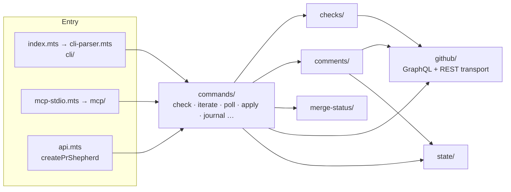
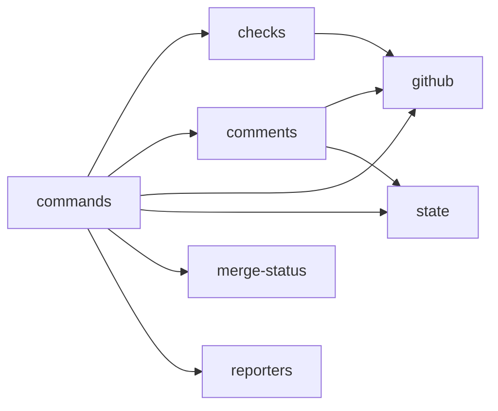

# shepherd — architecture

[← README](../README.md)

How `src/` is organized, which way dependencies point, and where new code goes. For contributors. Recipes: [extending.md](extending.md).

## Design rationale

Modules split along two jobs: **context gather** (`github`, `checks`, `comments`, `merge-status`) and **action emit** (`commands/iterate`, `commands/poll`, CLI formatters, MCP tools). The CLI parser, MCP stdio server, and `api.mts` are thin adapters over those.

- **One local MCP surface.** The stdio server is an opt-in integration that hosts register themselves; the plugins drive the CLI. It shares command implementations and token resolution with the CLI ([mcp.md](mcp.md)).
- **Skills over subagents.** Skill prompts inject into the main conversation instead of spawning a subagent that reloads `AGENTS.md` every turn.
- **Safe to interrupt.** Durable state lives in the PR on GitHub; the iterate loop self-terminates when the PR is merged, closed, or settled. Local state in `$PR_SHEPHERD_STATE_DIR` can be deleted without data loss.

## Module map



## Module tree

```
src/
├── index.mts, cli-parser.mts   # bin entrypoint and argv dispatch
├── api.mts                     # createPrShepherd programmatic API
├── mcp-stdio.mts, mcp/         # pr-shepherd-mcp: iterate, stack, apply, suggest,
│                               #   extract_journal, get_journal, playbook tools
├── cli/                        # argument parsing, help pages, Markdown formatters
├── commands/                   # one file or dir per subcommand
│   ├── check.mts               # context sweep; check-status.mts derives ShepherdStatus
│   ├── iterate/                # action dispatch (runIterate in index.mts)
│   ├── poll.mts                # bounded WAIT loop + TRIAGE debounce; poll-summary.mts, stack-*.mts
│   ├── tick.mts                # nextCheck and tick instructions
│   └── apply-merge.mts, resolve-mutate.mts, journal/, playbook.mts, clean.mts, ...
├── github/                     # transport.mts (auto/graphql/rest), graphql-http.mts, batch*.mts,
│   │                           #   rest-*.mts, queries.mts, gql/*.gql
├── checks/ comments/ merge-status/   # classify/triage, mutations, deriveMergeStatus
├── config/                     # schema.mts (zod keys and defaults), cascading RC loader
├── classify/ journal/ log/ reporters/ state/ threads/ suggestions/ events/ util/ types/
├── quota-budgets.mts, quota-warning.mts, pr-reference.mts, execution-context.mts
└── exit-codes.mts              # EXIT map, see exit-codes.md
```

## Dependency direction rule

Dependencies flow one way:



| Module                      | May import from                                                                                                                                                                                         |
| --------------------------- | ------------------------------------------------------------------------------------------------------------------------------------------------------------------------------------------------------- |
| `commands`                  | `github`, `checks`, `comments`, `state`, `merge-status`, `reporters`                                                                                                                                    |
| `checks`, `comments`        | `github`, for their domain-specific reads and mutations                                                                                                                                                 |
| `github`                    | Not `commands`, `checks`, or `comments` — except a few existing runtime helpers in the batch and `poll-summary-*` modules. Do not add new ones.                                                         |
| `merge-status`, `reporters` | Leaf-ish domain modules; not `commands`. (`merge-status/requirements.mts` reads `EMPTY_BRANCH_RULES` from `github/batch-parsers-rules.mts`.)                                                            |
| `types/`                    | Shared by all; no imports from `commands` or `github` beyond `import type`. Keep it lean.                                                                                                               |
| `exit-codes.mts`            | Shared leaf like `types/`; imports only types (from `types.mts` and `comments/resolve.mts`). Lives at the top level, not under `cli/`, because non-CLI modules such as `github/errors.mts` need it too. |

Type-only imports do not create runtime cycles. Never add an upward runtime import (e.g. `github` importing from `commands`): it creates circular dependencies and breaks single responsibility.

## Where to put new code

| What you're adding               | Where it goes                                                            |
| -------------------------------- | ------------------------------------------------------------------------ |
| New MCP tool                     | `mcp/server.mts` adapter over an existing command                        |
| New subcommand                   | `commands/<name>.mts`                                                    |
| New GraphQL query or mutation    | `github/gql/<name>.gql` + loader in `queries.mts`                        |
| New CI check classifier category | `checks/classify.mts` + type in `types/check-classification.mts`         |
| New failing-check triage field   | `checks/triage.mts` + `TriagedCheck` in `types/check-classification.mts` |
| New thread/comment mutation      | `comments/resolve.mts` + `ResolveOptions` in `types/report.mts`          |
| New merge state derivation rule  | `merge-status/derive.mts`                                                |
| New merge-requirement field      | `merge-status/requirements.mts` + `requirements-format.mts`              |
| New MCP/API operation            | `api.mts` + `mcp/server.mts`                                             |
| New tunable constant             | `config/schema.mts` (+ regenerate `pr-shepherd.schema.json`)             |
| New shared type                  | `types/github.mts`, `types/iterate.mts`, or `types/report.mts`           |
| New exit code                    | `EXIT` map in `exit-codes.mts` + [exit-codes.md](exit-codes.md)          |
