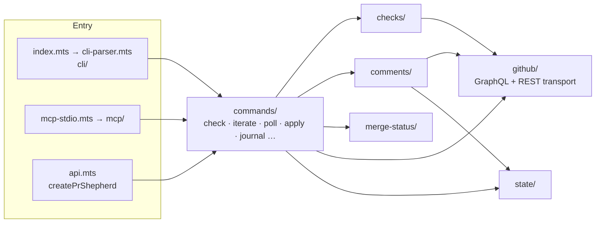
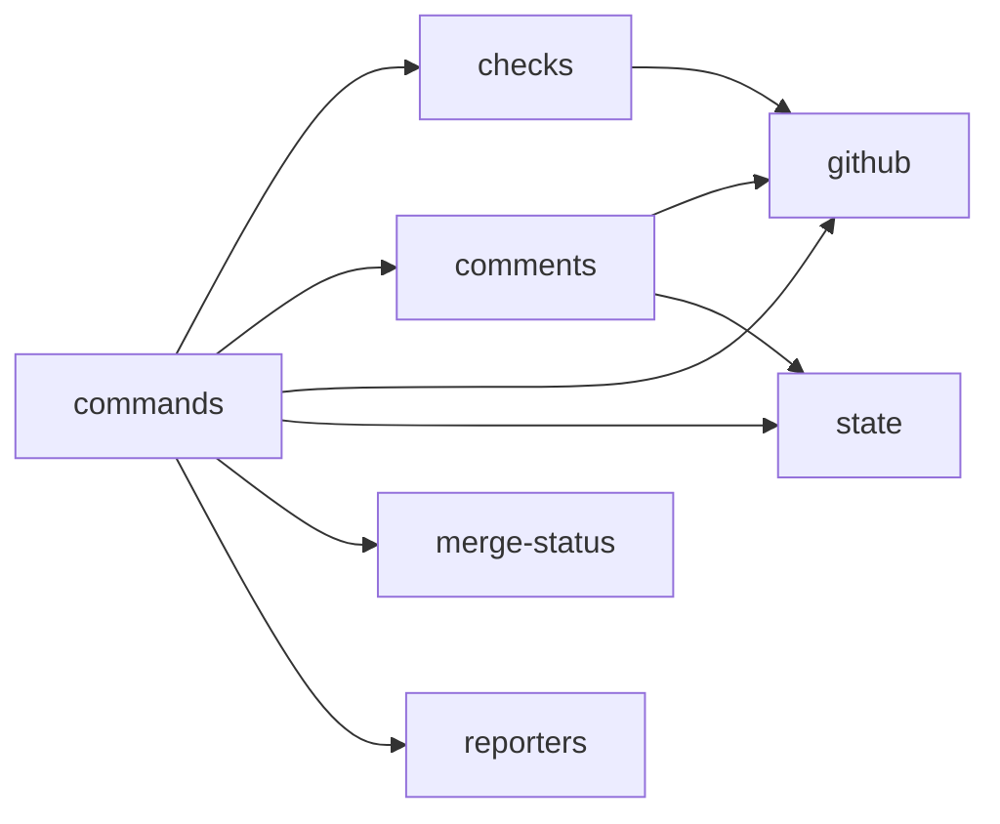

# shepherd — architecture

[← README](../README.md)

How `src/` is organized, which way dependencies point, and where new code goes. For contributors; see [extending.md](extending.md) for step-by-step recipes.

## Design rationale

Modules split along two jobs: **context gather** (`github`, `checks`, `comments`, `merge-status`) and **action emit** (`commands/iterate`, `commands/poll`, CLI formatters, MCP tools). I/O adapters (CLI parser, MCP stdio, `api.mts`) are thin layers over those.

| Principle                 | What it means                                                                                                                                                                                                      |
| ------------------------- | ------------------------------------------------------------------------------------------------------------------------------------------------------------------------------------------------------------------ |
| **One local MCP surface** | The version-matched stdio server is the canonical agent integration. It shares command implementations and GitHub token resolution with the CLI; plugins only declare the same local server. See [mcp.md](mcp.md). |
| **Skills over subagents** | Skill prompts inject into the main conversation instead of spawning a subagent that reloads `AGENTS.md` every turn, keeping cost and latency low.                                                                  |
| **Safe to interrupt**     | Durable state lives in the PR on GitHub. The iterate loop self-terminates when the PR is merged, closed, or settles after ready-delay. Local state in `$PR_SHEPHERD_STATE_DIR` can be deleted without data loss.   |

## Module map



## Module tree

```
src/
├── index.mts              # bin entrypoint — thin shim that imports cli-parser
├── api.mts                # createPrShepherd programmatic API
├── mcp-stdio.mts          # pr-shepherd-mcp binary entry
├── cli-parser.mts         # argv dispatch
├── types.mts              # barrel for types/*
├── exit-codes.mts         # EXIT map — see docs/exit-codes.md
├── config.json            # default config values
├── config/                # cascading RC loader (load.mts)
│
├── cli/                   # argument parsing, help pages, Markdown formatters
├── mcp/
│   ├── server.mts         # iterate, apply, extract_journal, get_journal, playbook,
│   │                      #   build_suggestion_patches, build_suggestion_patch tools
│   └── index.mts          # createPrShepherdMcpServer / runPrShepherdMcpStdio
│
├── commands/              # one file (or dir) per subcommand
│   ├── check.mts          # context sweep (fetch → classify → report)
│   ├── check-status.mts   # ShepherdStatus from a report
│   ├── iterate/           # action dispatch (runIterate in index.mts)
│   ├── poll.mts           # bounded WAIT loop + FIX_CODE debounce
│   ├── poll-summary.mts   # multi-PR / --stack aggregate summary
│   ├── ready-delay.mts    # ready-since.txt
│   ├── resolve-mutate.mts # apply review mutations
│   ├── apply-merge.mts    # REST apply merge
│   ├── journal/           # PR-body journal
│   ├── suggestion-patches.mts # build-suggestion-patches
│   ├── mark-files-as-viewed.mts
│   └── clean.mts
│
├── github/                # GraphQL batch + REST reads/mutations
│   ├── transport.mts      # auto / graphql / rest selection
│   ├── graphql-http.mts   # graphqlWithRateLimit
│   ├── batch.mts          # first-page batch + slim extra-page follow-ups
│   ├── batch-page.mts     # combined @include pagination
│   ├── rest-*.mts         # REST transport reads and mutations
│   ├── queries.mts        # loads gql/*.gql
│   └── gql/               # batch-pr.gql, batch-pr-page.gql, suggestion-threads.gql, …
├── checks/                # classify, triage, startup-failures, superseded
├── comments/              # resolve / minimize / dismiss mutations
├── merge-status/          # deriveMergeStatus + deriveMergeRequirements
├── classify/              # .pr-shepherd/classification/ loader, bundled standard rules
├── journal/               # Shepherd Journal Markdown parsing
├── log/                   # per-worktree debug log
├── reporters/             # agent-facing projections of report data
├── state/                 # seen markers, stall, fix-attempts, ready receipts
├── threads/               # thread transcripts
├── suggestions/           # suggestion fence parse + unified diff
├── util/
└── types/
```

## Dependency direction rule

Dependencies flow one way:



| Module                      | May import from                                                                                                                                                                                         |
| --------------------------- | ------------------------------------------------------------------------------------------------------------------------------------------------------------------------------------------------------- |
| `commands`                  | `github`, `checks`, `comments`, `state`, `merge-status`, `reporters`                                                                                                                                    |
| `checks`, `comments`        | `github`, for their domain-specific reads and mutations                                                                                                                                                 |
| `github`                    | Not `commands`, `checks`, or `comments` — except a few existing runtime helpers in the batch and `poll-summary-*` modules. Do not add new ones.                                                         |
| `merge-status`, `reporters` | Leaf-ish domain modules; not `commands`. (`merge-status/requirements.mts` reads `EMPTY_BRANCH_RULES` from `github/batch-parsers-rules.mts`.)                                                            |
| `types/`                    | Shared by all; no imports from `commands` or `github` beyond `import type`. Keep it lean.                                                                                                               |
| `exit-codes.mts`            | Shared leaf like `types/`; imports only types (from `types.mts` and `comments/resolve.mts`). Lives at the top level, not under `cli/`, because non-CLI modules such as `github/errors.mts` need it too. |

Type-only imports do not create runtime cycles. Never add an upward runtime import (e.g. `github` importing from `commands`): it creates circular dependencies and breaks single responsibility.

## Where to put new code

| What you're adding               | Where it goes                                                            |
| -------------------------------- | ------------------------------------------------------------------------ |
| New MCP tool                     | `mcp/server.mts` adapter over an existing command                        |
| New subcommand                   | `commands/<name>.mts`                                                    |
| New GraphQL query or mutation    | `github/gql/<name>.gql` + loader in `queries.mts`                        |
| New CI check classifier category | `checks/classify.mts` + type in `types/check-classification.mts`         |
| New failing-check triage field   | `checks/triage.mts` + `TriagedCheck` in `types/check-classification.mts` |
| New thread/comment mutation      | `comments/resolve.mts` + `ResolveOptions` in `types/report.mts`          |
| New merge state derivation rule  | `merge-status/derive.mts`                                                |
| New merge-requirement field      | `merge-status/requirements.mts` + `requirements-format.mts`              |
| New MCP/API operation            | `api.mts` + `mcp/server.mts`                                             |
| New tunable constant             | `config.json` + `PrShepherdConfig` in `config/load.mts`                  |
| New shared type                  | `types/github.mts`, `types/iterate.mts`, or `types/report.mts`           |
| New exit code                    | `EXIT` map in `exit-codes.mts` + [exit-codes.md](exit-codes.md)          |
