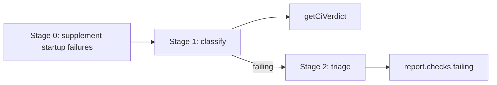

# shepherd CI checks

[← README](../README.md) | [context.md](context.md)

How Shepherd classifies CI checks and what failure context it surfaces to the agent. For readers of iterate's checks sections and contributors changing CI logic. Shepherd surfaces failures and log excerpts; it does not decide rerun versus code fix.

## Classification pipeline

### Stage 0: Supplement startup failures (`checks/triage.mts`)

A workflow run can end with `conclusion: startup_failure` before it creates any job or check-run context, so it may be missing from GraphQL `statusCheckRollup`. The batch query reads `commit.checkSuites` and merges suites whose `conclusion` is `STARTUP_FAILURE` into the check list (`checks/startup-failures.mts`).

REST `GET /repos/{owner}/{repo}/actions/runs?head_sha=<sha>&status=startup_failure` runs only when that CheckSuite page is missing or truncated (`hasNextPage`):

- The endpoint is repository-wide for the SHA, so runs are kept only when the REST `pull_requests` association includes this PR number and head SHA.
- Each run becomes a `CheckRun` with `conclusion: "STARTUP_FAILURE"`, the run ID, run URL, raw event, workflow name, and `display_title` as `summary`.
- A run ID already in the GraphQL list is updated in place, not duplicated.
- The supplement is best-effort: a failed request logs a warning and keeps the GraphQL data. A secondary rate limit aborts the tick with exit 75 instead ([graphql.md](graphql.md#startup-failure-checksuites-graphql--actions-rest-fallback)).

### Stage 1: Classify (`checks/classify.mts`)

Each check gets one `CheckCategory`. Rules apply in this order; the first match wins.

| Order | `CheckCategory` | Condition                                                                                                                                   |
| ----- | --------------- | ------------------------------------------------------------------------------------------------------------------------------------------- |
| 1     | `ignored`       | Name matches `checks.ignore`, unless its Actions run is protected by `checks.never-ignore` ([precedence](#ignoreprotection-precedence))     |
| 2     | `filtered`      | Triggered by an event not in `checks.ci-trigger-events` ([event filter](#event-filter)). Status contexts (`event: null`) are never filtered |
| 3     | `in_progress`   | `status` is anything but `COMPLETED`                                                                                                        |
| 4     | `skipped`       | `conclusion` is `SKIPPED` or `NEUTRAL`; reported, never blocks readiness                                                                    |
| 5     | `passed`        | `conclusion` is `SUCCESS`                                                                                                                   |
| 6     | `failing`       | Any other conclusion: `FAILURE`, `TIMED_OUT`, `CANCELLED`, `ACTION_REQUIRED`, `STARTUP_FAILURE`, `STALE`                                    |
| 7     | `superseded`    | A `failing` check whose conclusion is `CANCELLED` and that has newer-run evidence ([below](#concurrency-superseded-cancelled-checks))       |

### Ignore/protection precedence

`checks.ignore` matches the raw check name (`CheckRun.name` or `StatusContext.context`), case-insensitively, and removes matches from the CI verdict. The legacy cancellation-named `checks.never-ignore` takes precedence when it matches the workflow name or check name of any check in that Actions run: the run's checks stay visible and blocking. Shepherd never cancels workflow runs.

`checks.never-ignore` does not bypass the event filter. A protected workflow triggered by `workflow_dispatch`, `push`, or another non-PR event counts toward readiness only if that event is in `checks.ci-trigger-events`.

### Event filter

Only checks triggered by `checks.ci-trigger-events` (default `pull_request`, `pull_request_target`) count toward the PR-head verdict; `push`, `schedule`, `merge_group`, `workflow_dispatch`, and anything else are `filtered`. When a PR is in a merge queue, or was just removed, Shepherd separately reads the synthetic queue commit and accepts `merge_group` checks for that commit only. Queue checks carry `scope: "merge_group"` and `commitOid` so they are not confused with PR-head checks.

Filtered checks appear in `report.checks.filtered` and `filteredNames` and never block READY. `blockedByFilteredCheck` is set when the merge state is `BLOCKED` and the only failing checks are filtered; the reporter shows it as a hint.

### Concurrency-superseded CANCELLED checks

A concurrency group cancels an in-flight run when a newer run of the same workflow starts on the same commit (a double trigger, or a second push before the first run ends). The evicted run's checks complete `CANCELLED`, but branch protection resolves required checks by latest run per name, so GitHub merges once the newer run passes. Shepherd matches that by reclassifying the cancelled check as `superseded`.

Checks are grouped by workflow: the Actions workflow `databaseId` (`workflowId`), falling back to `workflowName` for the run-ID rule. A `CANCELLED` check becomes `superseded` when either holds:

| Evidence      | Requirements                                                                                                                                                                                                                                                                                                                                                                                                    |
| ------------- | --------------------------------------------------------------------------------------------------------------------------------------------------------------------------------------------------------------------------------------------------------------------------------------------------------------------------------------------------------------------------------------------------------------- |
| Higher run ID | A check in the same workflow, event, scope, and commit has a strictly greater numeric `runId`                                                                                                                                                                                                                                                                                                                   |
| Later success | A completed `SUCCESS` check with the same exact name, stable workflow ID, non-null event, scope, and commit; a distinct, lower numeric `runId`; finite positive timestamps; its start and completion both strictly later than the cancelled check's, and its own completion at or after its start. A cancelled wrapper may report completion before start; both of its recorded boundaries must still be beaten |

The later-success rule covers duplicated triggers whose run IDs were allocated out of start order. It proves only the observed run order in the loaded same-commit context, not that both events used the same PR base.

Limits:

- Only `CANCELLED` is reclassified. An older `FAILURE`, `TIMED_OUT`, or `STARTUP_FAILURE` is never masked; the newer run may not re-emit that check (for example under path filtering).
- Without either form of evidence a cancelled check stays `failing`, including a greatest-ID cancellation. Shepherd then recommends an authorized rerun or returns `ESCALATE` when no autonomous follow-up remains.
- Checks with no workflow identity (`workflowId` and `workflowName` both absent) or no numeric `runId` never participate as either side. That covers external `StatusContext` checks and Stage 0 `STARTUP_FAILURE` synthetics.
- Reclassification is local to Shepherd; GitHub's status rollup is unchanged.

`superseded` checks are excluded from the verdict and from `report.checks.failing`, are never triaged (no jobs or logs call), never appear under `## Failing checks`, and are listed only in `supersededNames`.

### Empty-check set

When every check is filtered or skipped (for example a docs-only PR that triggers only push checks), `getCiVerdict` returns `allPassed: true`, so READY is not blocked by CI that does not apply. `hasChecks` stays false; see [merge-status.md](merge-status.md#computestatus--shepherdstatus) for how that gates READY on a `BLOCKED` PR.

### Unreported required checks

A required status context with no check run and no status context at all is a different gap: the other checks can be green (`allPassed` stays true) and the missing names are not rows in the rollup. Shepherd loads the required contexts from the merge target. For a native stack that is the stack trunk (`stack.baseRefName`), the rules GitHub applies to every layer, not the upper layer's parent branch. The newest check or status of a name counts: a later success supersedes an older cancelled run.

Merged lower layers do not block this lookup when the lowest open PR still targets its merged parent's branch. One-PR checks verify that every lower layer merged, then compare the trunk with the lowest open layer's head from the validated stack order; closed or unknown lower states cannot designate an open child as the bottom. Aggregate summaries reuse the trunk's rules from a retained trunk-based member (merged members included) or fetch the trunk ref directly, never substituting the merged parent's rules.

| Situation                                                                                      | Result                                                                                                                                                                                                                                                            |
| ---------------------------------------------------------------------------------------------- | ----------------------------------------------------------------------------------------------------------------------------------------------------------------------------------------------------------------------------------------------------------------- |
| A check run in progress or queued, or a check suite with a `workflowRun` that is not completed | `WAIT` (CI is in progress). A queued suite without a workflow run does not count                                                                                                                                                                                  |
| Contexts missing, no relevant Actions workflow running                                         | `TRIAGE` immediately; `computeStatus` stays `PENDING`, even when `BLOCKED` and every reported check passed, so ready-delay does not start                                                                                                                       |
| Branch behind (base compare, trunk compare, or merge status `BEHIND`)                          | Instruction states the commit count and tells the caller to rebase and push; that push starts the checks. Stays `TRIAGE`, writes no marker                                                                                                                      |
| Branch current, contexts still missing                                                         | Shepherd instructs the caller to close and reopen the PR once for that head (`gh pr close` then `gh pr reopen`) and to investigate why workflows did not start. Records head and context set in `ci-retrigger.json`; the marker does not verify the caller ran it |
| Same head on the next tick, still missing                                                      | `ESCALATE` with `required-checks-unreported`                                                                                                                                                                                                                      |

The instruction says no CI checks are running and names the required checks that have not passed. To decide "behind", a non-stack PR loads `baseRef.compare(headRef).behindBy` using the head commit OID (so a fork branch name is not resolved in the base repository). A native-stack layer compares the stack trunk against the bottom open layer's head. Both compares run only while a required check is unreported, including when `mergeStateStatus` is `BLOCKED` for another reason, and are cached in `$PR_SHEPHERD_STATE_DIR/<owner>/<repo>/<pr>/` keyed on the live tip (`baseRef.target.oid` from `BatchPr`, or the trunk tip) and the head, so they rerun only when one moves. Being behind is not its own action once required checks have reported.

Output, each field omitted when empty:

| Field                       | When                                                         |
| --------------------------- | ------------------------------------------------------------ |
| `unreportedRequiredChecks`  | Required contexts with no run                                |
| `baseBehindBy`              | The PR base compare is behind; text also prints `**behind**` |
| `trunkBehindBy`             | The trunk compare is behind                                  |
| `actionsWorkflowInProgress` | A relevant Actions suite has not completed                   |

A `stack` summary routes the layer as `triage` with reason `unreported-required-checks` instead of an idle wait and prints the names on that layer.

### `getCiVerdict`

"Relevant" means not `filtered`, `skipped`, `ignored`, or `superseded`.

| Field             | Value                                                    |
| ----------------- | -------------------------------------------------------- |
| `anyFailing`      | A relevant check is `failing`                            |
| `anyInProgress`   | A relevant check is `in_progress`                        |
| `allPassed`       | No relevant check is failing or in progress              |
| `hasChecks`       | At least one relevant check exists                       |
| `filteredNames`   | Names of `filtered` checks                               |
| `ignoredNames`    | Names of checks suppressed by `checks.ignore`            |
| `supersededNames` | Names of `CANCELLED` checks reclassified as `superseded` |

## Stage 2: Triage (`checks/triage.mts`)

For each failing check, triage adds context from the GitHub Actions API:

| Field          | Content                                                                                                                                                                                                                                                                                                                                                                                                                                                                                                                                                                                                                                   |
| -------------- | ----------------------------------------------------------------------------------------------------------------------------------------------------------------------------------------------------------------------------------------------------------------------------------------------------------------------------------------------------------------------------------------------------------------------------------------------------------------------------------------------------------------------------------------------------------------------------------------------------------------------------------------- |
| `workflowName` | Workflow that owns the failing job (from `jobs?filter=latest`)                                                                                                                                                                                                                                                                                                                                                                                                                                                                                                                                                                            |
| `jobName`      | Matched job name; falls back to the check name                                                                                                                                                                                                                                                                                                                                                                                                                                                                                                                                                                                            |
| `failedStep`   | First step whose conclusion is not `success`, `skipped`, or `neutral`                                                                                                                                                                                                                                                                                                                                                                                                                                                                                                                                                                     |
| `runAttempt`   | GitHub's `run_attempt`, so Shepherd recommends at most one rerun. Attempt 1 is omitted; later attempts render as `[attempt: N]`                                                                                                                                                                                                                                                                                                                                                                                                                                                                                                           |
| `logExcerpt`   | From `GET /repos/{owner}/{repo}/actions/jobs/{job_id}/logs`: the first failed step's visible output. The collapsed `##[group]Run` / `Post` command block (script echo, `with:`, `env:`, `shell:`), later steps, and post-job cleanup (`Post job cleanup.`, `Cleaning up orphan processes`) are dropped. An aggregate job printing a `Job results` JSON block yields its non-success results plus the exit-code or error line. A step over 4,000 characters is suffix-truncated so the error line survives. A log with no step groups falls back to lines around the first error. Best-effort: missing or inaccessible logs omit the field |
| `relatedJobs`  | Up to 5 other `failure` / `timed_out` jobs from the same run that are not their own failing check, each `{ name, conclusion, failedStep?, logExcerpt? }` with the same excerpt rules. Attached once per run, to its first failing check, so a gate job shows its children's errors. Shares the job-log cache and REST read budget                                                                                                                                                                                                                                                                                                         |
| `annotations`  | Marker-gated inline annotations from completed `CheckRun`s of any conclusion. See [annotations](#annotations)                                                                                                                                                                                                                                                                                                                                                                                                                                                                                                                             |

By conclusion:

| Conclusion        | Triage                                                                                    | Tag                             |
| ----------------- | ----------------------------------------------------------------------------------------- | ------------------------------- |
| `CANCELLED`       | Job metadata only, to recover `run_attempt`; never a log excerpt                          | `[conclusion: CANCELLED]`       |
| `STARTUP_FAILURE` | `run_attempt` from the workflow-runs response; no jobs or logs calls; may carry `summary` | `[conclusion: STARTUP_FAILURE]` |
| Other failures    | Jobs, `failedStep`, `logExcerpt`, `relatedJobs`                                           | none                            |

Ordinary failures use only the bounded evidence Shepherd includes. A later failed attempt never gets a second rerun command, but a nonblank log excerpt still makes it autonomous `TRIAGE` investigation work. When a check has neither included evidence nor an authorized first-attempt rerun, Shepherd lets other autonomous work finish under `TRIAGE` (including refreshing a behind or conflicting branch after a later attempt) and returns `ESCALATE` only if that check is the last blocker with no autonomous path left.

### Annotations

The batch query probes `annotations(first: 1)`, so Shepherd paginates only check runs that have annotations. Bodies are loaded together, one `nodes(ids:)` request per 20 uncached check runs, then the single-check query only when `hasNextPage` is set (costs in [graphql.md](graphql.md#check-run-annotation-bodies)). `message` and `rawDetails` are capped independently before text and JSON output. Each annotation is surfaced once per PR; there is no resolve or minimize mutation.

`check` keeps successful-check annotations as raw context and marks them seen. `iterate` treats a successful parent conclusion as authoritative regardless of bucket and does not turn those annotations into `TRIAGE`.

## Report output

`report.checks`:

| Field                    | Content                                                                                                                                                        |
| ------------------------ | -------------------------------------------------------------------------------------------------------------------------------------------------------------- |
| `passing`                | `category === 'passed'`                                                                                                                                        |
| `failing`                | Triaged failing checks, with `workflowName`, `jobName`, `failedStep`, `logExcerpt`, `relatedJobs` (excerpt fields only for non-cancelled, non-startup-failure) |
| `inProgress`             | `category === 'in_progress'`                                                                                                                                   |
| `skipped`                | `category === 'skipped'`                                                                                                                                       |
| `filtered`               | Excluded by the event filter                                                                                                                                   |
| `ignored`                | Ignored checks that still carry unseen annotations; omitted when empty                                                                                         |
| `filteredNames`          | Names of filtered checks                                                                                                                                       |
| `blockedByFilteredCheck` | `BLOCKED` state is caused by a filtered check                                                                                                                  |
| `ignoredNames`           | Suppressed by `checks.ignore`; omitted when empty                                                                                                              |
| `supersededNames`        | `CANCELLED` checks reclassified as `superseded`; omitted when empty                                                                                            |

Pending checks also carry raw timing when GitHub exposes it:

| Field           | Content                                                                                  |
| --------------- | ---------------------------------------------------------------------------------------- |
| `source`        | `check_run`, `status_context`, or `startup_failure`                                      |
| `createdAtUnix` | Check-suite / workflow-run creation for check runs; status-context creation for statuses |
| `startedAtUnix` | Check-run start, when present                                                            |
| `updatedAtUnix` | Check-suite / workflow-run update, when present                                          |

Iterate escalates with `stall-timeout` when relevant CI stays pending or unstarted longer than `iterate.stall-timeout-minutes`. A required context that never created a check run does not use that timer; it takes the [unreported-required](#unreported-required-checks) path.
