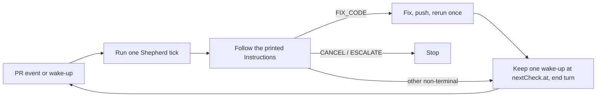

# Single ticks and the cloud

[← README](../README.md) | [actions.md](actions.md)

How Shepherd runs when the session, not Shepherd, owns the wait: one tick per invocation, woken by PR events and scheduled wake-ups instead of sleeping in a poll loop. For anyone running Shepherd in a Claude Code cloud session, through MCP or the library, or wiring it into an event-driven host.

The default command `pr-shepherd [PR]` and `pr-shepherd stack PR` sleep between `WAIT` ticks and return on a terminal action or `FIX_CODE`. A single tick moves the wait out of Shepherd and into the session.

## Which commands tick

| Command                                       | Behavior                                                       |
| --------------------------------------------- | -------------------------------------------------------------- |
| `pr-shepherd iterate [PR...]`                 | Always one tick (one PR, or one aggregate tick for several)    |
| `pr-shepherd stack PR --once`                 | One stack tick                                                 |
| MCP and library `iterate` and `stack`         | Always one tick                                                |
| `pr-shepherd [PR...]`, `pr-shepherd stack PR` | Loop and sleep, except one tick when `CLAUDE_CODE_REMOTE=true` |

There is no mode to configure. In a tick, `--interval`, `--timeout`, `--debounce`, `--quiet-status`, and `--until-terminal` have no effect. Seen markers are written immediately and the fingerprint cache is not used, so every tick is rebuilt from GitHub plus Shepherd's saved state.

## `nextCheck`

A tick's result carries `nextCheck` when another tick is meaningful:

| Field       | Meaning                                     |
| ----------- | ------------------------------------------- |
| `at`        | RFC 3339 UTC time, rounded up to the minute |
| `inSeconds` | Seconds from now until `at`                 |
| `reason`    | One of the reasons below                    |

| `reason`        | When                                                                                                                                                                                                                                           | Recheck               |
| --------------- | ---------------------------------------------------------------------------------------------------------------------------------------------------------------------------------------------------------------------------------------------- | --------------------- |
| `ready-delay`   | The final ready-delay countdown ends at `at`; no event fires then                                                                                                                                                                              | at the deadline       |
| `stall-timeout` | An unchanged state would trip the stall timeout, or (on `WAIT`) the oldest unstarted check, aged from its last update or else creation, would reach the CI-start stall timeout, and that comes first. For `stack`, the stack-level stall timer | at the deadline       |
| `merge-queue`   | The PR is queued                                                                                                                                                                                                                               | about every 5 minutes |
| `merge-pending` | A printed merge request can stay `pending` (one-PR REST merge, or a stack merge), so the rerun resumes it                                                                                                                                      | about every 5 minutes |
| `safety-net`    | Every other non-terminal tick; a backstop for a missed event                                                                                                                                                                                   | about 50 minutes      |

`nextCheck` is omitted for `FIX_CODE` (its immediate rerun reports one), `CANCEL`, `ESCALATE`, a `MERGE` whose command is not a REST merge, `MARK_READY`, and an aggregate result whose PRs are all terminal, whose rows are all `CANCEL` or `ESCALATE`, or whose only remaining work is final draft-verification probes. The probe instructions say when to stop or rerun the command.

Text prints a `**nextCheck**` header line; JSON and MCP `structuredContent` carry the object; `## Instructions` names the same time. A stack or multi-PR tick reports one `nextCheck` for the selection.

Tick special cases:

- Stack steps drop "at the configured polling cadence", and a pending REST stack merge reruns after the wake-up, so the appended tick step is the only timing rule.
- A clean draft with auto mark-ready disabled returns `CANCEL` without a wake-up. A `stack` command continues other layer work and schedules any next tick from the remaining layers.
- `MARK_READY` keeps its immediate rerun: that tick saw a draft, so the ready-delay timer was cleared; the next tick sees the PR ready, starts the timer, and reports the `ready-delay` deadline.

Waiting instructions end with a step naming the bundled "Event loop" playbook (`pr-shepherd playbook "Event loop"`): end the turn without sleeping, act only on Shepherd's output, and keep exactly one wake-up at `nextCheck.at`.

## Durable state

A cloud VM can be recycled between ticks, taking its temp directory with it. When `CLAUDE_CODE_REMOTE=true` and `PR_SHEPHERD_STATE_DIR` is unset, state moves to `<git-common-dir>/pr-shepherd-state` (found with a read-only `rev-parse --git-common-dir`), alongside the checkout instead of under `TMPDIR`.

| Situation                    | State directory            |
| ---------------------------- | -------------------------- |
| `PR_SHEPHERD_STATE_DIR` set  | that directory, always     |
| `CLAUDE_CODE_REMOTE=true`    | durable, for every command |
| Outside `CLAUDE_CODE_REMOTE` | temp directory             |
| Outside a repository         | temp directory             |

`pr-shepherd admin log-file` and `pr-shepherd admin clean` resolve the same directory, so in a cloud session they print and remove the durable log and state. A local tick, such as `pr-shepherd iterate` on a laptop, uses the temp directory like any other local command; set `PR_SHEPHERD_STATE_DIR` when ticks must survive a temp-directory wipe.

## Duplicate-reply scan

Losing the state directory also loses the uncertain-reply record that prevents duplicate replies. In cloud sessions (`CLAUDE_CODE_REMOTE=true`), the `apply review` reply command that `iterate` generates carries `--adopt-existing-replies`. Before posting, Shepherd reads the target threads and skips any whose last comment is already this exact Shepherd reply (hidden marker included) from the authenticated viewer, treating it as posted ([comments.md](comments.md#recovering-an-uncertain-reply)).

- The scan runs for every reply batch without a local uncertain-reply record, not only when the state directory is empty, because other state files are written before replies.
- It costs one extra read per batch of ten threads. A failed read never blocks the reply.
- A user-directed `apply review` without the flag never scans; it forwards every supplied reply ID, even in the cloud.

## What is not verified

Event delivery, wake-up scheduling, and routine APIs are host features. Shepherd prints the time and the rule; the session picks the mechanism. The playbook does not assume a scheduler exists and tells the agent to say so if none does.
