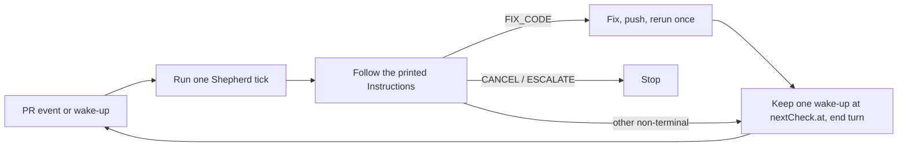

# Cloud and event mode

[← README](../README.md) | [actions.md](actions.md)

How Shepherd runs in a Claude Code cloud session, where the session is woken by PR events and scheduled wake-ups instead of sleeping in a poll loop. For anyone running Shepherd in the cloud or wiring it into an event-driven host.

Normally `pr-shepherd [PR]` sleeps between `WAIT` ticks and returns on a terminal action or `FIX_CODE`. In a cloud session a sleeping turn wastes the session, so **event mode** moves the wait out of Shepherd and into the session.

## Choosing the mode

`poll.mode` is `auto` (default), `poll`, or `event`. The CLI `--poll-mode`, MCP `iterate` input `pollMode`, and library option `pollMode` take the same values and override configuration.

| Mode    | Behavior                                                 |
| ------- | -------------------------------------------------------- |
| `poll`  | The poll dispatcher loops, sleeps, and debounces         |
| `event` | One tick per invocation; no sleeping, no debounce        |
| `auto`  | `event` when `CLAUDE_CODE_REMOTE=true`, otherwise `poll` |

In event mode, `--interval`, `--timeout`, `--debounce`, `--quiet-status`, and `--until-terminal` have no effect. `pr-shepherd [PR]`, `iterate`, `--stack`, and multi-PR selectors each run exactly one tick. Seen markers are written immediately (as `iterate` does) and the fingerprint cache is not used, so every tick is rebuilt from GitHub plus Shepherd's saved state.

## `nextCheck`

An event-mode result carries `pollMode: "event"` and, when another tick is meaningful, `nextCheck`:

| Field       | Meaning                                     |
| ----------- | ------------------------------------------- |
| `at`        | RFC 3339 UTC time, rounded up to the minute |
| `inSeconds` | Seconds from now until `at`                 |
| `reason`    | One of the reasons below                    |

| `reason`        | When                                                                                                                                                                                                                                             | Recheck               |
| --------------- | ------------------------------------------------------------------------------------------------------------------------------------------------------------------------------------------------------------------------------------------------ | --------------------- |
| `ready-delay`   | The final ready-delay countdown ends at `at`; no event fires then                                                                                                                                                                                | at the deadline       |
| `stall-timeout` | An unchanged state would trip the stall timeout, or (on `WAIT`) the oldest unstarted check, aged from its last update or else creation, would reach the CI-start stall timeout, and that comes first. For `--stack`, the stack-level stall timer | at the deadline       |
| `merge-queue`   | The PR is queued                                                                                                                                                                                                                                 | about every 5 minutes |
| `merge-pending` | A printed merge request can stay `pending` (one-PR REST merge, or a stack merge), so the rerun resumes it                                                                                                                                        | about every 5 minutes |
| `safety-net`    | Every other non-terminal tick; a backstop for a missed event                                                                                                                                                                                     | about 50 minutes      |

`nextCheck` is omitted for `CANCEL`, `ESCALATE`, a `MERGE` whose command is not a REST merge, `MARK_READY`, a native-stack draft hold, and an aggregate result whose PRs are all terminal or whose rows are all `CANCEL` or `ESCALATE`.

Text prints a `**nextCheck**` header line; JSON and MCP `structuredContent` carry the object; `## Instructions` names the same time. A stack or multi-PR selector reports one `nextCheck` for the selection, and every row `pollCommand` (including bounded draft probes) carries `--poll-mode event`.

Event-mode special cases:

- Stack steps drop "at the configured polling cadence", and a pending REST stack merge reruns after the wake-up, so the appended event step is the only timing rule.
- A native-stack draft hold prints its `--stack` handoff with `--poll-mode event`, plus a step not to rerun the held one-PR session or keep a wake-up for it. After the handoff the agent follows only the stack selector's output and its `nextCheck`.
- `MARK_READY` keeps its immediate rerun: that tick saw a draft, so the ready-delay timer was cleared; the next tick sees the PR ready, starts the timer, and reports the `ready-delay` deadline.

The instructions end with a "Cloud event loop" step naming the bundled playbook (`pr-shepherd playbook "Cloud event loop"`): run one tick, follow the printed instructions on when to rerun or end the turn without sleeping, act only on Shepherd's output, and keep exactly one wake-up at `nextCheck.at`. After `FIX_CODE` it reruns Shepherd once and ends the turn. This replaces the quota-aware `FIX_CODE` continuation; the quota warning itself still prints.

## Durable state

A cloud VM can be recycled between ticks, taking its temp directory with it. When `PR_SHEPHERD_STATE_DIR` is unset, state moves to `<git-common-dir>/pr-shepherd-state` (found with read-only `git rev-parse --git-common-dir`), alongside the checkout instead of under `TMPDIR`.

| Situation                                                | State directory            |
| -------------------------------------------------------- | -------------------------- |
| `PR_SHEPHERD_STATE_DIR` set                              | that directory, always     |
| `CLAUDE_CODE_REMOTE=true`                                | durable, for every command |
| Event-mode `iterate` and poll calls, including their log | durable                    |
| Other commands outside `CLAUDE_CODE_REMOTE`              | temp directory             |
| Outside a git repository                                 | temp directory             |

The CLI resolves the poll mode before opening the per-worktree log. `pr-shepherd admin log-file` and `pr-shepherd admin clean` resolve it the same way from `poll.mode` and their own `--poll-mode`, so `admin log-file --poll-mode event` prints the log an event tick writes, and `admin clean` with event mode removes the durable state. Both reject an invalid `--poll-mode` with a usage error. A local `apply` in the same checkout uses the temp directory, so set `PR_SHEPHERD_STATE_DIR` if you mix modes.

## Duplicate-reply scan

Losing the state directory also loses the uncertain-reply record that prevents duplicate replies. In durable-state sessions, the `apply review` reply command that `iterate` generates carries `--adopt-existing-replies`. Before posting, Shepherd reads the target threads and skips any whose last comment is already this exact Shepherd reply (hidden marker included) from the authenticated viewer, treating it as posted ([comments.md](comments.md#recovering-an-uncertain-reply)).

- The scan runs for every reply batch without a local uncertain-reply record, not only when the state directory is empty, because other state files are written before replies.
- It costs one extra read per batch of ten threads. A failed read never blocks the reply.
- A user-directed `apply review` without the flag never scans; it forwards every supplied reply ID, even in the cloud.

## What is not verified

Event delivery, wake-up scheduling, and routine APIs are host features. Shepherd prints the time and the rule; the session picks the mechanism. The playbook does not assume a scheduler exists and tells the agent to say so if none does.
