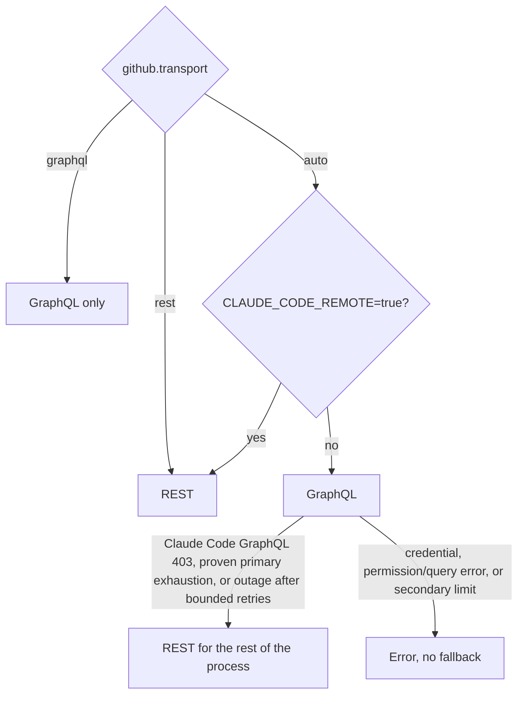

# GitHub API

[← README](../README.md) | [context.md](context.md)

How Shepherd talks to GitHub: transport selection, how GitHub meters each transport, quota warnings and backoff, and how to read spend. For operators watching API budgets and contributors adding GitHub calls.

| Page                                   | What it covers                                                                                       |
| -------------------------------------- | ---------------------------------------------------------------------------------------------------- |
| [graphql.md](graphql.md)               | GraphQL transport: batch query, pagination, operation catalog, fingerprint skip, REST calls it makes |
| [graphql-usage.md](graphql-usage.md)   | GraphQL points per command and per tick                                                              |
| [rest.md](rest.md)                     | REST transport: snapshot coverage, conditional reads, fields REST cannot supply, `ccr` proxy routes  |
| [rest-usage.md](rest-usage.md)         | REST `core` requests per command and per tick                                                        |
| [authentication.md](authentication.md) | Credential sources and which token pools share quota                                                 |

## Transport selection

`github.transport` is `auto` (default), `graphql`, or `rest`; the CLI `--transport` flag and the library/MCP option select the same mode ([configuration](configuration.md#github-api-transport)). Proxy settings apply to both clients.

Proven exhaustion: a recognized GraphQL quota refusal without a usable quota sample triggers `GET /rate_limit`; only a measured empty GraphQL bucket authorizes fallback. A healthy, malformed, or unavailable probe keeps the original error. Secondary limits and forced `graphql` mode never probe. Through the Claude Code proxy, `GET /rate_limit` can report a different `core` bucket than the `X-RateLimit-*` headers on ordinary REST responses; treat it as a separate sample. A switch is logged once in verbose output and does not mean the original error was harmless or that the snapshots carry identical fields.

On REST:

- Fields REST cannot supply stay unknown; unsupported operations produce a surfaced skip, error, or escalation ([rest.md](rest.md), [escalations](escalations.md#transport-unsupported)). Text, JSON, and MCP outputs still project equivalent available information.
- A clean merge state with complete CI and complete feedback evidence can be READY without `reviewDecision` or branch-protection details. Neither transport uses `reviewDecision` for readiness; a non-clean state still needs readable branch policy.
- A queued PR may use REST for supported queue interactions; enqueue is not presumed GraphQL-only.

GraphQL mode still makes some REST calls; they are listed in [graphql.md](graphql.md#rest-calls-in-graphql-mode).

## GitHub metering

The two transports use separate pools; exhausting one does not exhaust the other.

| Pool    | Unit                     | Notes                                                                                                                                   |
| ------- | ------------------------ | --------------------------------------------------------------------------------------------------------------------------------------- |
| GraphQL | points per hour          | Typical user PAT: 5,000/hour; GitHub App installation tokens can be higher. Pricing: [graphql.md](graphql.md#how-github-prices-a-query) |
| REST    | `core` requests per hour | A conditional read answered `304 Not Modified` is not charged ([rest.md](rest.md#conditional-reads))                                    |

| Limit                 | What it is                                                            | How Shepherd sees it                                                                                                           |
| --------------------- | --------------------------------------------------------------------- | ------------------------------------------------------------------------------------------------------------------------------ |
| Primary GraphQL quota | `x-ratelimit-remaining` / `rateLimit.remaining` on resource `graphql` | `apiUsage.graphql`, `quotaWarning`, pagination abort at remaining 0                                                            |
| Primary REST quota    | `x-ratelimit-remaining` on resource `core`                            | `apiUsage.rest`, `quotaWarning`; Actions jobs-list and startup-failure pages stop at remaining 0                               |
| Secondary rate limit  | Burst / concurrency / mutation abuse; does not decrement remaining    | HTTP 200 with GraphQL errors, or HTTP 403, often with `Retry-After` and a `secondary rate limit` message; `EXIT.TEMPFAIL` (75) |
| GraphQL node cap      | One query may not request more than 500,000 potential nodes           | Query rejected; not a quota warning                                                                                            |

`graphqlWithRateLimit` (`github/graphql-http.mts`, re-exported from `http.mts` / `client.mts`) and `restWithRateLimit` parse `x-ratelimit-remaining` / `-limit` / `-reset` and `Retry-After`. Failed REST calls throw `GitHubRequestError` with that metadata. `github/api-telemetry.mts` merges headers with GraphQL's `rateLimit` selection, so ordinary requests need no extra quota call.

`apiUsage` keeps telemetry from both pools, including GraphQL attempts before an automatic switch. Warnings and cadence follow the active transport: REST mode uses REST core only; GraphQL mode considers both. A pending REST core warning survives the poll loop; stale GraphQL warnings are discarded after a switch.

One tick can see two reset windows for one resource (the Claude Code proxy's responses can come from two `core` windows; live run #566 saw `used` 540 in window A and 652 in a later-resetting window B). `apiUsage` and `quotaWarning` report the window that resets later, never combining windows. Within one window the most conservative sample wins ([Quota warnings and cadence](#quota-warnings-and-cadence)).

## Per-tick budget

The single-PR poll interval is 60s (`poll.intervalSeconds`). `--stack` and multi-PR polls default to that times `poll.stackIntervalFactor` (built-in 2, so 120s), because a summary's cost grows with PR count. An explicit `--interval` overrides either default and is not multiplied. Ready-delay is 10 minutes.

| Situation                   | GraphQL transport                                                                                                                                       | REST transport                                                                                                                                                                                   |
| --------------------------- | ------------------------------------------------------------------------------------------------------------------------------------------------------- | ------------------------------------------------------------------------------------------------------------------------------------------------------------------------------------------------ |
| One PR, changed tick        | 1 point (`BatchPr`), plus supplements                                                                                                                   | 14 core requests for an unprotected base and single-page lists (13 charged on a cold cache), plus one per extra page and one for a protected base; only reads whose resource changed are charged |
| One PR, unchanged wait tick | 1 point (fingerprint hit), or 0 points and 0 core requests while the idle wait detectors all answer 304, with one `BatchPr` per `poll.reconcileSeconds` | 0 requests (a Claude Code cloud session also sends the unmetered `ccr` thread read)                                                                                                              |
| `--stack` summary           | `PollStackSummary`, about 0.36 points per layer (minimum 1); the anchor's first tick reads 4 entries per page                                           | 126 requests for 10 layers without validators, 104 charged on a cold cache; 0 when unchanged (cloud also sends one unmetered `ccr` thread read per layer)                                        |
| Detail                      | [graphql-usage.md](graphql-usage.md), [graphql.md](graphql.md#per-tick-budget)                                                                          | [rest-usage.md](rest-usage.md)                                                                                                                                                                   |

On REST, a bot that edits its PR status comment in place also costs session time: each edit returns `FIX_CODE` and restarts the ready delay ([rest.md](rest.md#bot-status-comment-edits)).

## Quota warnings and cadence

`watch.graphqlQuotaWarnings` bands (default 30% → 2x, 20% → 5x, 10% → 10x the configured `poll.intervalSeconds`) apply to GraphQL and, with the same bands, REST `core`. A band may instead use absolute `pollIntervalMinutes`, or both (the slower wins).

| Behavior        | Rule                                                                                                                                                                                                                                                                                                                                                          |
| --------------- | ------------------------------------------------------------------------------------------------------------------------------------------------------------------------------------------------------------------------------------------------------------------------------------------------------------------------------------------------------------- |
| Warning         | One `quotaWarning` per worktree, per credential, per reset window, on non-terminal results. An older sample in the same window does not warn again; a changed credential fingerprint does                                                                                                                                                                     |
| Sample choice   | Within one window: lowest `remaining` and highest `used`, independently (proxy routes can disagree within a tick). Never combines credentials. A late sample from an ended window is ignored. Each REST resource uses the fingerprint of the credential that supplied its sample; a credential change accepts that credential's current sample even if higher |
| Advice          | Tells the caller to slow down. Recommends an explicit REST `gh api repos/OWNER/REPO/pulls/PR` read for incidental work only while REST core is above the bands. When both budgets are low, one combined warning uses the later reset and does not suggest moving work                                                                                         |
| Applied cadence | The poll dispatcher (`pr-shepherd [PR]`, `--until-terminal`, `--stack`, multi-PR) sleeps `max(effective interval, active band interval)` every tick, even after the warning was claimed. The active band is the crossed entry with the lowest `remainingPercent`, from the tighter of GraphQL and REST core (REST mode: core only)                            |
| No compounding  | Band factors multiply configured `poll.intervalSeconds`, not an explicit flag or `poll.stackIntervalFactor`. A slower explicit interval stays in force; with defaults a stack sleeps 120s until a band is slower                                                                                                                                              |
| Advisory only   | Single-tick `iterate` and MCP `iterate`; those callers own recurrence                                                                                                                                                                                                                                                                                         |

## Rate-limit backoff

In `auto` mode, proven primary GraphQL exhaustion switches the operation and later work to REST. Bounded polls and single-tick `iterate` fail with exit 75 on the first rate-limit error. `--until-terminal` keeps polling while a rate limit is the only failure, including forced `graphql` mode or exhausted REST core:

| Response                                           | Wait                                                                       | Gives up                                       |
| -------------------------------------------------- | -------------------------------------------------------------------------- | ---------------------------------------------- |
| Explicit `Retry-After`                             | honored in full                                                            |                                                |
| Exhausted primary (`remaining` 0, GraphQL or core) | until `resetAt`, + 5s, + `resetAt % 5`s, so retries miss the reset instant | a later `resetAt` clears the no-progress count |
| Primary with unchanged or missing `resetAt`        | 15s, 30s, then 60s                                                         | exit 75 on the sixth consecutive response      |
| Secondary limit without `Retry-After`              | 60, 120, 240, 480, 960s                                                    | exit 75 on the sixth with no successful tick   |

A successful tick clears either budget.

Closure probes: only proven primary GraphQL exhaustion permits one REST pull read per tracked open PR between sleeps; a secondary throttle never does, even with a GraphQL resource header. A merged or closed PR returns `CANCEL` without waiting out the reset. A REST core limit on a probe skips further probes for that sleep without throwing. `--stack` / multi-PR polls return the all-terminal `CANCEL` only when every tracked layer is merged or closed.

REST branch-policy reads propagate primary and secondary throttling, `Retry-After`, and session refusals rather than treating them as unavailable policy; polling retries throttling before any readiness or merge decision.

## How to read spend

1. Pass `--verbose` on iterate or poll. Markdown adds `## GitHub API usage`; JSON includes `apiUsage`: credential source, request count, measured query cost, node count, remaining/limit/reset, REST `notModified` counts, and `unmeteredRestRequestCount` (REST responses without rate-limit headers, such as the proxy's `ccr/review_threads`).
2. `npx pr-shepherd admin log-file`: each response line carries quota headers, GraphQL cost, and credential source.
3. A `quotaWarning` / `## GitHub API quota warning` block is primary remaining% crossing a band. It is not emitted for secondary limits.
4. Exit 75 with `Retry-After` and a `secondary rate limit` message is a burst throttle, not an empty bucket. Back off; do not assume REST is exhausted too.

## Operational advice

- **Isolate quota with a different identity.** The agent's GitHub MCP, Copilot, and `gh api graphql` share the GraphQL pool of their token's user. A second PAT for the same user does not isolate quota; use a GitHub App installation token or a different user ([authentication.md](authentication.md)). A dedicated PAT still helps least privilege and audit.
- **Always pass the PR number** (or URL / `owner/repo#N`) so Shepherd skips the branch lookup.
- **Do not also poll** with GitHub MCP GraphQL, `gh pr checks`, or `gh pr watch`. Name incidental REST reads explicitly, for example `gh api repos/OWNER/REPO/pulls/PR`.
- **On a `quotaWarning`**, follow `## Instructions`: keep using pr-shepherd at the printed cadence. For `--until-terminal`, pass `--interval` from the warning and omit `--timeout`. Resume full cadence after the printed reset.

Open work: warnings are per worktree; token-scoped quota state would let worktrees sharing a credential share warned bands. GraphQL follow-ups are in [graphql-usage.md](graphql-usage.md#recommendations).
