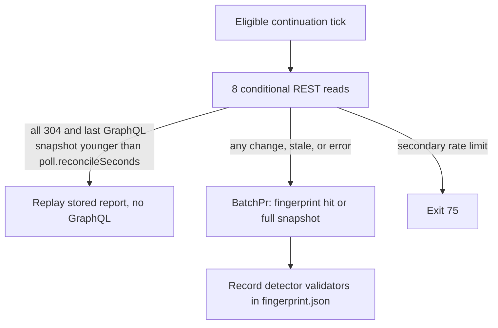

# shepherd GraphQL

[← README](../README.md) | [github-api.md](github-api.md) | [context.md](context.md)

How the GraphQL transport reads a PR: the batch query, pagination, the operation catalog, fingerprint reuse, idle-wait detectors, and the REST calls GraphQL mode still makes. For contributors changing GitHub reads and for anyone tuning point spend.

Transport selection, metering, quota warnings, and backoff are in [github-api.md](github-api.md); the REST transport is in [rest.md](rest.md). Measured costs per command are in [graphql-usage.md](graphql-usage.md).

## How GitHub prices a query

GitHub meters GraphQL in points per hour, not HTTP requests ([GitHub metering](github-api.md#github-metering)). Per [GitHub's formula](https://docs.github.com/en/graphql/overview/rate-limits-and-query-limits-for-the-graphql-api):

1. Count the connection-requests implied by the query AST. A nested `first`/`last` multiplies by its parent connection's size; assume every connection fills.
2. Divide by 100 and round to the nearest integer. The minimum is 1.

Example: `reviewThreads(last: 20) { comments(first: 100) }` is 1 + 20 = 21 connection-requests, so 1 point. A `BatchPr` first page, including the annotation probe, measures at cost 1. `--verbose` `GraphQL measured cost` is authoritative.

| Limit                 | Behavior                                                                                           |
| --------------------- | -------------------------------------------------------------------------------------------------- |
| 500,000 nodes / query | `first`/`last` multiplied through the tree. GitHub rejects the query outright; not a quota warning |
| Mutations             | Cannot select `rateLimit { cost }`; recorded as `unmeasuredRequestCount`, quota read from headers  |

Queries select this sibling so cost is exact; `github/api-telemetry.mts` merges it with the `x-ratelimit-*` headers, so no extra quota call is needed:

```graphql
_shepherdRateLimit: rateLimit {
  cost
  limit
  nodeCount
  remaining
  resetAt
  used
}
```

## The batch query

[`src/github/gql/batch-pr.gql`](../src/github/gql/batch-pr.gql) fetches everything for one PR on its first page:

| Data             | Fields                                                                                                                                  |
| ---------------- | --------------------------------------------------------------------------------------------------------------------------------------- |
| PR state         | `state`, `isDraft`, `mergeable`, `mergeStateStatus`, `reviewDecision`, `headRefOid`                                                     |
| Branch rules     | `baseRef.rules` (active repository/org rulesets) and classic `branchProtectionRule`, no extra round trip                                |
| Queue and stack  | `isInMergeQueue`, `isMergeQueueEnabled`, `mergeQueueEntry` (position, state, head/removal OIDs and parents), `stack`, `stackEntry`      |
| Review data      | Review threads, PR comments, reviews (all paginated backward)                                                                           |
| CI               | Check contexts (paginated forward) and `checkSuites(first: 50)` for startup failures                                                    |
| Annotation probe | `annotations(first: 1)` per `CheckRun` with `totalCount` and full fields; sets `hasAnnotations` and feeds the READY-receipt fingerprint |

`latestReviews` is capped at 100 and `reviewRequests` at 50, with no extra pages, so blocking-bot detection can miss reviewers beyond those caps.

Merge-queue check rollups are not on the first page. When the PR is queued, or its latest removal is still current, [`merge-queue-checks.mts`](../src/github/merge-queue-checks.mts) loads that commit's rollup via [`commit-check-contexts.gql`](../src/github/gql/commit-check-contexts.gql).

`statusCheckRollup` can omit runs that fail before any job exists, so suites with `conclusion: STARTUP_FAILURE` are merged into the check list ([startup failures](#startup-failure-checksuites-graphql--actions-rest-fallback)). Failing Actions jobs also get a bounded log excerpt ([failed job log excerpts](#failed-job-log-excerpts)).

## Response integrity

GraphQL reads are strict. Any GraphQL `errors`, null `data`, invalid JSON, a malformed payload, or a null check-context node throws `GitHubRequestError`, keeping GitHub's error paths. An incomplete snapshot never drives an action: `iterate` and `pr-shepherd [PR]` exit with a code from the HTTP status (`77` for 401/403, `75` for 429/5xx/rate-limited, `69` otherwise; [exit-codes.md](exit-codes.md)) instead of reaching `10`–`14`.

Only mutation batches that keep independent per-alias successes accept partial data; the resolve path reports successful aliases and returns failed ones for retry. New read paths must not enable partial data.

## Pagination strategy

Extra pages use [`batch-pr-page.gql`](../src/github/gql/batch-pr-page.gql), a slim document that `@include`s only connections with an outstanding cursor. All cursors go in one request per round. The generic paginator is `github/pagination.mts`.

| Data type      | Direction                                 | Cursor        | Why                                |
| -------------- | ----------------------------------------- | ------------- | ---------------------------------- |
| Review threads | backward (`last: N, before: startCursor`) | `startCursor` | Newest first, then earlier history |
| PR comments    | backward                                  | `startCursor` | Same                               |
| Reviews        | backward                                  | `startCursor` | Same                               |
| CI check runs  | forward (`first: N, after: endCursor`)    | `endCursor`   | Checks are added chronologically   |

- Approved-review extra pages are opt-in (`paginateApprovedReviews`, driven by `iterate.minimizeApprovals`).
- The first page loads the newest 20 review threads; the nested `comments` connection costs one request per thread on the page.
- If `x-ratelimit-remaining` is 0 before a follow-up page, pagination throws rather than returning a truncated thread list (every thread must be surfaced at least once). Nested thread-comment pages (`review-thread-comments.gql`) run at concurrency 4 and stop the same way.

## Operation catalog

Static documents live in [`src/github/gql/`](../src/github/gql/), loaded by [`queries.mts`](../src/github/queries.mts). Mutation documents with runtime aliases are built in code.

| Operation                    | Document                                      | When it runs                                                                                                                                                                                      | Selects `rateLimit.cost` |
| ---------------------------- | --------------------------------------------- | ------------------------------------------------------------------------------------------------------------------------------------------------------------------------------------------------- | ------------------------ |
| `BatchPr`                    | `batch-pr.gql`                                | Every `runCheck` / iterate tick. On a poll continuation its first page is also the fingerprint read; a hit stops there                                                                            | yes                      |
| `BatchPr` with receipt alias | `batch-pr.gql` + `poll-summary-fragment.gql`  | Existing READY receipt or elapsed ready-delay hint. The exact `PollSummaryPr` sibling and batch annotation totals replace a separate receipt read; first context page is 50 so it stays 1 point   | yes                      |
| `PollSummary`                | dynamic aliases + `poll-summary-fragment.gql` | Explicit multi-PR summary, in chunks of 50                                                                                                                                                        | yes                      |
| `PollStackTopology`          | `poll-stack-topology.gql`                     | Non-root native-stack layer when `BatchPr` could not carry the topology (more than 50 entries, or an incomplete entry); link fields only                                                          | yes                      |
| `UpperLayerConflictTarget`   | `upper-layer-conflict-target.gql`             | Conflicting upper stack layer: whether its head already contains its base, and which open layer targets trunk                                                                                     | yes                      |
| `PollStackSummary`           | `poll-stack-summary.gql`                      | `--stack` summary. Pages are `first: min(size, 50)` from the stored stack size (4 on the anchor's first page); later pages ask only for the rest. A resource-limit error halves `first` down to 1 | yes                      |
| `PollSummaryAnnotationProbe` | `poll-summary-annotation-probe.gql`           | One commit, only when a summary layer otherwise looks ready                                                                                                                                       | yes                      |
| `PollSummaryCheckPage`       | `poll-summary-check-page.gql`                 | A summary commit with more than 100 status contexts, per older page; no annotation probe                                                                                                          | yes                      |
| `BatchPrPage`                | `batch-pr-page.gql`                           | Extra connection pages, combined cursors                                                                                                                                                          | yes                      |
| `ReviewThreadComments`       | `review-thread-comments.gql`                  | A thread whose nested `comments` has another page                                                                                                                                                 | yes                      |
| `CommitCheckContexts`        | `commit-check-contexts.gql`                   | Merge-queue (or current-removal) commit rollup, including page 1                                                                                                                                  | yes                      |
| `CheckRunAnnotationsBatch`   | `check-run-annotations-batch.gql`             | First annotation page for uncached completed checks whose probe saw more than one, 20 runs per request                                                                                            | yes                      |
| `CheckRunAnnotations`        | `check-run-annotations.gql`                   | Further pages only when a batched first page has `hasNextPage`                                                                                                                                    | yes                      |
| `BaseBehind`                 | `base-behind.gql`                             | Head with unreported required checks, only when the base tip or head moved since the cached compare. A stack layer compares trunk against the bottom open layer, cached under the trunk tip       | yes                      |
| `RefRules`                   | `ref-rules-query.gql`                         | Stack layer whose `BatchPr` page lacked the trunk's rules: trunk rules and trunk compare in one read                                                                                              | yes                      |
| `SuggestionThreads`          | `suggestion-threads.gql`                      | `build-suggestion-patches`                                                                                                                                                                        | yes                      |
| `ApplyReviewPreflight`       | inline in `apply-review-preflight.mts`        | `apply review` with 1–20 GraphQL reply thread IDs                                                                                                                                                 | yes                      |
| `ReplyThreadTranscripts`     | `reply-thread-transcripts.gql`                | `apply review` reply IDs the preflight did not cover, 20 per request; `reply-thread-comments.gql` for long threads                                                                                | yes                      |
| `GetPrHeadSha`               | `get-pr-head-sha.gql`                         | `--require-sha` poll (`resolve.shaPoll`, default 2s × 10)                                                                                                                                         | yes                      |
| `PrNumberByBranch`           | `pr-number-by-branch.gql`                     | No PR number passed (pass the number to avoid it)                                                                                                                                                 | yes                      |
| `GetPrBody`                  | `get-pr-body.gql`                             | Journal apply before a body mutation, or read-only `get_journal`                                                                                                                                  | yes                      |
| `UpdatePrBody`               | `update-pr-body.gql`                          | Journal apply                                                                                                                                                                                     | no (mutation)            |
| `MarkPrReady`                | `mark-pr-ready.gql`                           | `mark_ready` when `viewerCanUpdate`                                                                                                                                                               | no (mutation)            |
| `PullRequestFiles`           | inline in `mark-files-as-viewed.mts`          | `apply files`                                                                                                                                                                                     | yes                      |
| `CheckBlockerPull`           | inline in `iterate/check-blocker-gate.mts`    | One per distinct pull blocker while a matching check fails                                                                                                                                        | yes                      |
| `CheckBlockerIssue`          | inline in `iterate/check-blocker-gate.mts`    | One per distinct issue blocker while a matching check fails                                                                                                                                       | yes                      |
| `BulkApply`                  | runtime aliases in `comments/resolve.mts`     | Reply / resolve / minimize / dismiss, chunks of 10                                                                                                                                                | no (mutation)            |
| `markFileAsViewed`           | runtime aliases, chunks of 10                 | `apply files`                                                                                                                                                                                     | no (mutation)            |

### Check-run annotation bodies

| Case                                     | Read                                                                                                                                                             |
| ---------------------------------------- | ---------------------------------------------------------------------------------------------------------------------------------------------------------------- |
| Probe `totalCount` is 1                  | The probe page is the whole body; no further read                                                                                                                |
| More than one, uncached, completed check | `CheckRunAnnotationsBatch`, 20 runs per request (1 + 20 = 21 connection-requests = 1 point). Passing, failing, skipped, filtered, and ignored checks all qualify |
| Batched page has `hasNextPage`           | `CheckRunAnnotations` with a cursor for that run, up to 1,000 annotations                                                                                        |
| Cached run                               | Skipped; results are cached per check-run id for 1 hour                                                                                                          |

The chunk size of 20 exists to keep each request at 1 point. A rate-limit error (the same classification as `--until-terminal` retry) aborts remaining chunks and pages so polling can back off; other per-check failures are summarized once per tick.

The poll-summary fragment does not select annotations. On a one-PR READY-receipt candidate, complete batch totals are copied by check ID into the same-request summary, keeping the v1 fingerprint without a probe. Other summary reads and fallback receipt snapshots use `PollSummaryAnnotationProbe`, paging with `before` past the newest 100 contexts. A failed or incomplete probe writes no fingerprint and does not clear a receipt whose head and base still match.

### Poll-summary reads

Summary documents carry raw workflow/run identities, review provenance, the latest decisive review state, reviewer requests, and repository admin capability, so compact counts use the same check classifier and review routing as full iteration.

- Status contexts are not capped. The summary reads the newest 100 per commit; `PollSummaryCheckPage` pages older ones by `oid` (shared `poll-summary-check-contexts.gql`) until the list matches `totalCount`. Both summary paths hydrate before fingerprinting and drop the cursor, so a one-PR receipt and a stack read hash the same evidence.
- A page that answers for another object, loses its rollup, or leaves the count short keeps checks incomplete, which fails readiness closed. A null rollup is a valid empty check set.
- Review connection overflow is reported as incomplete context.

READY certification with a truncated review sample:

| Base branch requires conversation resolution | Merge state                     | Truncated sample blocks the receipt?               |
| -------------------------------------------- | ------------------------------- | -------------------------------------------------- |
| yes                                          | `CLEAN`                         | no (GitHub confirms conversations no longer block) |
| yes                                          | `BLOCKED`, `UNKNOWN`, or queued | yes                                                |
| no, rule page complete                       | any                             | no                                                 |
| rule page truncated                          | any                             | yes (cannot prove resolution is optional)          |

Sampled actionable feedback and incomplete CI always block certification. Truncated review evidence adds the PR's `updatedAt` to the receipt fingerprint, so an update outside the sample invalidates the receipt and sends the layer through a full one-PR poll. The full one-PR check still surfaces review feedback independently.

## Per-tick budget

The single-PR poll interval is 60s (`poll.intervalSeconds`); `--stack` and multi-PR polls default to 120s ([github-api.md](github-api.md#per-tick-budget)). The REST column is `core` requests GraphQL mode still makes ([REST calls in GraphQL mode](#rest-calls-in-graphql-mode)); REST-transport costs are in [rest-usage.md](rest-usage.md).

| Situation                                                                                      | GraphQL                                                                                                                                                                                                                  | REST calls in GraphQL mode                                                        |
| ---------------------------------------------------------------------------------------------- | ------------------------------------------------------------------------------------------------------------------------------------------------------------------------------------------------------------------------ | --------------------------------------------------------------------------------- |
| Green `WAIT`, PR number passed, fingerprint hit                                                | 1× `BatchPr` first page (cost 1), no supplements                                                                                                                                                                         | READY-candidate mergeability refresh only (conditional; 304 on an unchanged pull) |
| Idle `WAIT`, detectors unchanged, within `poll.reconcileSeconds`                               | none                                                                                                                                                                                                                     | 8 conditional detector reads, all 304 (0 charged); 8 charged on the seeding tick  |
| Green `WAIT`, cold start or fingerprint miss, no extra pages, mergeable known, suites complete | 1× `BatchPr`                                                                                                                                                                                                             | none                                                                              |
| CI failing (one workflow run)                                                                  | plus `CheckRunAnnotationsBatch` and `CheckRunAnnotations` for `hasNextPage` only                                                                                                                                         | 1 jobs list (more past 100 jobs) + optional log excerpt                           |
| Large review PR                                                                                | 1 batch + N slim page queries, plus thread-comment pages at concurrency 4                                                                                                                                                | as above                                                                          |
| Head with unreported required checks                                                           | plus 1× `BaseBehind` when base tip or head moved; a stack layer adds the trunk compare on the same terms                                                                                                                 | none                                                                              |
| PR in merge queue                                                                              | batch metadata + `CommitCheckContexts` for the queue commit                                                                                                                                                              | as above                                                                          |
| First-look minimize / classification auto-resolve                                              | plus `BulkApply` chunks (unmeasured)                                                                                                                                                                                     | none                                                                              |
| `--require-sha` on apply                                                                       | plus up to 10× `GetPrHeadSha`                                                                                                                                                                                            | none                                                                              |
| `apply review` with reply IDs                                                                  | 1 `ApplyReviewPreflight` for up to 20 IDs (also the first SHA poll and first-batch recovery evidence); otherwise 1 `ReplyThreadTranscripts` per 20 IDs; `ReplyThreadComments` pages only for long threads, concurrency 4 | none                                                                              |
| Non-root stack layer in a stack of more than 50                                                | plus 1× `PollStackTopology` per 50 entries (smaller stacks ride on `BatchPr`)                                                                                                                                            | none                                                                              |
| `--stack` summary                                                                              | `PollStackSummary` pages sized to the stack                                                                                                                                                                              | 1× `GET /pulls/{n}` per open layer with GraphQL mergeability `UNKNOWN`            |
| Explicit aggregate poll (`pr-shepherd A B ...`)                                                | 1× `PollSummary` per 50 PRs                                                                                                                                                                                              | 1× `GET /pulls/{n}` per open PR with GraphQL mergeability `UNKNOWN`               |

### Fingerprint skip

An unchanged poll continuation tick stops after `BatchPr`'s first page, before any supplement, when that page's fingerprint matches the stored one. A miss continues the same request into the full snapshot at no extra cost, and every full fetch writes the fingerprint.

The fingerprint covers: head SHA, `updatedAt`, comment/thread/review counts, comment and review `updatedAt` revisions, latest thread-comment revisions, latest comment/review ids, check-rollup state, check-suite identity and completeness, merge/queue flags, merge policy, stack membership, and viewer login. Its windows match the first page: the latest 20 threads (first 100 comments each), 100 PR comments, and 100 reviews. New or edited review items change it, so the [comment visibility invariant](comments.md#first-look-items-comment-visibility-invariant) holds; a different viewer login is a miss.

Reuse is internal to poll. The tick returned to the caller always runs `BatchPr`: the last bounded-poll tick, `FIX_CODE` debounce ticks, the post-debounce return tick, and every single-tick `iterate` / MCP call. The skip is also refused when:

| Condition                                                                                                                           | Why                                                                                                                                                                                                                                                                   |
| ----------------------------------------------------------------------------------------------------------------------------------- | --------------------------------------------------------------------------------------------------------------------------------------------------------------------------------------------------------------------------------------------------------------------- |
| Cached report is `READY`                                                                                                            | mark-ready, merge, and ready-delay expiry need a live snapshot                                                                                                                                                                                                        |
| Cached report is not WAIT-shaped (first-look items, failing checks, actionable annotations, visible approvals, queue membership, …) | it carries work                                                                                                                                                                                                                                                       |
| More than 100 PR comments or reviews, more than 20 threads, or any fingerprinted thread with more than one comment                  | revisions on the first-page windows cannot cover an older edit                                                                                                                                                                                                        |
| `baseRef.rules` has `hasNextPage`                                                                                                   | merge policy may be incomplete                                                                                                                                                                                                                                        |
| `checkSuites(first: 50)` has `hasNextPage`                                                                                          | a later startup-failure suite would be invisible                                                                                                                                                                                                                      |
| REST mergeability differs from the cached report, including reports a prior REST refresh already filled in                          | GraphQL can stay `UNKNOWN` after REST says `CLEAN`; a cached `PENDING` must not stick                                                                                                                                                                                 |
| `inputDigest` changed                                                                                                               | it hashes `ignoreChecks`, `botUsernames`, `iterate.*`, `watch.readyDelayMinutes`, `checks.*`, `mergeStatus.blockingReviewerLogins`, `actions.autoMinimizeSuppressed` / `autoMarkReady` / `neverCancelRuns` / `workWhileQueued`, and classification rule file contents |

### Idle wait change detectors

A GraphQL-mode poll continuation runs conditional REST detectors instead of `BatchPr` when the stored report could be fingerprint-reused, it is not `READY`, no check is queued or running, no Actions workflow is unfinished, the PR is not a native-stack layer, and its settled mergeability came from GraphQL.



| Detector                                                                | Notes                                     |
| ----------------------------------------------------------------------- | ----------------------------------------- |
| `GET /pulls/{n}`                                                        |                                           |
| Head `check-runs?filter=latest`, `check-suites`, `statuses`             |                                           |
| `GET /pulls/{n}/reviews`, `/issues/{n}/comments`, `/pulls/{n}/comments` |                                           |
| `GET /branches/{base}`                                                  | `commit.sha` keys the cached base compare |

They share the REST transport's `rest-cache/` ETags ([conditional reads](rest.md#conditional-reads)), so unchanged resources answer free 304s. The first eligible tick seeds them with charged reads. A detector failure never triggers a transport fallback. `poll.reconcileSeconds` defaults to 900; `0` disables the detectors.

Not visible to detectors, so picked up at the next reconcile or any other change: thread resolution and unresolution, branch rule or protection changes, someone else enqueuing the PR, and GraphQL-only fields such as `reviewDecision`.

The cached fingerprint's own queue, count, completeness, and rule-window checks run before the live preflight, so a snapshot that cannot qualify goes straight to `BatchPr`. Within one tick, a non-root stack layer reuses one topology (from that tick's `BatchPr` first page, even on a hit, or a fresh `PollStackTopology` past 50 entries) for both the bottom merge target and the stale-ancestry check.

## REST calls in GraphQL mode

These REST `core` requests count against the REST pool, not GraphQL points, and never switch the transport. Counts are in the [per-tick budget](#per-tick-budget).

| Call                                                                                | When                                                                                                                                                                                         |
| ----------------------------------------------------------------------------------- | -------------------------------------------------------------------------------------------------------------------------------------------------------------------------------------------- |
| [`getMergeableState`](#getmergeablestate)                                           | Open PR with GraphQL `UNKNOWN` mergeability, or a candidate READY state                                                                                                                      |
| [Idle wait detector reads](#idle-wait-detector-reads)                               | Idle-wait poll continuation                                                                                                                                                                  |
| [Startup-failure runs](#startup-failure-checksuites-graphql--actions-rest-fallback) | CheckSuites missing or truncated                                                                                                                                                             |
| `GET /rate_limit`                                                                   | `auto` mode, a recognized GraphQL quota refusal without a usable quota sample; only a measured empty bucket authorizes the switch ([transport selection](github-api.md#transport-selection)) |
| `--until-terminal` closure probes                                                   | One pull read per tracked open PR between sleeps while waiting out GraphQL exhaustion ([rate-limit backoff](github-api.md#rate-limit-backoff))                                               |
| Actions jobs list and [failed job log excerpts](#failed-job-log-excerpts)           | Failing Actions checks                                                                                                                                                                       |

### `getMergeableState`

`GET /repos/{owner}/{repo}/pulls/{pull_number}` runs when GraphQL returns `mergeable` or `mergeStateStatus` `UNKNOWN` for an OPEN PR, or when `runCheck` is about to return a candidate READY state. GitHub computes mergeability asynchronously and REST often has it first. The same response's `state` and `merged_at` catch a merge or close that raced the GraphQL snapshot, with no separate request.

- Inside a PR's tick (READY refresh, UNKNOWN refresh, fingerprint-hit check) the read is conditional and shares the pull's ETag with the idle detectors, so an unchanged pull is a free 304 (`src/github/graphql-ready-refresh-cost.test.mts`). A body whose mergeability is still being computed is never stored.
- Aggregate polls (`--stack`, explicit lists) apply the same `UNKNOWN` fallback per PR in `poll-summary-mergeability.mts`, unconditionally, so a layer that just gained a conflict routes to `merge-conflicts` that tick.
- Not called for merged or closed PRs (REST also says `UNKNOWN`). `check.mts` guards on `batchData.state === 'OPEN'`; the aggregate poll guards on the summary PR's `state`.

### Idle wait detector reads

Eight conditional reads per eligible tick ([Idle wait change detectors](#idle-wait-change-detectors)); the seeding tick pays eight core requests beside its `BatchPr` (`src/github/graphql-wait-detectors.test.mts`). Errors fall through to `BatchPr`; a secondary rate limit exits 75.

### Startup-failure CheckSuites (GraphQL) + Actions REST fallback

`statusCheckRollup` omits runs that failed during startup before any job was created. The batch reads `commit.checkSuites` and merges `STARTUP_FAILURE` suites into the check list.

`GET /repos/{owner}/{repo}/actions/runs?head_sha=<sha>&status=startup_failure` runs only when CheckSuites are missing or `hasNextPage` is true, filtered to this PR's `pull_requests`. Ordinary failures log a warning and keep data already fetched; a secondary rate limit exits 75; extra pages stop when remaining is 0.

### Failed job log excerpts

For a failing, non-cancelled, non-startup-failure Actions check with a matched job, Shepherd reads `GET /repos/{owner}/{repo}/actions/jobs/{job_id}/logs` and includes the first failed step's visible output (run-command group and post-step cleanup omitted). Some context, such as aggregate `needs` results, exists only in logs. Failures or empty logs omit the excerpt; a secondary rate limit exits 75; extra jobs-list pages stop when remaining is 0.

## Targeted GraphQL reads

| Read                     | When                                                                    | What it selects                                                                                                                                                                                                                      |
| ------------------------ | ----------------------------------------------------------------------- | ------------------------------------------------------------------------------------------------------------------------------------------------------------------------------------------------------------------------------------ |
| `getPrHeadSha`           | `--require-sha` on `apply review` (MCP `review_mutations.requireSha`)   | Polls `headRefOid` until it matches, so threads resolve only after GitHub has the push                                                                                                                                               |
| Suggestion threads       | `build-suggestion-patches`                                              | [`suggestion-threads.gql`](../src/github/gql/suggestion-threads.gql): `headRefOid`, `headRefName`, `headRepository`, `nodes(ids: $threadIds)`, instead of a full snapshot                                                            |
| Reply transcripts        | `apply review` reply IDs needing pre-reply transcripts for seen markers | `ReplyThreadTranscripts` in batches of 20, validated against the target repo and PR; `ReplyThreadComments` past 100 comments; at most 4 concurrent. A bad page omits only its seen marker; every reply ID still reaches the mutation |
| `apply review` preflight | GraphQL, 1–20 GraphQL reply thread IDs                                  | `ApplyReviewPreflight` (1 point): `headRefOid`, `viewer.login`, and the threads' comment pages                                                                                                                                       |

The preflight replaces the first `GetPrHeadSha` poll, the `ReplyThreadTranscripts` read, and the first mutation batch's `ReplyRecoveryEvidence` read, each accepted only under its standalone checks. A thread past 100 comments, an unresolvable thread, a request error, or a REST thread handle falls back to the standalone read. Recovery evidence is reused for the `--adopt-existing-replies` scan and the first mutation batch only when `--require-sha` is absent or already matched, so a SHA wait never separates evidence from the mutation.

## Rate limiting

Shared quota behavior (warnings, cadence, `--until-terminal` backoff, closure probes) is in [github-api.md](github-api.md#quota-warnings-and-cadence). GraphQL spend is held down by the measures above: one batch per full tick with slim combined-cursor pages, queue rollups only when queued, opt-in approval pages, single-annotation bodies from the probe, 1-point annotation batches with a 1-hour cache, fingerprint skips, and idle-wait detectors. Ranked follow-ups are in [graphql-usage.md](graphql-usage.md#recommendations). If `nodeCount` approaches 500,000 on huge PRs, shrink `reviewThreads.comments(first: 100)`; point cost is mostly parent connections, not this `first`.
