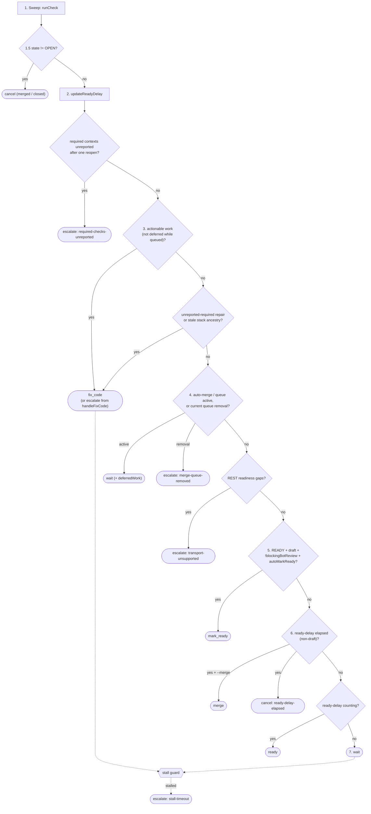
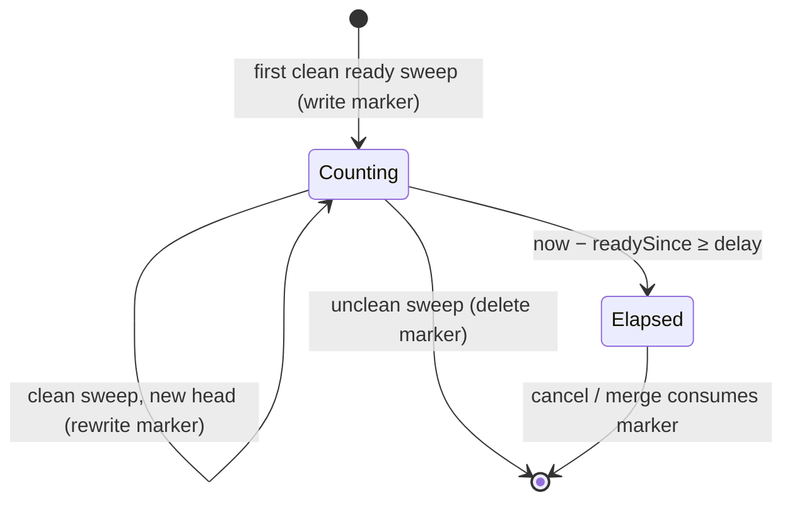

# shepherd iterate — dispatch flow

[← README](../README.md) | [actions.md](actions.md) | [context.md](context.md)

This page is the canonical decision order of one `iterate` tick (`src/commands/iterate/index.mts`), for maintainers and for readers who want to know why a tick returned a given action. Each tick gathers context and returns exactly one action; the output of each action is in [actions.md](actions.md), escalation predicates are in [escalations.md](escalations.md), and polling flags are in [cli-usage.md](cli-usage.md).

## Dispatch order

The first matching branch wins.

The shipped skill runs `pr-shepherd [PR] --until-terminal`, not `pr-shepherd iterate`. That poll stays inside ordinary `WAIT` and `MARK_READY`, and returns `READY` (ready-delay counting), `FIX_CODE` (after its `--debounce` window), `MERGE`, any non-terminal quota warning, or terminal `CANCEL` / `ESCALATE`. After following `## Instructions`, the skill reruns the same command unless it got `CANCEL` or `ESCALATE`, the instructions say to end the turn or not to rerun (event mode), or a human says stop. The bare `pr-shepherd [PR]` stays bounded for direct CLI users; MCP `iterate` returns one tick with no debounce, and its caller owns recurrence.

## Steps

### 1. Sweep

`runCheck({ autoResolve: true })` fires one GraphQL batch query (CI checks, review threads, PR comments, merge state, branch rules). A merged or closed PR returns a terminal report immediately. Otherwise outdated threads are surfaced without being resolved, and eligible already-seen `COMMENTED` review summaries are minimized in-process.

Human-authored threads must stay visible. Shepherd later pairs reply-and-resolve for unmarked bot/non-human threads and unmarked viewer-authored human feedback; unmarked other-human threads stay reply-only unless `iterate.resolveOtherHumanThreads` allows resolve. `resolutionOnly` also carries active marker-ended retry threads that are still being resolved.

### 1.5. Terminal state — PR merged or closed

**Check:** `report.mergeStatus.state !== 'OPEN'`. GitHub returns `mergeable: UNKNOWN` and `mergeStateStatus: UNKNOWN` for merged/closed PRs; `runCheck` surfaces top-level `status: 'MERGED'` or `status: 'CLOSED'`, and this branch stops before actionable checks.

**Emits:** `action: 'cancel'`, clearing the stall state and any stale ready-delay marker.

### 2. Ready-delay

`updateReadyDelay(pr, isCleanReadyState, readyDelaySeconds, owner, repo, options)` reads and writes `ready-since.txt`. Default delay is 10 minutes (`watch.readyDelayMinutes` or `--ready-delay`).

A **clean ready state** is `status === "READY"`, `hasReadinessWork` false, and no active auto-merge or merge-queue state being handled. It includes BLOCKED/UNSTABLE states where Shepherd has nothing left to do (green CI, no unresolved items, no blocking bot review pending). An initial first look at a hidden PR comment routes to `fix_code` for acknowledgement without restarting the countdown or voiding a READY receipt. An edited minimized comment that no longer matches a noise rule is readiness work: its new body surfaces, the countdown restarts, and the receipt is cleared.

| Event                                       | Effect on `ready-since.txt`          |
| ------------------------------------------- | ------------------------------------ |
| First clean ready sweep                     | Created with current timestamp       |
| Subsequent clean ready sweep (delay active) | Read; `remainingSeconds` decremented |
| Clean ready sweep on a different head       | Rewritten for that head (resets)     |
| Clean ready state, delay elapsed            | `shouldCancel: true`; file retained  |
| Elapsed delay consumed (`cancel`/`merge`)   | Deleted                              |
| Clean PR with a current receipt             | `shouldCancel: true`; no file needed |
| Hidden PR comment only                      | Unchanged (acknowledged, no reset)   |
| Non-READY, or READY with readiness work     | Deleted (countdown resets)           |
| PR merged/closed (step 1.5)                 | Deleted with the receipt             |

- Unclean sweeps include non-READY status, failing CI, conflicts, unresolved comments, review-summary minimization, and first-look threads and summaries.
- The elapsed marker stays until `cancel` or `merge` consumes it, so a hidden-comment acknowledgement tick does not restart the wait.
- A current READY receipt (same head, base, and readiness evidence) already proves the delay elapsed, so a clean sweep returns `shouldCancel: true` without a marker (`alreadyElapsed`). Rerunning a READY PR — for example with `--merge` after a `ready-delay-elapsed` cancel — does not restart the countdown. When the head, base, or evidence moved, the receipt is cleared and the countdown restarts. Hidden comment and review bodies are omitted from the receipt fingerprint, but a full poll reclassifies edited minimized PR comments. If the edited body no longer matches a noise rule, it becomes readiness work and clears the receipt.
- Before a READY sweep reaches this step, `runCheck` does one fresh REST mergeability read (unless the UNKNOWN fallback already did). If it reports `CONFLICTING`/`DIRTY`, the sweep becomes `FAILING`/`CONFLICTS`, resets the marker, and routes to `fix_code`.
- Marker path: `$PR_SHEPHERD_STATE_DIR/<owner>/<repo>/<pr>/ready-since.txt` (`<unix seconds> <head SHA>`). A future timestamp (clock skew), another head, or a marker without a head is reset to now.

The countdown's outcomes are emitted later, at [step 6](#6-ready-delay-completion).

### 3. Actionable work

**Check:** `hasActionableWork` is true when any of:

- `report.threads.actionable.length > 0`
- `report.threads.resolutionOnly.length > 0`
- `report.threads.firstLook.length > 0`
- `report.threads.ruleAutoResolveIds` is non-empty
- `report.comments.actionable.length > 0`
- `report.comments.minimizeIds` is non-empty
- `report.comments.firstLook.length > 0` (hidden PR comments; edited bodies count as `hasReadinessWork`, while initial acknowledgement does not; see [step 2](#2-ready-delay))
- `report.changesRequestedReviews.length > 0`
- `report.checks.failing.length > 0`
- `report.mergeStatus.status === 'CONFLICTS'`
- pending review-summary IDs, first-look summaries, or edited summaries

**Required contexts never reported.** Just before this check, `planUnreportedRequired` runs. If the one close/reopen for this head was already emitted and the contexts are still missing with nothing running, the tick escalates with `required-checks-unreported`. Otherwise its repair steps (rebase/push or close/reopen) ride on the `fix_code` result; with no other work they produce their own `fix_code` through the stall guard. A verified stale native-stack boundary also produces `fix_code`, after the active-merge check in [step 4](#4-active-merge-and-queue-removal).

**Failing checks.** All failing checks route here — including timeout, cancelled, startup-failure, flaky, and `merge_group` checks from the active/latest queue commit — except a check recorded as blocked on an external pull request or issue that is still open.

- That blocked check does not count toward this step, gets no `rerun:` command, and does not increment fix-attempt or fix-thrash. If it was the only cause, the tick is `wait` and the log names the blocker (`owner/name#N`).
- Once the blocker is merged or closed, the check stays here and `## Instructions` says to update the PR branch from its base (for example `gh pr update-branch <pr> --rebase`) and not to rerun the job.
- Queue checks are classified separately from PR-head checks, so supersession never crosses commit boundaries.
- The `fix` payload carries `conclusion` for each failing check. `workflowName`, `jobName`, `failedStep`, `logExcerpt`, and `relatedJobs` are populated only when triage runs (not for cancelled or startup-failure checks).

**Conflicts.** CONFLICTS is included so conflicts and review comments are handled in one tick. Iterate surfaces raw `**branch**` state and does not prescribe how to rebase a standalone PR. A native stack layer (`mergeRequirements.stack`) is the exception, because updating one layer from its base strands every layer above it:

| Situation                                                                                 | GraphQL mode                                                                                                                  | REST mode                           |
| ----------------------------------------------------------------------------------------- | ----------------------------------------------------------------------------------------------------------------------------- | ----------------------------------- |
| Stack not tracked locally                                                                 | `gh stack checkout <mergeRequirements.stack.number>` (the stack number, not the PR number)                                    | Repository's stack-update procedure |
| Upper layer behind its own PR base                                                        | `gh stack rebase --upstack --no-trunk` from that base, not from the trunk `mergeRequirements.stack.baseRefName`               | Repository's stack-update procedure |
| Upper layer already contains its base (`baseRef.compare(headRef).behindBy === 0`)         | Conflicts with stack trunk `<trunk>` (`stackTrunkConflict` in JSON): whole-stack `gh stack rebase` from the bottom open layer | Repository's stack-update procedure |
| Bottom open layer (PR base is the trunk, including a layer retargeted after lower merges) | Whole-stack `gh stack rebase`                                                                                                 | Repository's stack-update procedure |
| Publishing the rewritten stack                                                            | `gh stack push`, not a push of the PR head alone                                                                              | Repository's stack-update procedure |

- The printed step points at the Branch update playbook, which covers confirming each local layer is at its PR head before publishing, and `gh stack rebase --continue` in GraphQL mode. It does not print a second push.
- A `gh stack merge` step prints its missing-extension rule inline and says not to rebase or push.
- Stale-boundary repair, and a behind layer whose workflow rerun already failed, use the same transport-appropriate stack update and push.
- A conflicting head with a complete empty check-suite page and no check runs gets a note that GitHub did not start `pull_request` workflows, once Shepherd has seen that head for at least 2 minutes. Commit time is not used (GitHub's Commit object has no push timestamp). An unreadable seen marker omits the note.

**Deferred while queued.** With `--merge`, the PR in the merge queue, and `actions.workWhileQueued` not `true`, everything above **except** `checks.failing`, `mergeStatus.status === 'CONFLICTS'`, and check-run annotations stops counting — a Shepherd-initiated push would eject the PR. That work falls through to [step 4](#4-active-merge-and-queue-removal), which reports it as `deferredWork` counts on the `wait` result.

**Side-effects:** none. Shepherd never cancels workflow runs (GitHub exposes no exact viewer capability for cancellation); it only surfaces failure context.

**Emits:** `action: 'fix_code'`. A non-empty external check URL is an autonomous investigation path and stays `fix_code`. If no other autonomous work remains and every failing check needs a human-only action or lacks usable evidence and an authorized rerun, `handleFixCode` emits `escalate` with `check-follow-up-unavailable` and the raw check context. It can also escalate with `fix-thrash` or `base-branch-unknown`. Every `fix_code` is non-terminal and runs through the [stall guard](#stall-guard).

### 4. Active merge and queue removal

- An active auto-merge request or merge-queue entry emits `wait`, without ready-delay cancellation or the generic stall guard. In the queue, that `wait` also carries raw `deferredWork` counts (threads, comments, changes-requested reviews, review summaries) when [step 3](#3-actionable-work) held work back. Plain auto-merge (no queue membership) never defers anything.
- With `--merge` and a current queue removal that has no actionable failure, iterate emits `escalate` with the raw removal fields ([`merge-queue-removed`](escalations.md#merge-queue-removed)). A removal whose queue commit GitHub no longer returns is treated as stale. A squash or rebase removal is also stale once the current head reached the PR after the removal, even if that commit's committer time is earlier.
- If REST could not supply fields readiness depends on (no CI in progress, merge state known), the READY receipt is cleared and the tick escalates with `transport-unsupported`, naming each field.

### 5. Mark ready

**Check:** `report.status === 'READY'` AND `isDraft` AND `!blockingBotReviewInProgress` AND `config.actions.autoMarkReady` (disable with `--no-auto-mark-ready`).

There is no `mergeStateStatus === "CLEAN"` requirement: a draft whose derived status is `DRAFT` (even one that is also behind) can be marked ready when the Shepherd status is `READY`. This runs before the ready-delay completion, and that completion never applies to a draft.

**Side-effects:** the selected transport's mark-ready operation. REST uses the supported CCR route; an unavailable route escalates with `transport-unsupported`, and a denial with `authorization-required`.

**Emits:** `action: 'mark_ready'`.

### 6. Ready-delay completion

- **Elapsed** (`readyState.shouldCancel`, non-draft): writes the READY receipt (the one a later stack read calls shepherded), clears the marker and stall state, then emits `merge` when `--merge` is set (transport-aware, head-pinned merge or queue commands; native stacks route to the `--stack` selector instead; not gated on `viewerCanEnableAutoMerge` — GitHub reports authorization or policy failures), otherwise `cancel` with `reason: "ready-delay-elapsed"`. On a native-stack layer whose receipt cannot be written, it emits `wait` (through the stall guard) and keeps the marker so the next tick retries.
- **Counting** (`isReady`, not `shouldCancel`, `remainingSeconds > 0`): emits `action: 'ready'` and clears stall state. `--until-terminal` returns it instead of sleeping; the stall guard does not apply.

### 7. Wait

**Fallthrough:** nothing actionable, no terminal state, no ready-delay elapsed or counting, not marking ready.

A draft native stack layer is marked ready by its own session as soon as that layer is clean; it does not wait for lower layers. When the draft is clean (`READY`, no blocking bot review in progress) but `--no-auto-mark-ready` or `actions.autoMarkReady: false` applies, the wait carries the hold `{ kind: 'auto-mark-ready-disabled' }`, and its instructions return to the `--stack` selector instead of another one-PR iteration.

**Emits:** `action: 'wait'`, through the stall guard.

### Stall guard

Applies to ordinary `wait` and `fix_code` after the action is chosen — not to `ready`, active merge waits, `merge`, `cancel`, `mark_ready`, or `escalate`. A disabled mark-ready hold is an ordinary wait and uses the guard.

**Fingerprint:** PR head SHA from GitHub (not the local checkout), action, `status`, `mergeStateStatus`, `state`, `isDraft`, sorted failing-check names + conclusions, sorted actionable thread/comment/review IDs, sorted review-summary minimize IDs. Stored at `$PR_SHEPHERD_STATE_DIR/<owner>/<repo>/<pr>/iterate-stall.json`.

| Stored state                                          | Result                                     |
| ----------------------------------------------------- | ------------------------------------------ |
| Matches and `now − firstSeenAt ≥ stallTimeoutSeconds` | `escalate` with `stall-timeout`            |
| Matches, within threshold                             | Keep `firstSeenAt` and the original action |
| Differs, or missing (first sighting)                  | Write new state, keep the original action  |
| Timeout enabled, timer unreadable or unwritable       | `escalate` with `stall-state-unavailable`  |
| `--stall-timeout 0`                                   | Keep the original action                   |

`wait` also inspects in-progress CI for a start stall (queued/requested checks that never start).

## Decision table

Exit codes `0`/`10`–`15` report one-PR state; see [exit-codes.md](exit-codes.md) for stack-level `16` and the `sysexits.h` codes when a step fails before reaching a row.

| Step  | Condition                                                                    | Action                                          | Exit code |
| ----- | ---------------------------------------------------------------------------- | ----------------------------------------------- | --------- |
| 1.5   | `state === 'MERGED'`                                                         | `cancel`                                        | 0         |
| 1.5   | `state === 'CLOSED'`                                                         | `cancel`                                        | 14        |
| 3     | Required contexts still unreported after one close/reopen, nothing running   | `escalate` (`required-checks-unreported`)       | 13        |
| 3     | `hasActionableWork`, unreported-required repair, or stale stack ancestry     | `fix_code`                                      | 12        |
| 3     | Only checks without autonomous follow-up                                     | `escalate` (`check-follow-up-unavailable`)      | 13        |
| 3     | Same thread remains after `fixAttemptsPerThread` returned `FIX_CODE` results | `escalate` (`fix-thrash`) with pending commands | 13        |
| 4     | Only non-CI work while queued (`--merge`, in queue, `!workWhileQueued`)      | `wait` with `deferredWork`                      | 10        |
| 4     | Auto-merge or merge queue active                                             | `wait`                                          | 10        |
| 4     | `--merge`, current queue removal, no actionable failure                      | `escalate` (`merge-queue-removed`)              | 13        |
| 4     | REST readiness gaps                                                          | `escalate` (`transport-unsupported`)            | 13        |
| 5     | READY + isDraft + !blockingBotReview + autoMarkReady                         | `mark_ready`                                    | 11        |
| 6     | `shouldCancel` + `--merge`                                                   | `merge`                                         | 15        |
| 6     | `shouldCancel` without `--merge`                                             | `cancel`                                        | 0         |
| 6     | Ready-delay counting                                                         | `ready`                                         | 10        |
| 7     | Fallthrough                                                                  | `wait`                                          | 10        |
| guard | Same fingerprint for ≥ `stallTimeoutMinutes` on `fix_code` or `wait`         | `escalate` (`stall-timeout`)                    | 13        |
