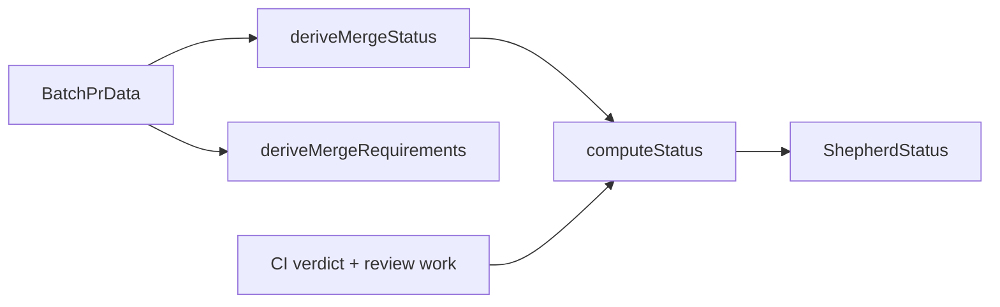

# shepherd merge-status derivation

[← README](../README.md) | [context.md](context.md)

How Shepherd turns GitHub's mergeability fields into a merge status, a `ShepherdStatus`, and a printed list of merge requirements. For readers of iterate output and contributors changing readiness logic.

## `deriveMergeStatus` — first-match-wins table

`src/merge-status/derive.mts`. Takes a `BatchPrData` and returns a `MergeStatusResult`. It does not branch on `state`; a merged or closed PR is handled by `runCheck` (see [Terminal PRs](#terminal-prs-use-state-not-mergeability)).

| Priority | Condition                                         | Status      | Why it is here                                                           |
| -------- | ------------------------------------------------- | ----------- | ------------------------------------------------------------------------ |
| 1        | `mergeable === 'CONFLICTING'`                     | `CONFLICTS` | GraphQL conflict signal; wins even for drafts                            |
| 2        | `blockingBotReviewInProgress`                     | `BLOCKED`   | A rebase would dismiss the in-progress bot review, so it outranks BEHIND |
| 3        | `mergeStateStatus === 'DIRTY'`                    | `CONFLICTS` | REST-side conflict signal; wins even for drafts                          |
| 4        | `isDraft` or `mergeStateStatus === 'DRAFT'`       | `DRAFT`     | Wins over BEHIND, BLOCKED, UNSTABLE                                      |
| 5        | `mergeStateStatus === 'BEHIND'`                   | `BEHIND`    | Status only; Shepherd does not rebase                                    |
| 6        | `mergeStateStatus === 'BLOCKED'` or `'HAS_HOOKS'` | `BLOCKED`   | Branch rules block merge                                                 |
| 7        | `mergeStateStatus === 'UNSTABLE'`                 | `UNSTABLE`  | Some non-required checks are not passing                                 |
| 8        | `mergeStateStatus === 'CLEAN'`                    | `CLEAN`     | Mergeable                                                                |
| 9        | anything else, including `UNKNOWN`                | `UNKNOWN`   | GitHub has not computed merge state                                      |

Both fields are checked for drafts because GitHub can report `mergeStateStatus: DRAFT` before the `isDraft` boolean updates.

## `computeStatus` — ShepherdStatus

`src/commands/check-status.mts`. First match wins.

| Order | Condition                                                                 | ShepherdStatus        |
| ----- | ------------------------------------------------------------------------- | --------------------- |
| 1     | merge status `CONFLICTS`                                                  | `FAILING`             |
| 2     | any relevant check failing                                                | `FAILING`             |
| 3     | any relevant check in progress                                            | `IN_PROGRESS`         |
| 4     | [Ready while BLOCKED or UNSTABLE](#ready-while-blocked-or-unstable) holds | `READY`               |
| 5     | merge status `BLOCKED`, `UNSTABLE`, or `BEHIND`                           | `PENDING`             |
| 6     | merge status `UNKNOWN`                                                    | `UNKNOWN`             |
| 7     | unresolved threads, comments, or changes-requested reviews                | `UNRESOLVED_COMMENTS` |
| 8     | `CLEAN` or `DRAFT`, all checks passed, no unreported required checks      | `READY`               |
| 9     | `CLEAN` or `DRAFT` with unreported required checks                        | `PENDING`             |
| 10    | otherwise                                                                 | `UNKNOWN`             |

`DRAFT` counts as `CLEAN` for readiness because marking the PR ready resolves it. `reviewDecision` is not an input to either transport's readiness.

### Ready while BLOCKED or UNSTABLE

GitHub may report `BLOCKED` for reasons Shepherd cannot act on (pending human review, approval count, a branch rule). `computeStatus` returns `READY` when all of these hold:

| Condition                              | Detail                                                                                                                                                                            |
| -------------------------------------- | --------------------------------------------------------------------------------------------------------------------------------------------------------------------------------- |
| `verdict.allPassed`                    | No failing or in-progress relevant checks                                                                                                                                         |
| Relevant passing checks exist          | `verdict.hasChecks`, or merge status `UNSTABLE` with at least one ignored check. `BLOCKED` does not get the ignored-check extension: it can mean required checks have not started |
| No review work                         | No unresolved threads (including outdated or minimized threads still `isResolved: false`, which route as resolution-only work), comments, or changes-requested reviews            |
| Merge status `BLOCKED` or `UNSTABLE`   |                                                                                                                                                                                   |
| `blockingBotReviewInProgress` is false | A pending bot review is Shepherd work                                                                                                                                             |
| No unreported required checks          | See [checks.md](checks.md#unreported-required-checks)                                                                                                                             |

The report keeps `mergeStatus.status` as `BLOCKED` or `UNSTABLE`, which is GitHub's actual state. Only the top-level `ShepherdStatus` becomes `READY`. The ready-delay timer starts, and `cancel` is emitted after it elapses.

## Merge requirements

After each sweep, `deriveMergeRequirements` (`src/merge-status/requirements.mts`) folds classic branch protection, the PR's applicable rulesets, and current PR state into one snapshot. JSON carries it on `mergeRequirements`; `src/merge-status/requirements-format.mts` renders the text. Text and JSON omit the same entries.

Printed unless trivial:

| Text                                    | JSON                                                             | Meaning                                                                                                                                   |
| --------------------------------------- | ---------------------------------------------------------------- | ----------------------------------------------------------------------------------------------------------------------------------------- |
| `Approvals: None [Required]`            | `approvals: { current, requiredCount }`                          | Current APPROVED reviews vs required count. `[Required]` only when `requiredCount > 0`. Omitted when there are none and none are required |
| `Conversations Resolved: No [Required]` | `conversationsResolved: { resolved, unresolvedCount, required }` | Unresolved thread count vs `requiresConversationResolution`. Omitted when resolution is not required                                      |

Printed only when they apply:

| Text                                          | JSON field                         | When                                                                                      |
| --------------------------------------------- | ---------------------------------- | ----------------------------------------------------------------------------------------- |
| `Code owner review: [Required]`               | `codeOwnerReview`                  | `requiresCodeOwnerReviews`                                                                |
| `Last-push approval: [Required]`              | `lastPushApproval`                 | `requiresLastPushApproval`                                                                |
| `Signed commits: [Required]`                  | `signedCommits`                    | `requiresCommitSignatures`                                                                |
| `Linear history: [Required]`                  | `linearHistory`                    | `requiresLinearHistory`                                                                   |
| `Branch up to date: Yes\|No [Required]`       | `branchUpToDate`                   | **Only** when `requiresStrictStatusChecks`. `current` is `mergeStateStatus !== "BEHIND"`. |
| `Required status checks: a, b [Required]`     | `requiredStatusChecks.contexts`    | Non-empty required contexts                                                               |
| `Required deployments: … [Required]`          | `requiredDeployments.environments` | Non-empty environments                                                                    |
| `Required workflows: [Required]`              | `requiredWorkflows`                | `requiresWorkflows`                                                                       |
| `Code scanning: [Required]`                   | `codeScanning`                     | `requiresCodeScanning`                                                                    |
| `Merge queue: …`                              | `mergeQueue`                       | Required, enabled, or already in queue                                                    |
| `Stack: <n> (layer <pos>/<size>, base <ref>)` | `stack`                            | GitHub stack membership                                                                   |

`requiredStatusChecks.contexts` lists the merge target's required contexts. A native-stack layer uses the stack trunk's contexts, since its own base branch may carry no rules; a trunk with none omits the entry. Run state for each context is in the checks sections; a context with no run at all is reported as `unreportedRequiredChecks`.

Read these lines instead of inferring a required review from `reviewDecision`. `REVIEW_REQUIRED` with no `Approvals:` line (none required) means GitHub is not waiting on an approval. Cancel notes use `blockedReasonFromRequirements` (awaiting N approvals, unresolved conversations, branch behind base, merge queue) for the same reason.

`stack` drives merging. With `--merge` enabled and the clean READY state held for the ready delay, a present `stack` field turns that one-PR tick into non-terminal `TRIAGE` directing the agent to `pr-shepherd stack <PR URL> --until-terminal --merge` instead of `gh pr merge`. The aggregate command emits `gh stack merge` for the highest open layer whose open lower layers all have current READY receipts; that command lands the named layer and every unmerged layer below it, at every stack position including 1. GitHub's stack field is public preview and can be absent on a genuinely stacked PR, so absence means no signal, not proof the PR is unstacked.

An iterate result built without a sweep (tests only; no `mergeRequirements`) falls back to a `**required**` line listing `requiredStatusCheckContexts`. Live output never prints it.

## Gotchas

### DIRTY vs CONFLICTING

Both mean merge conflicts and both map to `CONFLICTS`:

| Signal                         | Source                                                                               |
| ------------------------------ | ------------------------------------------------------------------------------------ |
| `mergeable === 'CONFLICTING'`  | GraphQL, once GitHub has computed the merge state                                    |
| `mergeStateStatus === 'DIRTY'` | The `getMergeableState` REST refresh, which can return it while GraphQL is `UNKNOWN` |

`runCheck` also refreshes mergeability over REST for a candidate READY state. That catches GraphQL lag where the batch still says `CLEAN` but REST already says `DIRTY`, so the PR maps to `CONFLICTS` before ready-delay completes. The same response refreshes the PR state, so a merge or close that raced the GraphQL snapshot cancels the tick with no extra request.

### Terminal PRs use state, not mergeability

GitHub often reports `mergeable` and `mergeStateStatus` as `UNKNOWN` after a merge or close. `state` is authoritative: `runCheck` returns top-level `status: "MERGED"` or `"CLOSED"` and skips CI and comment processing, and iterate cancels the loop ([iterate-flow.md](iterate-flow.md)). `deriveMergeStatus` still passes the raw fields through.

## Blocking-bot review detection

`detectBlockingBotReview(pr)` returns true when either holds, matching logins case-insensitively by prefix against `mark-ready.blocking-reviewer-logins` (default `[]`, set in `.pr-shepherdrc.yml`):

1. Any `reviewRequest` login matches.
2. Any `latestReview` login matches and its `state` is `PENDING`.

A completed review (`APPROVED` or `CHANGES_REQUESTED`) does not set `blockingBotReviewInProgress`.
